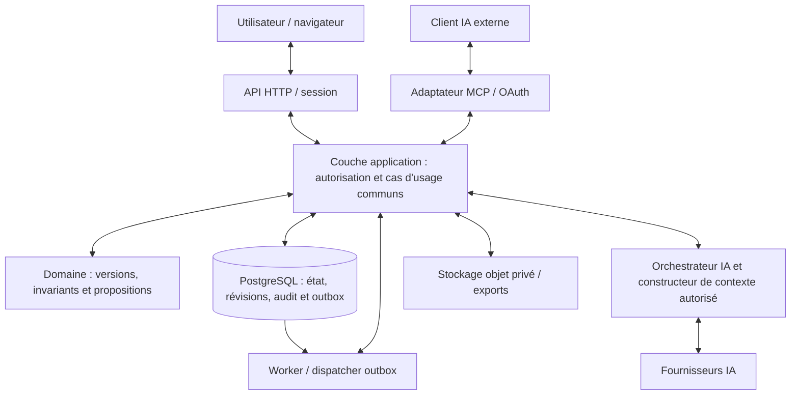

# Architecture technique — Plateforme de création littéraire

**Version :** 0.2  
**Statut :** Principes GO-01 acceptés, socle Lot 0 exécuté ; détails futurs proposés
**Références :** `PRD.md`, `DOMAIN-MODEL.md`

## 1. Objectifs

L'architecture doit :

- permettre un développement incrémental ;
- centraliser les règles métier ;
- garantir l'isolation des projets ;
- permettre les modifications multi-objets atomiques ;
- prendre en charge plusieurs fournisseurs IA ;
- exposer les fonctions autorisées via MCP ;
- conserver un historique fiable ;
- permettre l'ajout de modules narratifs ;
- préparer l'édition collaborative temps réel sans l'imposer au MVP.

## 2. Style architectural

### 2.1 Choix recommandé

**Monolithe modulaire avec application web et processus de traitement asynchrone.**

Le système comprend :

1. une application web ;
2. une API métier ;
3. une base PostgreSQL ;
4. un processus de tâches asynchrones ;
5. un stockage de fichiers, si nécessaire ;
6. une interface MCP ;
7. des adaptateurs vers les fournisseurs IA.

L'API et le serveur MCP peuvent partager le même code métier et être déployés dans un même service ou dans deux processus.

Ils ne doivent pas disposer de règles métier divergentes.

### 2.2 Pourquoi pas des microservices dès le MVP ?

Les opérations critiques modifient fréquemment plusieurs types de données simultanément :

- scène ;
- événement ;
- personnage ;
- relation ;
- proposition ;
- historique.

Les distribuer entre plusieurs services et bases rendrait l'atomicité et les conflits sensiblement plus difficiles à gérer.

Le monolithe modulaire permet de préserver des frontières internes claires sans introduire de transactions distribuées.

## 3. Stack de référence

| Couche | Technologie proposée | Justification |
|---|---|---|
| Frontend | React, Next.js, TypeScript | Interface web structurée et écosystème mature |
| Éditeur | Tiptap / ProseMirror | Documents structurés et extensions |
| API métier | TypeScript, Fastify | Contrôle explicite des contrats et de l'exécution |
| Validation | Schémas typés, par exemple Zod | Validation aux frontières |
| Base principale | PostgreSQL | Transactions, contraintes, JSONB, recherche textuelle |
| Accès aux données | ORM ou requêtes typées, à arbitrer | Migrations et contrôle SQL |
| Authentification | Fournisseur OIDC compatible | Éviter de développer un système d'identité fragile |
| Fichiers | Stockage compatible S3 | Pièces jointes et exports volumineux |
| Tâches asynchrones | Worker applicatif, file persistante | Appels IA, exports, analyses |
| Cache/file avancée | Redis, si besoin démontré | À introduire lorsque justifié |
| MCP | SDK MCP compatible avec le transport retenu | Interopérabilité avec les clients |
| Recherche initiale | PostgreSQL full-text search | Éviter un moteur séparé prématuré |
| Recherche sémantique | pgvector ou service dédié, ultérieurement | Recherche contextuelle avancée |

Ces choix constituent une proposition à valider par ADR.

### 3.1 Monorepo

Structure suggérée :

- `apps/web` : application web ;
- `apps/api` : API HTTP et composition des services ;
- `apps/worker` : traitements asynchrones ;
- `packages/domain` : types, règles et invariants métier ;
- `packages/application` : cas d'usage et orchestration ;
- `packages/contracts` : schémas partagés et contrats publics ;
- `packages/infrastructure` : persistence et adaptateurs ;
- `packages/mcp` : adaptateur MCP ;
- `packages/ai` : abstraction des fournisseurs ;
- `packages/ui` : composants d'interface réutilisables ;
- `docs` : documentation.

Les dépendances doivent être orientées vers le domaine, et non l'inverse.

## 4. Architecture logique

### 4.1 Frontend

Responsabilités :

- affichage ;
- navigation ;
- édition ;
- gestion de l'état local ;
- visualisation des différences ;
- commentaires ;
- gestion des conflits ;
- interactions avec l'assistant IA.

Le frontend ne doit pas :

- accéder directement à PostgreSQL ;
- contenir les clés des fournisseurs IA ;
- décider seul des permissions ;
- fusionner localement des propositions ;
- considérer une sauvegarde comme confirmée sans réponse serveur.

### 4.2 API métier

Modules internes proposés :

- Identity & Access ;
- Projects ;
- Manuscripts ;
- Narrative Objects ;
- Relations ;
- Timeline ;
- Comments ;
- Proposals ;
- Audit ;
- Search ;
- AI Orchestration ;
- Export ;
- Module Registry.

Chaque module expose des cas d'usage explicites.

Exemples :

- `CreateProject`
- `UpdateScene`
- `CreateNarrativeObject`
- `SearchProject`
- `ValidateProposal`
- `MergeProposal`
- `BuildAIContext`

Les contrôleurs HTTP ne doivent pas implémenter directement ces règles.

### 4.3 Infrastructure

Responsabilités :

- transactions PostgreSQL ;
- stockage des fichiers ;
- envoi des notifications ;
- accès aux modèles IA ;
- gestion des tâches ;
- métriques et journaux ;
- intégration OIDC ;
- exposition MCP.

Le domaine métier ne doit pas dépendre directement des SDK des fournisseurs IA.

## 5. Frontières transactionnelles

### 5.1 Source de vérité

PostgreSQL est la source de vérité pour :

- projets ;
- permissions ;
- manuscrits ;
- scènes ;
- objets narratifs ;
- relations ;
- propositions ;
- approbations ;
- révisions ;
- audit.

Le stockage objet est réservé principalement aux pièces jointes et artefacts exportés.

### 5.2 Fusion d'une proposition

La fusion doit s'effectuer dans une transaction PostgreSQL unique.

Elle inclut :

- vérification des versions ;
- validation métier ;
- modification des ressources ;
- création des révisions ;
- enregistrement du changement ;
- mise à jour du statut de la proposition ;
- écriture des événements outbox nécessaires.

### 5.3 Effets asynchrones

Après fusion, des traitements peuvent être déclenchés :

- indexation de recherche ;
- notifications ;
- calculs statistiques ;
- invalidation des résumés IA ;
- mise à jour de projections.

Ils ne doivent pas conditionner la validité de la transaction principale.

L'outbox transactionnelle est recommandée pour éviter la perte d'événements entre l'écriture métier et leur traitement.

## 6. Gestion de la concurrence

### 6.1 Objets structurés

Utiliser une révision attendue lors de chaque modification.

Une écriture fondée sur une révision obsolète est refusée.

### 6.2 Texte du manuscrit

Au MVP :

- sauvegarde automatique ;
- révision de base ;
- écriture optimiste ;
- refus des écrasements concurrents ;
- conservation du brouillon local en cas de conflit.

### 6.3 Propositions

Les propositions conservent les révisions des ressources qu'elles souhaitent modifier.

La fusion revérifie ces révisions.

Une proposition approuvée peut devenir conflictuelle si le projet a évolué.

### 6.4 Évolution temps réel

L'édition collaborative CRDT est reportée à V1.

Avant son intégration, il faudra définir comment convertir un état collaboratif stabilisé en révision métier et comment appliquer une proposition sur une scène ouverte simultanément par plusieurs auteurs.

Cette difficulté ne doit pas être ignorée dans la conception.

## 7. Modèle de stockage

### 7.1 Tables principales

Familles de tables envisagées :

- users ;
- projects ;
- project_memberships ;
- invitations ;
- manuscripts ;
- chapters ;
- scenes ;
- scene_revisions ;
- narrative_objects ;
- narrative_object_revisions ;
- narrative_relations ;
- scene_references ;
- comments ;
- proposals ;
- proposal_revisions ;
- proposed_operations ;
- proposal_reviews ;
- change_sets ;
- change_events ;
- module_activations ;
- ai_conversations ;
- ai_messages ;
- ai_executions ;
- delegated_grants ;
- provider_credentials ;
- outbox_events.

### 7.2 Isolation des projets

Toutes les tables métier concernées portent un `project_id`.

Les clés étrangères doivent empêcher les références entre projets lorsque celles-ci sont interdites.

Des contraintes composites peuvent être utilisées pour renforcer cette isolation.

PostgreSQL Row-Level Security peut être ajouté comme défense en profondeur, mais ne remplace pas le contrôle d'autorisation de l'application.

### 7.3 Recherche

Au MVP :

- index de recherche textuelle PostgreSQL ;
- filtrage obligatoire par projet et autorisations ;
- index sur les identifiants et relations ;
- pagination ;
- limitation des volumes retournés.

En V1 :

- indexation sémantique ;
- découpage de scènes en passages ;
- association des passages à leurs révisions ;
- invalidation lors des modifications ;
- recherche hybride textuelle et vectorielle.

## 8. Intégration de l'IA

### 8.1 Composants

**AI Orchestrator**

Gère la conversation, les outils autorisés, les limites et les appels aux fournisseurs.

**Context Builder**

Sélectionne les données pertinentes du projet.

**Provider Adapter**

Uniformise les interactions avec les modèles pris en charge.

**Tool Executor**

Exécute les cas d'usage métier autorisés.

**Proposal Builder**

Convertit les modifications proposées en opérations métier validables.

**AI Execution Log**

Conserve les métadonnées d'exécution, les coûts estimés et la provenance.

### 8.2 Chaîne d'exécution

1. L'utilisateur formule une demande.
2. Le serveur identifie l'utilisateur, le projet et les permissions.
3. Le constructeur de contexte sélectionne les ressources autorisées.
4. Le fournisseur IA reçoit les données nécessaires.
5. L'IA peut demander l'exécution d'outils autorisés.
6. Les arguments des outils sont validés.
7. Les services métier exécutent les lectures ou préparent une proposition.
8. La réponse indique les sources et les opérations préparées.
9. Toute fusion suit le parcours de validation défini.

Une sortie de modèle, même structurée, reste non fiable jusqu'à validation.

### 8.3 Contexte

Le constructeur de contexte doit :

- appliquer les permissions avant récupération ;
- limiter les volumes ;
- privilégier les scènes et objets pertinents ;
- identifier les révisions des sources ;
- distinguer faits et résumés générés ;
- éviter les transmissions inutiles de données ;
- prévoir la gestion des contextes devenus obsolètes.

## 9. Interface MCP

### 9.1 Positionnement

Le serveur MCP est un adaptateur vers les cas d'usage métier.

Il ne constitue pas une seconde API de modification indépendante.

### 9.2 Transport

Pour l'accès distant, retenir un transport HTTP compatible avec la version MCP choisie.

Pour les outils de développement locaux, un transport local pourra être proposé si nécessaire.

Le protocole, la version et les mécanismes d'autorisation seront figés dans les contrats.

### 9.3 Sécurité

Chaque appel MCP doit être associé à :

- une identité humaine ou de service ;
- un client ;
- une délégation ;
- des permissions ;
- un projet autorisé ;
- un identifiant de corrélation.

Le serveur doit vérifier les autorisations sur chaque opération.

### 9.4 Périmètre MVP

Exposer :

- découverte des projets autorisés ;
- lecture de contexte ;
- recherche ;
- lecture des scènes et objets ;
- consultation des relations ;
- création de propositions ;
- ajout d'opérations ;
- prévisualisation ;
- soumission ;
- consultation de statut.

Ne pas exposer la fusion automatique via MCP dans le MVP.

## 10. Authentification et délégation

### 10.1 Application web

Authentification via OIDC ou mécanisme équivalent validé.

Sessions sécurisées, cookies adaptés, protection CSRF et contrôle d'origine selon les mécanismes retenus.

### 10.2 Clients MCP

Autorisation déléguée avec consentement explicite.

Les permissions accordées doivent être plus restrictives ou égales à celles de l'utilisateur.

Les jetons doivent être limités en durée, audience et périmètre.

### 10.3 Clés des fournisseurs IA

Une clé API de fournisseur IA n'est pas un jeton d'autorisation MCP.

Elle sert à appeler un fournisseur de modèle.

Elle doit être conservée de façon chiffrée, ne pas être exposée au navigateur et ne jamais donner directement accès aux projets.

## 11. Traitements asynchrones

Tâches candidates :

- génération IA longue ;
- analyses narratives ;
- export de projet ;
- indexation ;
- notifications ;
- purge et maintenance ;
- recalcul des statistiques.

Chaque tâche doit disposer :

- d'un identifiant ;
- d'un propriétaire ou projet ;
- d'un état ;
- d'une politique de reprise ;
- de limites de ressources ;
- d'un mécanisme d'annulation lorsque possible.

Les tâches susceptibles d'être relancées doivent être idempotentes ou protéger leurs effets contre les doublons.

## 12. Modules fonctionnels

Le registre des modules fournit :

- types d'objets ;
- schémas de validation ;
- relations autorisées ;
- capacités ;
- dépendances ;
- migrations ;
- composants d'interface associés.

L'activation d'un module est stockée par projet.

Les modules ne doivent pas importer directement les détails internes d'autres modules sans contrat explicite.

Au MVP, ils sont compilés avec l'application.

## 13. Déploiement

### 13.1 Développement

Environnement local reproductible comprenant :

- application web ;
- API ;
- PostgreSQL ;
- worker si nécessaire ;
- stockage de fichiers de développement ;
- fournisseur d'identité de développement ou configuration de test.

Docker Compose peut faciliter l'initialisation.

### 13.2 Production initiale

Déploiement possible sur une infrastructure classique :

- frontend ;
- API ;
- worker ;
- PostgreSQL managé ou administré ;
- stockage objet ;
- reverse proxy TLS ;
- supervision.

La séparation physique des services peut évoluer sans modifier leurs contrats métier.

## 14. Observabilité

Prévoir :

- journaux structurés ;
- identifiants de corrélation ;
- métriques de latence ;
- taux d'erreur ;
- échecs de sauvegarde ;
- conflits de versions ;
- échecs de fusion ;
- appels IA ;
- coûts estimés ;
- refus d'autorisation ;
- événements MCP.

Ne pas journaliser par défaut le contenu intégral des scènes, les prompts contenant des manuscrits ou les secrets.

## 15. Sauvegarde et restauration

Le plan doit couvrir :

- PostgreSQL ;
- stockage de fichiers ;
- clés et configurations nécessaires à la restauration ;
- cohérence entre données et pièces jointes ;
- vérification régulière des sauvegardes ;
- tests de restauration.

La sauvegarde seule n'est pas une preuve de récupérabilité.

## 16. Tests d'architecture

Tests prioritaires :

- isolation interprojets ;
- transaction multi-objets ;
- contrôle de concurrence ;
- cohérence de l'historique ;
- validation des schémas ;
- délégation MCP ;
- refus des outils non autorisés ;
- restauration ;
- idempotence ;
- reprise des tâches ;
- absence de fuite de secrets ;
- comportement en cas d'indisponibilité d'un fournisseur IA.

## 17. Décisions à formaliser

- ADR-0001 : monolithe modulaire et PostgreSQL ;
- ADR-0002 : API métier unique et adaptateur MCP ;
- ADR-0003 : propositions transactionnelles et révisions ;
- ADR-0004 : collaboration asynchrone au MVP ;
- ADR-0005 : modularité fonctionnelle avec schémas versionnés.

## 18. Limites assumées

L'architecture MVP ne garantit pas encore :

- édition temps réel ;
- fonctionnement hors ligne ;
- univers partagé entre projets ;
- moteur temporel avancé ;
- extensions exécutables tierces ;
- orchestration multi-agents complexe ;
- publication éditoriale complète.

Ces capacités restent possibles, mais ne doivent pas être simulées par des composants incomplets.

## 19. Analyse consolidée et décisions proposées

**Portée :** MVP seulement, évolutions V1 nommées. **Références :** [sources S01–S24](RESEARCH-SOURCES.md), ADR-0001 à ADR-0008, [contrats détaillés](API-CONTRACTS.md).

### Synthèse

Monolithe modulaire recommandé, stockage transactionnel unique, worker séparé par processus mais même domaine. La couche application porte l'autorisation et les cas d'usage. Aucun adaptateur HTTP, MCP ou fournisseur IA n'accède directement aux dépôts narratifs.

### Comparaison des styles et du déploiement

| Critère | A. Monolithe modulaire | B. Services avec bases séparées | C. Backend géré / fonctions avec base partagée |
|---|---|---|---|
| Cohérence multi-objets | Une transaction locale | Saga/compensation, atomicité forte coûteuse | Possible si transaction serveur unique ; pas depuis le navigateur |
| Petite équipe assistée IA | Contrats locaux, tests communs | Nombreux contrats/réseau/déploiements à maintenir | Départ rapide, dépendance plateforme et limites de fonctions |
| Exploitation et maintenance | API/worker/PostgreSQL, modérées | Discovery, versions, queues et incidents distribués | Exploitation allégée, débogage fournisseur et coûts variables |
| Sécurité | Un point de politique, modules à discipliner | Identités machine et permissions réseau supplémentaires | RLS/auth gérées utiles, fonctions privilégiées à encadrer |
| Performances | Peu de sauts ; contention mesurable | Isolation de charge, latence réseau | Risques cold start, timeout transactions/jobs |
| Évolutivité / extraction | Worker, indexation, exports extractibles | Déploiement autonome immédiat | Extraction dépend des interfaces de la plateforme |
| Coût global | Faible surface initiale | Coût humain élevé sans besoin prouvé | Coût fournisseur et enfermement à examiner |

**Recommandation :** A, confiance élevée compte tenu des fusions multi-objets (pas une stack imposée par PRD). C crédible si la base reste derrière les mêmes cas d'usage ; aucun accès navigateur privilégié. B reportée jusqu'à mesure ou équipes indépendantes. PostgreSQL préféré à une base documents : contraintes composites, transactions, JSONB et recherche dans un même périmètre. Une base graphe séparée n'apporte pas de bénéfice démontré au MVP.

SaaS initial facilite mises à jour, OAuth et sauvegardes, mais crée une responsabilité d'hébergement de manuscrits. Auto-hébergement réduit certains transferts et donne contrôle des clés, mais impose support, mises à jour et exposition MCP distante. Recommandation Q-01 : application conteneurisable avec stockage interchangeable, un mode d'exploitation officiellement supporté au départ ; choix de ce mode humain avant lot 0. Ni Kubernetes ni Redis requis.

### Flux et séparation des responsabilités

Les flèches worker→application sont des commandes bornées avec contexte persistant. Le dispatcher peut acquitter la file via son infrastructure ; il ne gagne aucun droit narratif global. Le fournisseur retourne des données et demandes d'outils à l'orchestrateur, jamais des écritures SQL.

### Frontières transactionnelles et verrouillage MVP

Une transaction d'écriture prend d'abord un verrou exclusif sur la ligne Project (`FOR UPDATE` conceptuel), puis relit permissions et état. TOUTES les écritures du projet, y compris sauvegarde directe, changement de rôle, révocation de grant projet, module, structure, commentaires et merge, suivent ce protocole. Les grants multi-projets sont révoqués en verrouillant les projets triés par id avant leur ligne ; ordre global projet→autorisation→proposition→ressources. Un changement global User/ExternalClient utilise la même barrière sur les projets concernés et peut être asynchrone seulement si un drapeau de refus global est vérifié avant les commandes.

C'est un choix conservateur pour empêcher write skew, cycles et créations concurrentes violant une cardinalité. Il ne repose pas uniquement sur le verrouillage des lignes déjà présentes, insuffisant pour les invariants de graphe. Niveau READ COMMITTED suffisant si toutes les écritures respectent la barrière et si l'état est relu après acquisition ; les requêtes critiques ne réutilisent pas un snapshot chargé avant le verrou. Le spike B devra mesurer contention et absence d'interblocage. Alternative SERIALIZABLE avec reprise complète envisageable si ce verrou devient limitant, ADR-0003 à réexaminer.

#### R-CONT-01 — Contention du verrou exclusif projet

**Risque explicite, non mesuré et non accepté définitivement.** Le verrou s'applique à toutes les écritures d'un projet : deux scènes indépendantes, un commentaire, un changement de rôle et un merge se sérialisent même sans conflit de ressource. Une transaction longue retarde donc l'autosave d'autres auteurs. Une hausse du nombre de workers/connexions peut allonger la file d'attente plutôt qu'augmenter le débit ; le verrou ne doit jamais couvrir appel IA, export fichier ou autre réseau.

Pour un projet, le débit d'écriture est borné approximativement par l'inverse de la durée moyenne de détention du verrou, hors autres coûts ; ce n'est pas une capacité garantie. Mesurer séparément **temps d'attente**, **temps de détention**, latence totale de sauvegarde, débit utile, profondeur de file, timeouts et reprises. Une lecture ordinaire sans verrou d'écriture ne doit pas être artificiellement sérialisée par cette barrière, même si la saturation DB peut dégrader toute la charge.

Le spike B doit comparer : écritures séquentielles ; écritures parallèles de plusieurs scènes indépendantes du même projet ; même scène concurrente ; projets distincts ; merge long sur scène A pendant autosaves de scène B. Avec bases valides et sans timeout provoqué, les sauvegardes indépendantes doivent toutes réussir avec leur seule révision locale incrémentée. Un changement de project.changeSequence n'est pas un motif de REVISION_CONFLICT sur une scène inchangée.

Contrôles proposés : transactions courtes et tailles d'opérations bornées, calcul coûteux de diff hors section verrouillée, limites d'attente et erreurs transitoires explicites, absence de retry immédiat en boucle ; la validation métier finale reste dans la transaction. Les budgets de timeout et l'enveloppe de charge ne sont pas inventés ici : ils doivent être déclarés avant qualification. Toute stratégie plus fine (verrous par agrégat, contraintes DB, SERIALIZABLE avec reprise complète) exige une preuve de maintien de l'atomicité et des invariants de graphe/révocation, puis révision de l'ADR-0003. L'acceptation initiale GO-01 est conditionnelle à ces mesures ; NFR-04 reste une cible à vérifier dans une charge représentative définie.

Une édition directe applique autorisation + CAS revision + snapshot + ChangeSet + audit + éventuelle outbox dans une transaction. La recherche lexicale et le texte dérivé minimal sont actualisés transactionnellement au MVP : un renommage n'exige pas un worker pour être retrouvable. Les projections lourdes futures sont asynchrones et ne servent jamais de source de permissions.

Une preview travaille en lecture seule REPEATABLE READ, projette les opérations en mémoire et retourne les bases épinglées ; pas de réservation d'ID ni d'écriture canonique. Une validation fait les mêmes contrôles sans persister de statut. Submit/approve/merge sont des commandes et revalident ; un ancien rapport n'est jamais une autorisation.

### Parcours de bout en bout

| Parcours | Étapes | Fin de transaction / résultat |
|---|---|---|
| Lire scène | HTTP ou MCP → authentifier → même ReadScene → membership/grant → requête `(projectId,id)` → sérialisation sûre | Révision, ETag, sources ; aucune écriture narrative |
| Préparer proposition | Adaptateur → CreateProposal → schéma, permissions et références → revision immuable + audit | Draft seulement ; scènes/objets inchangés |
| Prévisualiser | Adaptateur → PreviewProposal → snapshot cohérent → bases, résolution symbolique, projection finale, diff et contrôles | Diffs calculés sur la révision demandée ; aucune autorité de merge |
| Fusionner | Humain → MergeProposal → verrou projet → auth fraîche → idempotence → verrou état proposition → approval/bases/modules → projection finale → écritures/révisions/ChangeSet/audit/outbox | Commit unique ; rollback complet sur une erreur ; mapping final seulement au succès |

### Outbox, idempotence, jobs et effets externes

Outbox persistée avec l'état métier, livraison au moins une fois, clé événement unique et inbox de déduplication chez chaque consommateur. Acquittement après effet vérifié ; retry borné/backoff/jitter, dead-letter observable. Un SMTP réussi suivi d'un crash peut être doublé : ne pas promettre exactly once pour notification ; inclure un identifiant de déduplication si le service le permet. Export : chemin temporaire par job, publication d'un manifeste complet seulement après succès, nettoyage des orphelins.

La clé d'idempotence est liée à userId+clientId+grantId+projectId+opération+empreinte canonique du corps et des préconditions. La fraîche autorisation est vérifiée avant de retourner une réponse mémorisée ; une révocation ne révèle pas un ancien résultat. Même clé/corps différent → IDEMPOTENCY_KEY_REUSED ; réponse réussie perdue → même résultat, même mapping et ChangeSet. Conservation minimale proposée 24 h pour commandes ordinaires ; unicité de fusion par proposalId conservée aussi longtemps que le ChangeSet, même après expiration de clé.

Un job transporte projectId, initiatorUserId, clientId, grantId, executionId, authorizationEpoch, type et paramètres bornés, sans token ni clé fournisseur. Les droits sont revérifiés au démarrage, avant chaque appel externe et avant toute publication. La révocation ne peut retirer les données déjà envoyées au fournisseur ; elle bloque les outils suivants et la publication. Pas de reprise automatique d'un appel IA dont l'acceptation est inconnue sans politique explicite de coût et de déduplication.

### Éditeur, diff riche et migration CRDT

Recommandation provisoire : JSON ProseMirror versionné, un document par scène, snapshot en PostgreSQL. Format MVP autorisé : doc, paragraph, text, heading, bulletList, orderedList, listItem, blockquote, hardBreak ; marks bold/italic/strike/link avec protocoles autorisés. Pas de HTML arbitraire, scripts, iframes ni ressources distantes chargées automatiquement. Schéma et taille/profondeur limités serveur, pas uniquement JSON Schema de forme.

Le diff comporte un delta des champs structurés et un diff riche : aligner blocs de même type/contenu, distinguer insertion/suppression/déplacement et marks ; comparer mots après alignement ; rendre le texte avec composants sûrs. Conserver le document avant/après et hashes ; un diff d'affichage n'est pas un patch exécutable. En cas d'alignement ambigu, montrer deux versions complètes et signaler l'ambiguïté. Une proposition remplace la scène entière avec expectedRevision ; aucune fusion textuelle automatique MVP. Le spike A choisira l'algorithme après tests de normalisation, Unicode et marks.

Pour V1 : migration explicite par scène, gel court des écritures optimistes, création d'un Y.Doc à partir du snapshot, attribution d'un `documentEpoch`, conservation du binaire et updates Yjs dès ce point. Les anciens clients ne peuvent plus écrire dans cet epoch. Le JSON reste une projection exportable ; recharger un nouveau Y.Doc depuis JSON à chaque sauvegarde détruirait l'identité CRDT. Les révisions métier deviennent des checkpoints identifiés par epoch+vector ; une future barrière de merge devra coordonner serveur collaboratif et commit PostgreSQL avant diffusion. Cette atomicité étendue n'est pas résolue par Yjs et constitue une décision V1 à prototyper, jamais une garantie actuelle. S15/S17/S18.

### IA : noyau commun et capacités spécifiques

| Élément | Noyau commun | OpenAI | Anthropic |
|---|---|---|---|
| Exécution | Messages applicatifs, sélection bornée, quotas, cancellation, statut, usage | Responses avec appels de fonctions | Messages avec tool_use/tool_result |
| Schémas | Commandes internes validées indépendamment | Conversion au sous-ensemble strict supporté, tester la transformation | Conversion tool schema et boucle dédiée |
| Conversations | Stockées dans le projet et privées à l'initiateur | Identifiants Responses/Conversations optionnels, non canoniques | Historique transmis selon API ; pas d'identité conversationnelle commune supposée |
| MCP distant | Option distincte de la boucle intégrée | Allowed tools et approbation du fournisseur | Connecteur bêta, règles/headers et conservation spécifiques |
| Coûts/streaming | Usage normalisé + données brutes minimales | Items et événements propres, cache/usage distincts | Blocs, stop_reason et usage propres |

L'assistant intégré privilégie une boucle de fonctions exécutées dans la couche application. Noyau minimal proposé : `generate(messages, toolDefinitions, limits, providerOptions) -> stream<text|toolRequest|usage|failure>` ; la plateforme garde une table de capacités par fournisseur/modèle. Un mode non pris en charge est refusé, pas simulé. L'IA n'a pas de permission `scene.write` ni `proposal.merge`, même si l'utilisateur owner les possède. Les opérations outils sont séquentielles dans une proposition, avec versions explicites ; plusieurs demandes du modèle ne deviennent pas des transactions concurrentes implicites.

Limiter la fuite de contexte : sélection explicite des sources et révisions, recherche lexicale filtrée, troncature visible, aperçu du périmètre sortant, consentement, clés hors prompt. Les résumés sont des dérivés générés invalidés après changements ; jamais un canon. La séparation instructions/données réduit les injections sans les éliminer ; les capacités serveur sont la barrière de sécurité. S08–S14.

### Recherche, cache, fichiers et observabilité

Recherche MVP PostgreSQL : texte courant extrait du document validé, noms/alias/notes, index GIN et filtres projet/type/statut, requête paramétrée. Tri déterministe `(rank,id)`, curseur opaque signé lié au projet, query, filtre et autorisation ; changements concurrents peuvent faire varier le rang, pas exposer un autre projet. Pagination n'est pas un snapshot persistant ; résultat révisé relu avant affichage sensible. Aucun total global ni suggestion interprojets. Embeddings/hybride V1 quand la recherche lexicale est mesurée insuffisante, avec chunks révisionnés et filtrage d'accès avant classement. S21.

Aucun cache partagé de manuscrits MVP. Si ajouté : clé incluant projet, droits/authorizationEpoch et révision, invalidation à la révocation, `Cache-Control: private,no-store` sur contenus privés. Stockage objet : exports et futurs médias, jamais scènes canoniques du MVP ; buckets privés, références applicatives autorisées, téléchargement via passerelle avec nouvelle autorisation.

Observabilité : correlationId, executionId, latence, save failures, conflits, saturation verrou projet, backlog outbox, refus, coût ; aucun texte ni prompt brut dans les traces. TLS, secrets chiffrés par enveloppe, sauvegardes isolées DB+objets+clés. Tester restauration vers environnement isolé avec blocage egress IA/notifications et invalidation des anciennes sessions/grants. RPO/RTO provisoires 24 h du PRD, à confirmer avant production ; durabilité d'un commit ne promet pas RPO zéro après destruction de l'infrastructure.

### Réponses explicites aux 25 questions de la mission

| Question | Réponse proposée / référence |
|---|---|
| 1–2. Monolithe ou services, pourquoi ? | Monolithe modulaire, transactions locales et coût d'exploitation ; comparaison §19 |
| 3. Source de vérité ? | PostgreSQL, objets exportés dérivés ; ADR-0006 |
| 4. Fusion atomique ? | Verrou projet et transaction incluant historique et outbox ; API §18 |
| 5. Versionner scènes/objets ? | Révision monotone, snapshot et changeset ; domaine §22 |
| 6. Diff riche ? | Avant/après, alignement blocs puis mots/marks ; spike A |
| 7. Conflits ? | Refus CAS, brouillon préservé, révision explicite puis nouvelle approbation |
| 8. CRDT ? | Epoch, import unique, binaire durable et futurs checkpoints ; pas de double source |
| 9. MCP sans contournement ? | Adaptateur sans dépôt narratif, mêmes cas d'usage et tests de parité |
| 10–11. Identité déléguée, humain/client/exécution ? | ActorIdentity serveur + grant lié à OAuth client ; executionId distinct |
| 12–13. Contexte / injections ? | Minimisation et consentement, séparation données/instructions, outils limités serveur |
| 14. Identifiants temporaires ? | Références typées locales, mapping alloué seulement au commit |
| 15. Merge idempotent ? | Clé bornée et contrainte durable d'unicité proposalId→ChangeSet |
| 16. Effets externes ? | Outbox après commit, consommateurs idempotents ; pas de fournisseur dans transaction |
| 17–18. Recherche / vecteurs ? | PostgreSQL lexical MVP ; sémantique V1 après mesure |
| 19–20. Modules / versions ? | Désactivation conserve les données ; registre immuable, migration explicite |
| 21. Univers partagé ? | Plusieurs manuscrits même projet ; interprojets après nouveau modèle d'autorisation |
| 22. Canon, croyance, lecteur ? | Trois agrégats V1 distincts ; aucune extraction canonisée automatiquement |
| 23. Temps non grégorien ? | Ordre/unknown MVP ; calendriers/ticks et conversions explicites ultérieurement |
| 24. Administration exclue ? | Rôles, invitations, secrets, grants, politique, modules et purge hors propositions |
| 25. Décisions ouvertes ? | Plan : Q-01..15, GO-00..GO-04, ADR proposés et spikes |

## 20. Alternatives, risques et questions ouvertes

Risque principal : sérialisation de toutes les écritures d'un projet sous charge d'autosave ; à mesurer avant de raffiner les locks. Alternatives crédibles : SERIALIZABLE pour domaines disjoints, recherche séparée et workers dédiés après profilage. ORM, hébergeur, IdP et bibliothèques secondaires restent ouverts. Les versions exactes ne sont pas figées sur des connaissances anciennes. Aucun service distribué ni moteur CRDT n'est requis par le Lot 0.

## Critères d'acceptation du document

Lecture, préparation, preview et merge sont retraçables avec identités, transactions et stockage ; le diagramme interdit tout accès IA/MCP direct à DB ; chaque effet externe a une politique de reprise ; les 25 questions ont une réponse ou décision ouverte ; la stratégie de verrou explique cycles et concurrence création/suppression, pas seulement les mises à jour de lignes existantes.

## Décisions d’exécution du Lot 0 — 31 octobre 2026

Première cible validée : **auto-hébergement Docker Compose**, SaaS possible ultérieurement. Backend Fastify/TypeScript et frontend Next.js/React/TypeScript ; PostgreSQL source de vérité ; OIDC Code + PKCE avec Keycloak en développement, sessions serveur. Les recommandations SaaS initiales des sections de comparaison constituent désormais un historique, pas la cible retenue. Les adaptateurs IA/MCP et worker réutiliseront les services applicatifs mais ne sont pas implémentés au Lot 0.

## Qualification isolée du stockage éditeur — 31 octobre 2026

Le [Spike A exécuté](SPIKE-A-REPORT.md) étaye le JSON ProseMirror versionné et les snapshots PostgreSQL. Les pertes Markdown sont signalées, les diffs riches disposent d’un fallback explicite et l’import/rechargement binaire Yjs est éprouvé hors production. ADR-0007 reste proposé : aucune bascule du contrat Scene ni dépendance Yjs n’est introduite dans les applications. Les bornes du laboratoire sont des paramètres expérimentaux, pas des quotas produit acceptés. La réception du Lot 0 et sa CI verte ne lèvent pas les réserves du verrou projet, des opérations multi-scènes, des commentaires ou de l’exploitation publique. L’atomicité PostgreSQL↔serveur CRDT demeure une décision V1 future.
