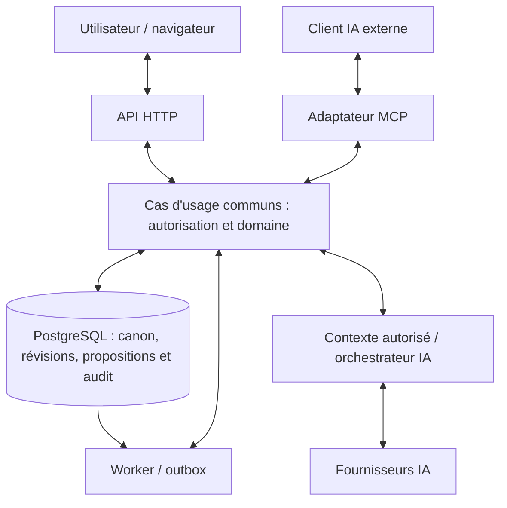

# Executive Summary

**Statut :** Conception consolidée le 30 octobre ; GO-00..02 validés et Lot 0 réalisé le 31 octobre 2026. **Portée :** dossier de référence MVP et réalisation locale du socle. Voir le [rapport exécuté du Lot 0](LOT-0-REPORT.md) pour les tests, limites et validation de sortie encore attendue.

Le dépôt dispose désormais d'un dossier permettant de préparer le Lot 0 sans réinventer les identités, les permissions, les révisions ou les frontières de sécurité. Le socle validé GO-01 est un **monolithe modulaire avec PostgreSQL**, une **couche métier commune au web, à l'IA et à MCP**, et des **propositions multi-objets fusionnées dans une transaction unique**. La collaboration reste asynchrone au MVP ; la coédition CRDT, les faits/connaissances/révélations et la recherche sémantique restent V1.

La traçabilité comprend **150 exigences numérotées**, dont **100 MUST MVP** affectées à un lot. Les contrats comprennent **27 opérations HTTP sur 24 chemins**, dont 10 opérations Lot 0 exécutées, **13 outils MCP**, **deux fixtures complètes de propositions**, **deux diagnostics illustratifs**, **50 scénarios de contrat**, **26 AC transversaux**, **neuf ADR dont quatre décisions acceptées dans leur portée et une mise en œuvre du socle**, avec ADR-0008 partiellement validé GO-02. Spikes A/C futurs et B partiellement qualifié sur les métadonnées. Le PRD est modifié uniquement par les deux patchs approuvés ; les recherches sont conservées. Les accords du 31 octobre sont tracés dans HUMAN-DECISIONS.md ; les autres arbitrages restent ouverts.

## État des documents analysés

| Ensemble | État initial constaté | Travail effectué |
|---|---|---|
| AGENTS.md | Absent, y compris consignes d'ancêtres recherchées | Créé, règles de périmètre et invariants explicites |
| PRD v0.1, R-A, R-M | Présents, PRD provisoire, citations de recherche non résolubles | Lus intégralement dans l'ordre ; couverture des sections et écarts dans [l'audit](DOCUMENT-AUDIT.md) |
| Traçabilité | Squelette NON_ANALYSE | Remplacé par [matrice exhaustive](RESEARCH-TRACEABILITY.md), sans fausse justification concurrentielle |
| Domaine, architecture, API, sécurité | Premières propositions cohérentes mais ouvertes | Conservées et enrichies, contradictions ciblées corrigées |
| ADR-0001..0005 | Proposés, aucun accepté | Préservés et complétés ; trois ADR ajoutés |
| Plan, contrats machine, exemples, tests | Absents | Produits, puis vérifiés ensemble |

R-A désigne `deep-research-analyse-fonction.md`, qui traite surtout le modèle central et l'IA ; R-M désigne `deep-research-modele-fonctionnel.md`, qui traite surtout les logiciels et le catalogue fonctionnel. Les noms des fichiers ne doivent pas faire inverser leur contenu.

La recherche technique est documentée par **30 entrées de sources primaires** dans [RESEARCH-SOURCES.md](RESEARCH-SOURCES.md). Les pages ProseMirror ont renvoyé 403 et certains tutoriels Campfire n'ont fourni qu'une coquille : leurs détails non vérifiés ne fondent pas une décision.

## Écarts entre PRD et recherches

| Écart significatif | Décision proposée / autorité |
|---|---|
| Temps réel suggéré tôt par la recherche | Optimiste MVP, CRDT V1 conformément au PRD |
| AUTO_APPLY / AUTO_VALIDATED pour IA | Pas de fusion IA MVP, même si l'utilisateur déléguant est owner |
| Maquette de fusion partielle « 6/7 » | Interdite MVP : tout ou rien ; découpage futur en propositions cohérentes |
| IA facultative dans R-M | Usage facultatif ; capacité IA intégrée/MCP obligatoire pour terminer le MVP |
| DOCX/EPUB/PDF présentés comme exports minimaux | Markdown et archive JSON MVP ; formats éditoriaux V1 |
| Modèles libres, canvas, séries, calendriers, systèmes spécialisés | Pas ajoutés au MVP par simple intérêt technique |
| Six lots PRD contre huit demandés | Correspondance explicite dans le plan ; aucun changement silencieux |
| PROP-10 initialement SHOULD contre révision/invalidation requises | Promotion MUST MVP acceptée et appliquée le 31 octobre ; moteur au lot 4 |
| Rôles merge/export, notes privées et conversations non définis | Valeurs sûres proposées ; confidentialité par champ non promise ; conversations privées à initiateur |
| Temps absolu universel recommandé dans R-M | unknown/ordinal d'abord ; calendrier fictif et tick distinct du timestamp technique |

Les divergences **D01–D17** sont détaillées dans l'audit. Les contrôles de sécurité, l'accessibilité, les cibles NFR et les sauvegardes viennent principalement du PRD ; les recherches ne constituent pas une preuve opérationnelle de leur satisfaction.

### Traçabilité résumée

| Besoin | Exigences PRD | Source principale | Couverture proposée |
|---|---|---|---|
| Projets privés et rôles | PROJ, COLLAB-05, SEC-01..05 | PRD 7/8/15, R-M comptes | Lots 0 et 3 ; AC-01/15 |
| Écriture et récupération | EDIT, NFR-01/04 | R-M manuscrit/éditeur, Scrivener | Lot 1 ; AC-02/03/04/17 |
| Bible reliée et recherche | DATA, SEARCH, MOD | R-A modèle/relations, R-M vues et modules | Lot 2 ; AC-03/09/11/16 |
| Collaboration et propositions | COLLAB, PROP | R-A propositions et revue | Lots 3–4 ; AC-04/05/08/13/14 |
| IA intégrée et délégation | AI, AI-SEC | R-A identité/contexte, documentation officielle | Lots 5–6 ; AC-06/07/12/18/19/20 |
| Portabilité et exploitation | EXPORT, SEC, NFR | PRD et sources infrastructure | Lots 1 et 7 ; AC-10/21/24/25 |

La matrice détaillée distingue MUST/SHOULD/COULD et MVP/V1/V2+ ; **132 exigences sont classées MVP, 16 V1 et 2 V2+** dans l'inventaire numéroté. Ce décompte n'inclut pas tous les modules futurs non numérotés du PRD ; il ne signifie pas que toutes les améliorations SHOULD/COULD sont bloquantes pour le MVP.

## Décisions d'architecture — principes de socle validés, détails futurs proposés

| Option | Bénéfice | Limite | Recommandation |
|---|---|---|---|
| Monolithe modulaire | Transaction locale, contrôles communs, exploitation simple | Discipline des modules et contention à mesurer | Retenu comme proposition, confiance élevée |
| Services avec bases séparées | Déploiement et charge indépendants | Coordination distribuée pour merge multi-objets | Différé faute de besoin démontré |
| Backend géré / fonctions | Exploitation initiale allégée | Dépendance fournisseur et limites jobs/transactions | Alternative crédible si même couche métier et transaction serveur |

PostgreSQL est proposé comme source de vérité du texte et des objets. Les effets externes suivent le commit via outbox. Un verrou projet commun aux écritures protège les invariants d'ensemble et les révocations concurrentes ; le spike B en mesure les limites. Une preview projette l'état final sans modifier canon, proposition ou révisions. Une fusion inclut ressources, snapshots, ChangeSet, audit, état merged et outbox dans le même commit. Le retry retrouve le même ChangeSet et le même mapping d'identifiants.

| ADR | Objet | Statut |
|---|---|---|
| [0001](adr/0001-monolithe-modulaire-postgresql.md) | Monolithe modulaire vs services | Proposée |
| [0002](adr/0002-api-metier-unique-et-mcp.md) | API métier unique et adaptateur MCP | Proposée |
| [0003](adr/0003-propositions-transactionnelles.md) | Propositions, révisions et fusion transactionnelle | Proposée |
| [0004](adr/0004-edition-asynchrone-au-mvp.md) | Asynchrone MVP, CRDT V1 | Proposée |
| [0005](adr/0005-modules-et-schemas-versionnes.md) | Modules et schémas versionnés | Proposée |
| [0006](adr/0006-source-de-verite-et-stockage.md) | Source de vérité et stockage | Proposée |
| [0007](adr/0007-stockage-editeur-et-diff.md) | Document riche, snapshots et diff | Proposée, conditionnée au spike A |
| [0008](adr/0008-identite-delegation-et-politiques.md) | Identité déléguée et politiques proposées | Proposée |

## Modèle de domaine

Le [modèle](DOMAIN-MODEL.md) précise les identités, attributs minimaux, ownership, cardinalités, cycles, suppression, versionnement et sécurité des agrégats demandés. Scènes et objets conservent leurs IDs au renommage/déplacement. Les références sont des associations stables du projet ; les références temporaires d'une proposition sont typées et résolues uniquement à la fusion.

Une proposition distingue **proposalRevision**, contenu immuable examiné, et **stateVersion**, concurrence sur les transitions/reviews. L'approbation porte sur révision et hash précis ; toute modification du contenu l'invalide. Une restauration crée r+1. Un module désactivé garde ses données et références et refuse ses mutations. Aucun rôle, secret ou grant ne peut être modifié par une proposition narrative.

NarrativeFact, KnowledgeAssertion et ReaderDisclosure restent trois modèles V1 distincts. Le MVP ne transforme pas un texte, une croyance ou une critique IA en vérité canonique. Plusieurs manuscrits peuvent partager les objets d'un projet ; un univers entre projets nécessite plus tard un nouveau modèle de partage explicite.

## API, MCP et IA

Les [contrats](API-CONTRACTS.md) décrivent lectures, écritures humaines, cycle complet des propositions, versions, permissions, erreurs, audit et transactions. [OpenAPI](spec/openapi.yaml) fournit le sous-ensemble minimal vérifiable ; les routes secondaires doivent être contractualisées avant leur implémentation.

La redirection officielle `latest` pointe vers [MCP 2026-07-28](https://modelcontextprotocol.io/specification/latest) à la date de vérification. Le profil cible utilise des requêtes autonomes ; la compatibilité des clients est une preuve à établir par spike C. Les [définitions des 13 outils](spec/mcp-tools.json) sont séparées des [politiques applicatives](spec/mcp-policy.json), qui ne prétendent pas être une norme MCP. L'identité de sécurité vient d'OAuth/client/grant, pas du libellé clientInfo.

Pour l'assistant intégré, OpenAI Responses et Anthropic Messages ont des adaptateurs distincts et un noyau commun limité. Les particularités de schéma, streaming, conservation et MCP ne sont pas effacées. [OpenAI recommande Responses pour les nouveaux projets](https://developers.openai.com/api/docs/guides/migrate-to-responses) ; le [connecteur MCP Claude](https://platform.claude.com/docs/en/agents-and-tools/mcp-connector) consulté est bêta avec des conditions de conservation propres. Aucun modèle ni tarif n'est figé sans essai et contrat.

Les deux [propositions de fixture](examples/proposals/README.md) illustrent maladie et conflit temporel/révision. Les [diagnostics](examples/diagnostics.json) séparent calcul sous hypothèses et critique subjective. La contrainte temporelle de l'exemple est explicitement fournie ; aucun solveur V1 n'est introduit dans le MVP.

## Sécurité

Le [modèle de sécurité](SECURITY-MODEL.md) couvre 26 scénarios de menace et les frontières navigateur/API, MCP, domaine/DB, worker, contenu/IA, fournisseur et copies exportées/sauvegardées. Chaque menace critique a contrôle concret et test associé ; les risques opérateur, fournisseur et bearer volé restent visibles.

Refus par défaut, projet privé, permissions côté serveur et même politique sur recherche/extraits/export/historique/IA/MCP. Les acteurs IA n'héritent jamais de la capacité humaine à écrire le canon ou à fusionner. Les jobs relisent les autorisations avant appels et publication. Les clés IA sont personnelles, chiffrées et absentes des contextes/logs. Les backups incluent récupération des clés et test de restauration isolée. Les limites/budgets sont techniques et testables, sans tarification inventée.

## Plan de réalisation

Le [plan](IMPLEMENTATION-PLAN.md) donne objectif, prérequis, exigences, tâches, risques, livrables, tests, AC fonctionnels/sécurité/données/résilience et sortie de chacun des huit lots, sans calendrier arbitraire.

### Backlog priorisé résumé

| Lot | Priorité dominante | Fonction / sortie | MUST MVP au lot principal |
|---|---|---|---|
| 0 — Fondations | P0 | Projet privé, identité, permissions, contrats et audit | 16 |
| 1 — Manuscrit et éditeur | P0 intégrité / P1 expérience | Écrire, autosave, restaurer, plan et export texte | 16 |
| 2 — Référentiel narratif | P0 références / P1 outils | Fiches, liens, modules, recherche et timeline simple | 24 |
| 3 — Collaboration asynchrone | P0 accès / P1 revue | Invitations, rôles et commentaires ancrés | 7 |
| 4 — Propositions | P0 | Preview, revue, conflits et merge atomique | 10 |
| 5 — Assistant IA intégré | P0 sécurité / P1 assistance | Contexte sourcé et propositions sans écriture canonique | 14 |
| 6 — MCP externe | P0 délégation / P1 interopérabilité | Même métier, grants, révocation et refus merge | 5 |
| 7 — Consolidation / production | P0 récupération / P1 qualité | Export complet, restauration, charge et accessibilité | 7 |

Les critères sont repris dans [50 scénarios de contrat](CONTRACT-TESTS.md). La couverture exécutée au Lot 0 est détaillée dans [son rapport](LOT-0-REPORT.md), sans revendiquer l’exécution de tous les scénarios futurs. Spikes A/C non exécutés ; B qualifié uniquement sur les métadonnées, protocole complet multi-scènes encore requis.

## Risques et décisions ouvertes

Risque de sur-spécification si l'on ajoute CRDT, faits détaillés, plugins ou vecteurs au socle. Risque de contention du verrou projet à mesurer ; risque de perte de marks ou de mauvais réancrage à explorer avec le spike A. Historique Tiptap commercial distinct de l'historique métier, compatibilité client MCP non prouvée et politiques fournisseurs à vérifier avant intégration. Rétention, hébergement, IdP/AS, accès opérateurs et objectifs de reprise restent à valider aux jalons du plan.

Les décisions produit Q-01..Q-15 sont toutes reprises au plan ; les recommandations techniques sont distinguées des invariants du PRD. L'alternative aux recommandations proposées reste possible par ADR révisé et contrats mis à jour, sans contournement des invariants.

## Livrables produits

| Ensemble | Fichiers |
|---|---|
| Audit et recherche | [Audit](DOCUMENT-AUDIT.md), [sources](RESEARCH-SOURCES.md), [traçabilité](RESEARCH-TRACEABILITY.md) |
| Conception principale | [Domaine](DOMAIN-MODEL.md), [architecture](ARCHITECTURE.md), [API/MCP](API-CONTRACTS.md), [sécurité](SECURITY-MODEL.md) |
| Réalisation future | [Plan lots 0–7 et spikes](IMPLEMENTATION-PLAN.md), [tests de contrat](CONTRACT-TESTS.md), [50 scénarios structurés](spec/contract-scenarios.json) |
| Contrats machine | [OpenAPI](spec/openapi.yaml), [opérations JSON Schema](spec/operations.schema.json), [outils MCP](spec/mcp-tools.json), [politique MCP](spec/mcp-policy.json), [inventaire exigences](spec/requirements.json) |
| Exemples | [Maladie](examples/proposals/01-maladie.json), [meurtrier/conflit](examples/proposals/02-meurtrier-conflit.json), [diagnostics](examples/diagnostics.json) |
| Gouvernance | [Registre ADR](adr/README.md), [AGENTS.md](../AGENTS.md), présent rapport |
| Vérification du dossier | [Rapport des contrôles](SPECIFICATION-VALIDATION.md) |

OpenAPI est validé avec `openapi-spec-validator`, JSON Schema avec `jsonschema` Draft 2020-12 ; requêtes et opérations des deux fixtures sont conformes. Les références documentaires locales et la couverture des 100 MUST MVP ont été contrôlées. Ces résultats valident les artefacts de conception, pas leur future exécution ni les NFR.

## Correction documentaire et réalisation du Lot 0

Le registre normalisé sépare type, priorité produit, version et texte intégral ; les NFR portent l’objectif complet avec priorité null. Après accord explicite, PROP-10 passe de SHOULD à MUST ; les 150 IDs sont conservés. Les deux patchs PRD sont appliqués et les huit lots acceptés. Le [validateur reproductible](../scripts/README.md) couvre aussi les contrats exécutés du Lot 0.

Le socle local est réalisé et vérifié : [rapport](LOT-0-REPORT.md), [mesures préliminaires](LOT-0-CONTENTION.json), [démarrage](../README.md). R-CONT-01 demeure ouvert : le test de métadonnées ne remplace pas le spike B multi-scènes. La prochaine étape nécessite la réception du Lot 0 et une autorisation explicite avant Lot 1.

## Critères d'acceptation du document

Rapport autoportant reliant audit, écarts, options d'architecture, domaine, contrats, sécurité, backlog, ADR et preuves de validation ; annexes liées pour JSON détaillé ; décisions ouvertes classées sans acceptation implicite ; réalisation Lot 0 et décisions futures distinguées.

## Décisions requérant validation humaine avant implémentation

| Classe | Décisions |
|---|---|
| **VALIDÉES POUR LOT 0** | GO-00..02, PRD/huit lots, PROP-10 MUST, monolithe/PostgreSQL, invariants transactionnels, rôles et identité OIDC, owner unique, auto-hébergement local. Verrou projet toujours provisoire. |
| **À VALIDER AVANT LE LOT CONCERNÉ** | Éditeur après spike A ; schémas/modules ; invitations/transfert owner ; propositions après spike B (PROP-10 MUST déjà validée) ; fournisseurs/clés/consentement/budget ; OAuth et clients MCP après spike C ; rétention, exploitation, restauration et risques résiduels avant production (GO-03..04). |
| **NON BLOQUANTE** | Bibliothèque UI secondaire, modèles de genres, quotas commerciaux, séries partagées entre projets, calendriers avancés, CRDT et autres choix V1/V2+ sans impact requis sur le socle (GO-05). |
