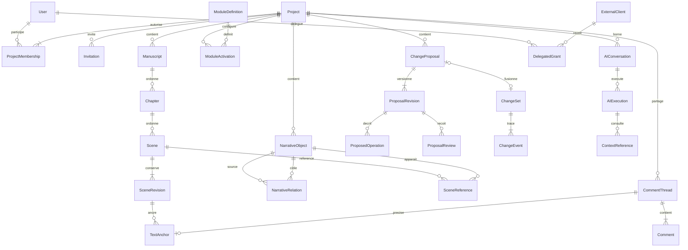
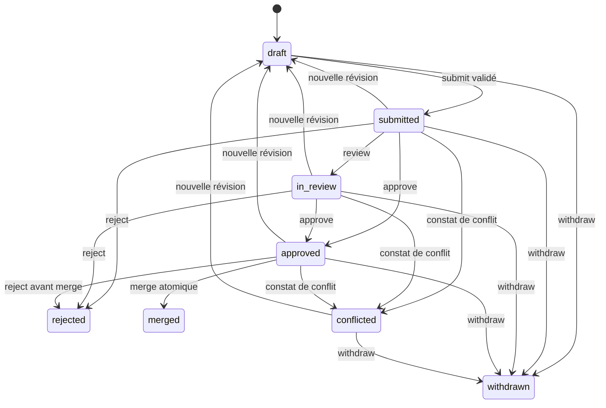

# Modèle de domaine — Plateforme de création littéraire

**Version :** 0.4
**Statut :** Domaine Lots 0–3 implémenté, réception Lot 3 attendue ; détails futurs proposés
**Référence principale :** `docs/PRD.md`

## 1. Objectif

Définir les concepts métier, leurs relations, leur cycle de vie et les règles que toute implémentation doit respecter.

Le modèle doit prendre en charge :

- plusieurs projets par utilisateur ;
- des projets privés ou collaboratifs ;
- des manuscrits structurés ;
- des objets narratifs reliés ;
- des modules spécialisés ;
- un historique exploitable ;
- des modifications humaines ou IA ;
- des propositions multi-objets ;
- des permissions cohérentes sur toutes les interfaces.

## 2. Principes de modélisation

**DM-01 — Identité stable**

Chaque objet métier possède un identifiant opaque et immuable, indépendant de son nom et de sa position.

**DM-02 — Isolation par projet**

Toute ressource appartenant à un projet est explicitement rattachée à celui-ci.

**DM-03 — Révision contrôlée**

Toute ressource modifiable dispose d'une révision monotone ou d'un identifiant de version équivalent.

**DM-04 — Historique non destructif**

Une modification appliquée crée une trace durable. L'historique ne doit pas dépendre de l'affichage de l'interface.

**DM-05 — Relations explicites**

Les liens entre objets sont représentés comme des relations identifiables et validées.

**DM-06 — Évolution des schémas**

Les propriétés spécifiques à un type narratif sont versionnées et validées.

**DM-07 — Même logique métier pour tous les acteurs**

Humains et IA passent par les mêmes services de lecture, d'écriture et de validation.

## 3. Agrégats métier

### 3.1 Identity & Access

Entités :

- `User`
- `Project`
- `ProjectMembership`
- `Invitation`
- `ExternalClient`
- `DelegatedGrant`
- `ProviderCredential`

Responsabilités :

- identité des personnes ;
- appartenance aux projets ;
- rôles ;
- invitations ;
- autorisations déléguées aux clients externes ;
- références sécurisées vers les identifiants des fournisseurs IA.

### 3.2 Manuscript

Entités :

- `Manuscript`
- `Chapter`
- `Scene`
- `SceneRevision`
- `SceneReference`
- `TextComment`

Responsabilités :

- structure et ordre du texte ;
- édition ;
- révisions ;
- liens vers les objets narratifs ;
- commentaires et ancrages textuels.

### 3.3 Narrative Knowledge

Entités :

- `NarrativeObject`
- `NarrativeObjectRevision`
- `NarrativeRelation`
- `NarrativeRelationRevision`
- `ObjectTypeDefinition`
- `ModuleActivation`

Responsabilités :

- personnages ;
- lieux ;
- événements ;
- objets et organisations ;
- relations ;
- schémas spécialisés ;
- modules activés.

### 3.4 Review & Change Management

Entités :

- `ChangeProposal`
- `ProposalRevision`
- `ProposedOperation`
- `ProposalReview`
- `ProposalComment`
- `ChangeSet`
- `ChangeEvent`

Responsabilités :

- préparation ;
- revue ;
- validation ;
- contrôle de concurrence ;
- fusion atomique ;
- traçabilité.

### 3.5 AI & Analysis

Entités :

- `AIConversation`
- `AIMessage`
- `AIExecution`
- `ContextReference`
- `AnalysisFinding`
- `AnalysisRun`

Responsabilités :

- conversations ;
- exécutions de modèles ;
- références aux données consultées ;
- propositions IA ;
- analyses de cohérence ;
- diagnostics littéraires.

## 4. Modèle des comptes et projets

### 4.1 User

Champs minimaux :

| Champ | Type logique | Contrainte |
|---|---|---|
| id | UUID | Identifiant immuable |
| email | Texte | Unique selon politique d'identité |
| displayName | Texte | Modifiable |
| identityProviderId | Texte | Identité externe ou locale |
| createdAt | Horodatage | Obligatoire |
| status | Enum | active, suspended, deleted |

L'authentification est un service distinct du modèle narratif.

### 4.2 Project

Champs :

- `id`
- `name`
- `description`
- `ownerId`
- `visibility` : private au MVP
- `status` : active, archived, pending_deletion
- `settings`
- `createdAt`
- `updatedAt`
- `revision`

Invariants :

- un projet possède toujours un propriétaire actif ou une procédure explicite de transfert ;
- l'archivage ne supprime pas les données ;
- aucune opération n'accède implicitement aux ressources d'un autre projet ;
- le nombre de projets d'un utilisateur n'est pas limité par le domaine métier.

### 4.3 ProjectMembership

Champs :

- `projectId`
- `userId`
- `role`
- `status`
- `createdAt`
- `createdBy`

Rôles initiaux :

- owner ;
- admin ;
- author ;
- reviewer ;
- reader.

Une contrainte d'unicité porte sur `(projectId, userId)` pour une adhésion active.

Les permissions effectives sont calculées par le service d'autorisation, et non directement par l'interface.

## 5. Modèle du manuscrit

### 5.1 Manuscript

Champs :

- `id`
- `projectId`
- `title`
- `description`
- `status`
- `position`
- `revision`

Un projet peut contenir plusieurs manuscrits.

### 5.2 Chapter

Champs :

- `id`
- `projectId`
- `manuscriptId`
- `title`
- `position`
- `metadata`
- `revision`

Un chapitre appartient à un manuscrit.

### 5.3 Scene

Champs :

- `id`
- `projectId`
- `chapterId`
- `title`
- `position`
- `status`
- `pointOfViewObjectId` facultatif
- `summary`
- `contentFormatVersion`
- `content`
- `revision`
- `createdAt`
- `updatedAt`
- `deletedAt` facultatif

**Décision proposée :** conserver le contenu principal des scènes dans PostgreSQL au MVP.

Cela permet de modifier atomiquement une scène et les objets narratifs concernés au sein d'une même transaction.

Le contenu peut être représenté sous forme de document structuré, compatible avec un éditeur riche. Son schéma exact sera fixé après prototype.

### 5.4 SceneRevision

Champs :

- `id`
- `sceneId`
- `projectId`
- `revisionNumber`
- `contentSnapshot`
- `metadataSnapshot`
- `actor`
- `createdAt`
- `changeSetId` facultatif

Le MVP conserve des révisions récupérables. Une stratégie de compression ou de stockage différentiel pourra être introduite après mesure.

### 5.5 Ordre des scènes

L'ordre est une propriété métier distincte de l'identité.

Le déplacement d'une scène :

- conserve son identifiant ;
- conserve ses références ;
- modifie sa position ou son parent ;
- crée une révision ou un événement de changement ;
- ne réécrit pas les identifiants des scènes suivantes.

Le choix entre rang fractionnaire et réindexation transactionnelle relève de l'implémentation.

## 6. Objets narratifs

### 6.1 NarrativeObject

Structure commune :

| Champ | Rôle |
|---|---|
| id | Identifiant stable |
| projectId | Périmètre de sécurité |
| typeKey | Type fonctionnel |
| schemaVersion | Version du schéma |
| name | Nom affiché |
| summary | Résumé facultatif |
| attributes | Propriétés structurées validées |
| notes | Description libre |
| status | active, archived, deleted |
| revision | Version courante |
| createdAt / updatedAt | Traçabilité |

Types initiaux :

- `character`
- `place`
- `event`

Types prévus :

- `organization`
- `artifact`
- `creature`
- `concept`
- `plot`
- `character_arc`
- `clue`
- `revelation`
- `world_rule`

**Choix proposé :** modèle hybride PostgreSQL.

Les propriétés communes, identifiants, relations et permissions sont relationnels. Les propriétés propres aux types utilisent des structures JSON validées par schéma.

Il ne s'agit pas d'autoriser du JSON arbitraire sans contrôle.

### 6.2 Character

Propriétés initiales possibles :

- nom complet ;
- alias ;
- description ;
- rôle narratif ;
- caractéristiques ;
- motivations ;
- objectifs ;
- conflits ;
- évolution ;
- notes du projet (visibles selon les droits du projet ; confidentialité par champ hors MVP).

Les liens vers d'autres personnages ou lieux ne doivent pas être enregistrés uniquement sous forme de chaînes textuelles.

### 6.3 Place

Propriétés initiales :

- description ;
- catégorie ;
- parent éventuel ;
- caractéristiques ;
- notes.

La hiérarchie des lieux doit être acyclique si elle représente une inclusion géographique.

### 6.4 Event

Propriétés initiales :

- titre ;
- description ;
- statut ;
- position chronologique ;
- date ou repère temporel facultatif ;
- durée facultative ;
- incertitude éventuelle.

Un événement peut être relié à plusieurs scènes.

L'ordre chronologique des événements est distinct de l'ordre de lecture des scènes.

## 7. Temps narratif

### 7.1 Problème

Tous les univers n'utilisent pas le calendrier grégorien. Une date peut être inconnue, relative, fictive ou approximative.

### 7.2 Modèle conceptuel

`TemporalExpression` pourra prendre plusieurs formes :

- `unknown` ;
- `absolute` : instant ou intervalle dans un calendrier défini ;
- `relative` : avant/après un autre événement avec une durée éventuelle ;
- `ordinal` : position relative dans une séquence ;
- `approximate` : intervalle ou incertitude.

Le MVP implémente une chronologie ordonnée simple.

La résolution des contraintes complexes est prévue pour V1.

### 7.3 Invariants

- l'absence de date n'est pas une erreur ;
- deux événements peuvent avoir un ordre indéterminé ;
- un événement peut durer ;
- une scène peut décrire un événement passé ;
- le calendrier du monde ne doit pas être implicitement confondu avec l'horodatage technique.

## 8. Relations narratives

### 8.1 NarrativeRelation

Champs :

- `id`
- `projectId`
- `sourceObjectId`
- `targetObjectId`
- `relationType`
- `attributes`
- `validity` facultatif
- `revision`
- `status`

Exemples :

- `knows`
- `related_to`
- `member_of`
- `located_in`
- `owns`
- `causes`
- `opposes`
- `precedes`

Les types de relation possèdent une définition et des contraintes.

### 8.2 Contraintes

- les deux objets existent ;
- les deux objets appartiennent au même projet au MVP ;
- le type de relation est reconnu ;
- les types source et cible sont compatibles ;
- les cardinalités éventuelles sont respectées ;
- les relations acycliques sont vérifiées lorsque nécessaire.

Une relation peut être orientée ou symétrique.

Le moteur doit définir ce comportement explicitement plutôt que de le déduire du nom.

### 8.3 SceneReference

Association entre une scène et un objet narratif.

Champs :

- `sceneId`
- `objectId`
- `referenceType`
- `metadata`

Types possibles :

- present ;
- mentioned ;
- point_of_view ;
- setting ;
- depicts_event ;
- relevant_to_plot.

La référence structurée ne prouve pas nécessairement que le nom de l'objet apparaît littéralement dans le texte. Les sorties API exposent id, projectId, sceneId, objectId, referenceType et revision ; aucun tempId persistant. Une liste de références proposée est une entrée de remplacement : le moteur conserve les identités existantes par le couple objet/type, crée les nouvelles et historise les retraits dans la révision de scène.

## 9. Canon et connaissances narratives — extension V1

Le MVP ne doit pas présumer qu'une fiche décrit automatiquement une vérité immuable.

### 9.1 NarrativeFact

Champs conceptuels :

- `id`
- `projectId`
- `subjectId`
- `predicate`
- `objectValue`
- `validity`
- `canonicalStatus`
- `sourceReferences`
- `revision`

Statuts envisageables :

- canonical ;
- hypothesis ;
- disputed ;
- superseded.

### 9.2 KnowledgeAssertion

Représente ce qu'un personnage croit ou sait.

Champs :

- `holderCharacterId`
- `factId`
- `knowledgeState`
- `validity`
- `source`
- `confidence`

Une croyance peut être fausse par rapport au canon.

### 9.3 ReaderDisclosure

Représente une information révélée ou suggérée au lecteur.

Champs :

- `factId`
- `sceneId`
- `disclosureType`
- `strength`
- `revision`

Cette séparation doit rester possible sans refonte des identifiants des objets du MVP.

## 10. Modules

### 10.1 ModuleDefinition

Décrit :

- identifiant ;
- version ;
- capacités ;
- types d'objets ;
- types de relations ;
- schémas ;
- dépendances ;
- migrations éventuelles.

### 10.2 ModuleActivation

Champs :

- `projectId`
- `moduleKey`
- `moduleVersion`
- `enabled`
- `configuration`

La désactivation :

- masque ou désactive les fonctionnalités concernées ;
- conserve les données ;
- conserve les références ;
- interdit les écritures propres au module si la politique le prévoit ;
- ne détruit rien automatiquement.

### 10.3 Limite MVP

Les modules sont des composants applicatifs connus et livrés avec le produit.

Le chargement de code tiers arbitraire n'est pas prévu.

## 11. Propositions de modification

### 11.1 ChangeProposal

Champs :

- `id`
- `projectId`
- `title`
- `description`
- `createdByActor`
- `origin` : human, integrated_ai, external_ai
- `status`
- `currentProposalRevision`
- `createdAt`
- `updatedAt`
- `submittedAt`
- `mergedAt`
- `mergedChangeSetId`

États :

- draft ;
- submitted ;
- in_review ;
- approved ;
- conflicted ;
- rejected ;
- withdrawn ;
- merged.

### 11.2 ProposalRevision

Chaque modification du contenu d'une proposition crée une nouvelle révision de proposition.

Une approbation porte sur une révision précise, et non simplement sur l'identifiant de la proposition.

**Invariant :** modifier une proposition après son approbation invalide les approbations précédentes.

### 11.3 ProposedOperation

Opérations MVP autorisées :

- `create_object`
- `update_object`
- `archive_object`
- `create_relation`
- `update_relation`
- `remove_relation`
- `replace_scene_content`
- `update_scene_metadata`
- `move_scene`

La création d’un événement utilise `create_object` avec `typeKey: event` ; aucun alias `create_event` distinct.

Une opération contient :

- `operationId`
- `kind`
- `targetId` ou identifiant temporaire ;
- `expectedRevision` si la cible existe ;
- `payload` validé ;
- `reason` facultatif.

Les identifiants temporaires permettent à une proposition de créer un objet puis de le référencer dans une autre opération.

Le serveur résout ces identifiants lors de la validation et de la fusion.

### 11.4 Périmètre exclu du MVP

Une proposition narrative ne peut pas :

- modifier les permissions ;
- ajouter des membres ;
- modifier les identifiants de fournisseurs IA ;
- désactiver les mécanismes de sécurité ;
- supprimer définitivement un projet.

Ces opérations administratives suivent des parcours distincts.

## 12. Cycle de vie des propositions

Transitions autorisées :

- draft → submitted ;
- submitted → in_review ;
- submitted/in_review → approved ;
- submitted/in_review → rejected ;
- draft/submitted/in_review → withdrawn ;
- submitted/in_review/approved → conflicted, après validation ;
- conflicted → draft, pour révision ;
- approved → merged, si toutes les vérifications réussissent.

La validation d'une proposition doit vérifier :

1. la syntaxe des opérations ;
2. les types et schémas ;
3. les permissions ;
4. les identifiants et relations ;
5. les versions attendues ;
6. les invariants métier ;
7. les contraintes de taille et de ressources.

L'approbation ne garantit pas que la fusion sera encore possible plusieurs minutes plus tard.

Toutes les préconditions doivent être revérifiées à la fusion.

## 13. Fusion atomique

La fusion d'une proposition suit le processus suivant :

1. authentifier l'acteur ;
2. vérifier son droit de fusion ;
3. ouvrir une transaction ;
4. verrouiller les ressources pertinentes ou appliquer une stratégie de concurrence équivalente ;
5. vérifier la révision approuvée de la proposition ;
6. vérifier les révisions attendues des objets ;
7. valider les opérations ;
8. appliquer toutes les modifications ;
9. créer les révisions des ressources ;
10. créer le `ChangeSet` ;
11. créer les événements d'audit ;
12. marquer la proposition comme fusionnée ;
13. valider la transaction.

En cas d'échec, toutes les modifications de cette transaction sont annulées.

Les effets externes, tels que notifications ou indexation, doivent être traités après validation, idéalement via une outbox transactionnelle.

## 14. Modification directe

Les utilisateurs autorisés peuvent modifier directement certaines ressources.

Une modification directe :

- utilise le même service métier ;
- vérifie les permissions ;
- contrôle la version attendue ;
- crée une nouvelle révision ;
- crée un événement de changement ;
- reste restaurable.

Le fait de ne pas afficher une proposition à l'utilisateur ne signifie pas que l'opération est dépourvue d'historique.

## 15. Concurrence du manuscrit

### 15.1 MVP

Le MVP utilise une stratégie de concurrence optimiste pour les scènes.

Chaque sauvegarde transmet la révision de base.

Si cette révision n'est plus courante :

- le serveur refuse l'écrasement ;
- le brouillon local est préservé ;
- l'interface signale le conflit ;
- l'utilisateur peut comparer, copier ou résoudre les modifications.

Une sauvegarde échouée ne doit jamais être affichée comme réussie.

### 15.2 V1

L'édition collaborative temps réel pourra utiliser un moteur CRDT.

Les documents collaboratifs devront néanmoins disposer de points de synchronisation avec :

- les révisions métier ;
- les propositions ;
- les exports ;
- les audits ;
- les restaurations.

Le CRDT ne doit pas devenir un second modèle d'autorisation.

## 16. Commentaires et ancrages

### 16.1 CommentThread et Comment — réalisation Lot 3

CommentThread porte `id`, `projectId`, `targetType` scene/object, `targetId`, `rootCommentId`, auteur, état open/resolved, révision, compte de messages et dates. Comment porte son ID stable, projet/fil, auteur, corps texte brut nullable après retrait, état active/withdrawn, révision, dates, dernier modificateur et motif de retrait. Cible et résolution appartiennent au fil ; édition/retrait appartiennent au message. Les deux révisions sont distinctes et contrôlées pour une modification de message.

Création, réponse, édition, retrait et résolution produisent des snapshots attribués et un audit transactionnel. Aucun JSON ProseMirror ni révision de scène/fiche n’est modifié. Le retrait logique conserve auteur et origine ; l’historique des corps reste réservé à l’auteur encore membre et aux modérateurs. Les propositions ciblées par commentaire restent Lot 4.

### 16.2 TextAnchor

Origine immuable : `id`, `projectId`, `threadId`, `sceneId`, `sceneRevision`, positions ProseMirror UTF-16 `from`/`to`, `quote`, `prefix`, `suffix`, état initial valid, auteur et date. La FK composite garantit la scène/révision du même projet. Citation et contextes sont vérifiés/calculés sur le snapshot serveur ; aucune sélection client ne suffit seule.

`AnchorResolution` est une projection séparée indiquant la révision courante : valid, relocated, ambiguous ou orphaned. Seules les deux premières portent des positions actuelles certaines ; les autres renvoient from/to null. L’origine n’est jamais écrasée. Correspondance déterministe conservatrice par alignements optimaux ou bloc complet unique inchangé, bornée en coût ; aucune recherche de sous-chaîne seule ne produit un rattachement. La version d’origine reste consultable selon les droits. [ADR-0012](adr/0012-collaboration-asynchrone-et-ancrages.md).

### 16.3 Invitations et memberships

Invitation versionnée, ID opaque, email destinataire, rôle non-owner, invitant, échéance et état pending/accepted/revoked/expired ; hash de jeton uniquement en stockage, jamais dans le DTO/historique. Expired est dérivé de l’échéance. Acceptation liée au compte issuer/subject et à son email IdP vérifié en session ; un refus devient revoked avec motif recipient_declined. Membership révisé et historisé avec séquence de changement de droits ; retrait non destructif, owner unique. Les invitations pending liées aux adresses du membre sont révoquées atomiquement lors d’un changement de droits ; une nouvelle invitation explicite est nécessaire. Email n’est jamais l’identité primaire.

## 17. Acteurs et audit

### 17.1 ActorIdentity

Une action peut provenir :

- d'un utilisateur humain ;
- d'un assistant IA intégré agissant pour un utilisateur ;
- d'un client IA externe agissant dans le cadre d'une délégation ;
- d'un service système.

Une identité d'acteur contient selon le cas :

- `actorType`
- `userId`
- `clientId`
- `grantId`
- `executionId`

### 17.2 ChangeEvent

Champs :

- `id`
- `projectId`
- `actor`
- `action`
- `resourceType`
- `resourceId`
- `beforeRevision`
- `afterRevision`
- `changeSetId`
- `timestamp`
- `correlationId`

Les journaux d'audit ne doivent pas reproduire systématiquement l'intégralité des manuscrits.

## 18. Suppression et restauration

Au MVP :

- les suppressions courantes sont logiques ;
- les références vers un objet archivé restent identifiables ;
- les suppressions définitives suivent une procédure spécifique ;
- les restaurations créent une nouvelle révision plutôt que d'effacer l'historique ;
- la suppression d'un objet référencé nécessite une politique explicite.

Aucune suppression en cascade de contenu narratif ne doit être déclenchée implicitement par une relation.

## 19. Règles d'intégrité prioritaires

| ID | Invariant |
|---|---|
| INV-01 | Une ressource privée n'est accessible que dans un projet autorisé |
| INV-02 | Une relation ne peut pas cibler un objet d'un autre projet au MVP |
| INV-03 | Un identifiant ne change pas lors d'un renommage |
| INV-04 | Une révision appliquée ne peut pas être modifiée rétroactivement |
| INV-05 | Une modification exige une version de base valide |
| INV-06 | Une fusion multi-objets est atomique |
| INV-07 | Une approbation concerne une révision précise de proposition |
| INV-08 | Un acteur IA ne peut pas élargir ses propres permissions |
| INV-09 | La désactivation d'un module conserve ses données |
| INV-10 | Un événement narratif n'exige pas de date réelle complète |
| INV-11 | Une extraction IA n'est pas automatiquement un fait canonique |
| INV-12 | Une restauration est traçable |
| INV-13 | Un commentaire ne doit pas être réancré de manière trompeuse |
| INV-14 | Les opérations administratives sont exclues des propositions narratives du MVP |

## 20. Décisions encore nécessaires

- Format exact des documents de scènes.
- Politique de conservation des révisions.
- Granularité des permissions au-delà du projet.
- Types et cardinalités des relations initiales.
- Politique de suppression des objets fortement référencés.
- Modèle d'univers partagé entre plusieurs romans.
- Représentation des calendriers fictifs.
- Algorithme de comparaison des documents structurés.
- Migration des scènes vers la collaboration CRDT en V1.

## 21. Tests contractuels du domaine

Les tests doivent démontrer notamment :

1. le refus des références interprojets ;
2. la conservation des liens après renommage ;
3. la détection des révisions obsolètes ;
4. l'absence de fusion partielle ;
5. l'invalidation d'une approbation après révision ;
6. la conservation des données d'un module désactivé ;
7. la restauration sans effacement d'historique ;
8. le refus d'une écriture IA non autorisée ;
9. la résolution des identifiants temporaires ;
10. le refus d'une relation violant son schéma.

Ces invariants sont prioritaires sur l'implémentation des vues graphiques.

## 22. Consolidation du modèle au 30 octobre 2026

**Portée :** modèle conceptuel MVP, contrats proposés pour les lots 0–7 ; extensions nommées, non implémentées. **Références complémentaires :** [audit](DOCUMENT-AUDIT.md), [contrats](API-CONTRACTS.md), [spécification des opérations](spec/operations.schema.json), ADR-0003/0005/0006/0007/0008.

### Synthèse

La version 0.1 est conservée. Les précisions ci-dessous ferment les ambiguïtés d'identité, de suppression et de révision. Les recommandations restent proposées. Le projet possède les données narratives ; l'auteur d'une contribution en conserve l'attribution sans acquérir une propriété d'accès indépendante du membership.

### Contrat commun des ressources

`id` est une chaîne opaque générée côté serveur, sans signification métier ; UUID aléatoire v4 recommandé. `(projectId,id)` est une clé de rattachement vérifiée dans toutes les références. Une chaîne de fixture n'est pas un identifiant à reprendre en production. Renommage, déplacement et restauration conservent id et projectId. Un déplacement interprojets est interdit MVP.

Toute ressource mutable possède `revision >= 1`, `createdAt`, `updatedAt`, `createdByActor`, `updatedByActor`, `deletedAt?`. Chaque mutation réussie de contenu/métadonnées augmente la révision de 1 ; un no-op peut retourner l'état existant, sans fausse nouvelle contribution. Un snapshot historique est immuable et identifié par `(projectId,resourceId,revision)`. L'horodatage technique UTC ne sert jamais de date du monde fictif.

Une scène a UNE révision couvrant texte, parent, position, métadonnées et références attachées. Il n'existe pas de révision du texte indépendante permettant d'ignorer une modification de métadonnées. Les associations `SceneReference` disposent aussi de leur propre identité pour la traçabilité ; leur mutation incrémente la scène dans la même transaction. Une ressource ne peut être mutée que par une opération par proposition ; regrouper les champs dans cette opération, plutôt que dépendre d'un ordre ambigu d'incréments.

### Inventaire des agrégats, ownership et cycles de vie

Les règles communes ci-dessus s'appliquent à chaque ligne sauf mention « immuable ». Aucune collection enfant n'est nécessairement chargée entièrement avec son agrégat. Toutes les ressources projet requièrent `project.read` pour lecture, puis la capacité spécifique à l'écriture.

| Entité / objectif | Attributs minimaux complémentaires | Relations et cardinalités | Cycle, suppression et version | Sécurité / invariants particuliers |
|---|---|---|---|---|
| User : identité humaine | issuer, subject, emailVerified, displayName, status | 1 utilisateur → 0..N memberships ; identité unique `(issuer,subject)` | active→suspended→deleted ; pas de suppression en cascade des œuvres | Email mutable, jamais clé d'identité ; retrait propriétaire nécessite transfert |
| Project : frontière | ownerId, name, language, status, visibility=private, settings, authorizationEpoch, changeSequence | 1 owner actif ; 0..N manuscrits/objets/membres | active→archived→pending_deletion ; retour archived→active autorisé admin ; purge distincte | Archivage lecture/export/historique autorisés ; écritures narratives et IA interdites |
| ProjectMembership : rôle local | projectId,userId,role,status,revision | N utilisateurs ↔ N projets ; une ligne logique par couple | active→removed ; réactivation historisée | owner unique, pas de suppression du dernier owner ; rôle relu à chaque commande |
| Invitation : rejoindre | id,projectId,emailCanonical,role,tokenHash,expiresAt,status,inviterId,revision | 1 projet, 1 invitant ; 0..1 utilisateur acceptant | pending→accepted/revoked/expired ; acceptation unique | Jeton aléatoire stocké haché ; compte authentifié et email vérifié identique ; pas de rôle owner |
| Manuscript : structure du livre | title,position,status | 1 projet ; 0..N chapitres | suppression logique réversible ; nouvelle révision à toute réorganisation | Pas de cascade cachée ; descendants archivés dans une commande explicite atomique |
| Chapter : groupe de scènes | manuscriptId,title,position | exactement 1 manuscrit ; 0..N scènes | déplacement conserve id ; mutation des révisions des parents concernés | Tout parent doit appartenir au projet ; pas de cycle de structure |
| Scene : unité de rédaction | chapterId,title,summary,status,position,contentFormatVersion,content,wordCount | exactement 1 chapitre MVP ; 0..N références/commentaires | active→deleted ; restore crée r+1 ; snapshot intégral par sauvegarde confirmée | Un chapitre « Non classées » ordinaire suffit, pas de hiérarchie nouvelle |
| SceneRevision : état récupérable | sceneId,revisionNumber,contentSnapshot,metadataSnapshot,referenceSnapshot,changeSetId,actor | N révisions pour 1 scène | immuable sous politique de conservation | Lecture soumise aux droits actuels, pas aux droits historiques |
| NarrativeObject : fiche typée | typeKey,schemaVersion,name,summary,attributes,notes,status | 1 projet ; 0..N relations et références | active→archived→deleted ; restore crée r+1 | Archive conserve liens ; deleted avec liens actifs refusé, sauf retrait de ces liens dans le même changement |
| Character : rôle spécialisé | aliases[],description,goals[],healthSummary?,conditionEventRefs[] | spécialisation d'un NarrativeObject `character`, même id | suit NarrativeObject | État de santé descriptif ne modélise pas automatiquement tout son historique temporel |
| Place : lieu | description,category,parentPlaceId? | 0..1 parent ; 0..N enfants | suit NarrativeObject | Parent même projet et type place ; acyclicité ; aucun arbre géographique imposé |
| Event : événement | description,chronologyPosition,temporalExpression | 0..N scènes, lieux et participants via liens | suit NarrativeObject | Ordre ordinal ou unknown MVP ; pas de date complète obligatoire |
| NarrativeRelation : lien typé | sourceObjectId,targetObjectId,relationType,attributes,status | 2 extrémités NarrativeObject ; scènes via SceneReference | create/update/remove logique versionnés | Types MVP : related_to, knows (relation sociale), located_in, participates_in, precedes ; `knows` ne signifie pas KnowledgeAssertion |
| SceneReference : occurrence structurée | id,projectId,sceneId,objectId,referenceType,metadata,revision | N scènes ↔ N objets | mutation dans agrégat Scene ; suppression logique | Unicité active `(sceneId,objectId,referenceType)` ; types présent/mentionné/POV/lieu/événement selon enums du contrat |
| ModuleDefinition : contrat de type | key,version,schemas,relationDefinitions,dependencies[],migrations | 1 version → N activations ; registre applicatif | versions publiées immuables | Pas de code utilisateur ; graphe de dépendances sans cycle |
| ModuleActivation : capacité projet | projectId,moduleKey,moduleVersion,enabled,configuration,revision | unique projet/module | on↔off ; changement schemaVersion explicitement migré | Off : lecture/export autorisés sous droits projet, création/mutation module refusées ; aucune suppression |
| CommentThread / Comment | fil : cible, état, révision ; message : corps, auteur, état, révision | 1 cible/fil ; 1..N messages ; 0..1 ancrage | fil open→resolved ; édition auteur, retrait auteur/modérateur tracé | Texte brut ou rendu assaini ; l'historique privé n'est pas un journal technique |
| TextAnchor : passage cité | id,projectId,sceneId,sceneRevision,from,to,quote,prefix,suffix,state | 1 scène/révision ; 1 fil | origine immuable ; projection valid/relocated/ambiguous/orphaned | Positions ProseMirror dans la révision citée ; réancrage proposé seulement si unique, jamais inventé |
| ChangeProposal : enveloppe | title,description,origin,currentProposalRevision,status,stateVersion,mergedChangeSetId? | 1 projet ; 1..N révisions ; 0..1 ChangeSet fusionné | état selon diagramme ; fusionnée terminale ; retrait ≠ purge | Auteur et origine déterminés serveur ; pas de permission administrative dans une opération |
| ProposalRevision : intention revue | proposalId,number,operations[],baseSnapshots,dependencyRevisions,contentHash,createdBy | 1 proposition ; 0..N opérations en brouillon, 1..N à submit ; 0..N reviews | immuable ; nouvelle révision pour titre/justification/opérations/bases | Une approbation se lie au numéro ET au hash ; changement invalide les anciennes |
| ProposedOperation : commande typée | operationId,kind,targetId? ou tempId?,expectedRevision?,payload,reason? | 1 révision de proposition ; références locales explicites | immuable dans sa révision | Types fermés dans operations.schema.json ; pas de SQL, code, JSON Patch universel |
| ProposalReview : avis humain | id,proposalId,proposalRevision,contentHash,reviewerId,decision,comment,createdAt,validity | N reviews / révision ; unicité décision active par reviewer/révision | append-only ; validity effective calculée avec droits actuels | Ancien avis conservé, invalidated après contenu changé ou reviewer sans capacité |
| ChangeSet : unité appliquée | id,projectId,origin,proposalId?,proposalRevision?,actor,resourceRevisions[],createdAt | 1 transaction réussie ; 1..N ChangeEvents | immuable ; inverse futur est nouveau ChangeSet | Unicité proposalId pour merge ; modification directe et restauration aussi changesets |
| ChangeEvent : attribution métier | changeSetId,resourceType,resourceId,beforeRevision,afterRevision,actor,correlationId | N événements / changeset | immuable, sans copie des textes | Révisions pointent les snapshots, audit sans secrets ; échecs via événement de sécurité séparé |
| AIConversation : échange | id,projectId,ownerUserId,providerConfigRef,status,revision | 0..N messages, exécutions | active→closed ; rétention séparée de l'historique canonique | Privée à l'initiateur MVP ; une proposition partagée ne révèle pas le transcript ; retrait du membership supprime l'accès |
| AIExecution : tentative bornée | id,projectId,userId,clientId,grantId?,provider,model,status,budgetReservation,usage,startedAt,endedAt | 1 conversation ; 0..N ContextReferences/propositions | queued→running→succeeded/failed/cancelled/unknown | Provenance serveur ; unknown en cas de timeout fournisseur facturable, pas de retry aveugle |
| ContextReference : preuve de contexte | executionId,resourceType,resourceId,revision,range?,contentHash,selectionReason | N sources / exécution | immuable sous rétention | Source exacte récupérable uniquement si toujours autorisée ; pas de secret, résumé marqué generated |
| DelegatedGrant : délégation | id,userId,clientId,projectIds[],scopes[],expiresAt,revokedAt?,revision | 1 utilisateur + 1 client ; ensemble fini projets | active→revoked/expired, pas de réactivation implicite | Toute réduction de rôle/accès réduit immédiatement droits effectifs ; révocation sérialisée avec écritures |
| ExternalClient : identité logicielle | id,oauthClientId,displayName,redirectUris,allowedScopes,status,revision | 0..N grants ; provenance oauth séparée de clientInfo | registered→disabled ; rotation de secret si client confidentiel | `clientInfo.name` est un libellé, pas une preuve ; PKCE pour client public |

### Catalogue proposé des relations MVP

La liste suivante ferme le registre initial ; les types supplémentaires des sections exploratoires sont V1/V2+ ou restent à décider. Les relations retirées sont des tombstones ; unicités et cardinalités portent sur les relations actives, et leurs extrémités doivent exister dans le même projet. Aucun self-link n'est autorisé dans ce catalogue initial.

| relationType | Source → cible | Direction / cardinalité | Contraintes déterministes |
|---|---|---|---|
| related_to | Tout NarrativeObject → tout NarrativeObject | Symétrique, N↔N | Une arête par paire non ordonnée ; représentation canonique des deux IDs, jamais de double miroir |
| knows | Character → Character | Orientée, N→N | Une arête par couple orienté ; relation sociale seulement, aucun fait ou savoir supposé |
| located_in | Character ou Event → Place | Orientée, 0..1 destination active par source | Localisation descriptive courante MVP, pas de présence historique déduite ; lieux imbriqués via parentPlaceRef, pas une seconde source de hiérarchie |
| participates_in | Character → Event | Orientée, N→N | Couple unique ; aucune connaissance ou présence au même instant inférée automatiquement |
| precedes | Event → Event | Orientée, N→N | Graphe acyclique ; si deux positions ordinales sont renseignées, source < cible ; pas de calcul de durée implicite |

Modules initiaux : `characters` pour Character, `places` pour Place, `timeline` pour Event. Le socle porte liens et références mais toute mutation de lien exige les modules de ses extrémités actifs ; les liens existants restent lisibles quand un module est off. ModuleDefinition publie la version de ce registre et de ses schémas ; une modification de règles invalide les validations préparées et exige revalidation, pas une migration silencieuse du canon. Les dépendances préconditionnées sont complétées/vérifiées par le serveur ; un move sans bases des deux parents ou une relation sans base de son extrémité existante non déjà ciblée est invalide.

### Schéma conceptuel

### Versions de proposition et transitions complètes

`proposalRevision` numérote le contenu immuable examiné ; `stateVersion` protège les changements d'état et de revue. ETag fort proposé : `"p2-s5"`. Approve incrémente stateVersion, jamais proposalRevision. Réviser titre, raison, bases ou opérations crée proposalRevision+1, incrémente stateVersion, repasse draft et invalide toutes les approbations effectives antérieures. Les commentaires de revue ne changent pas l'intention mais sont historisés ; ils ne l'approuvent pas.

`merged`, `rejected`, `withdrawn` sont terminaux MVP ; nouvelle proposition par duplication explicite si nécessaire. Une preview/validate ne change aucun état. Un conflit au merge annule la transaction entière ; le résultat expose `effectiveStatus: conflicted` sans prétendre avoir persisté ce statut. Si l'interface souhaite le marquer, une commande `mark_conflicted` séparée avec version courante et audit est autorisée à l'humain, jamais condition de sécurité du prochain merge.

### Références temporaires et état final

Seuls les champs de référence typés acceptent `{"tempId":"illness"}` ou `{"id":"opaque"}`. Jamais de substitution dans un texte libre. Les tempId sont uniques dans une révision et réservés aux créations. `create_object(typeKey=event)` couvre l'événement. Preview utilise des identifiants symboliques sans réserver de ligne canonique ; le merge alloue les IDs définitifs dans sa transaction et retourne le mapping. Un retry réussi retourne le même mapping.

Les bases des ressources modifiées ET des dépendances structurantes sont conservées : chapitres source/destination, parents de lieux, extrémités de relations, versions de modules et de politique. Le moteur valide un état final projeté complet : suppression puis référence résiduelle, cardinalité, cycle et type incompatible bloquent la totalité. Les dépendances modifiées imposent revalidation et, si la précondition épinglée change, révision explicite ; pas de rebase silencieux. Les contraintes attachées à des ensembles sont protégées par le verrou projet de toutes les écritures (architecture §19).

### Invariants complémentaires et exemples d'état

| ID | Règle testable | AC / test |
|---|---|---|
| INV-15 | Toute ressource mutable et association possède un mécanisme de version ; mutation enfant et parent cohérentes | AC-04, CT-05/06 |
| INV-16 | Une proposition fusionnée correspond à exactement un ChangeSet durable | AC-14, CT-15 |
| INV-17 | Le grant, membership et état module sont revérifiés sous verrou commun à leur modification | AC-15, CT-20/27 |
| INV-18 | Pas de réutilisation d'approbation entre deux contenus même si opérations reviennent à leur ancien état | AC-13, CT-12 |
| INV-19 | L'absence de date ou d'assertion de savoir ne crée aucune contradiction | AC-23, diagnostics |
| INV-20 | Les conversations privées ne sont pas visibles par simple accès au projet | AC-22, CT-38 |

Exemple : Scene S r7 contient doc JSON v1, appartient à C1, référence Character K r3. Déplacer S vers C2 produit S r8 et nouvelles versions structurelles C1/C2 ; K conserve son identité et sa révision. Restaurer le texte de S r6 sur r8 produit S r9 avec les références validées, jamais un retour du compteur à 6. Un événement sans date a `temporalExpression:{"kind":"unknown"}` ; un ordre simple a `{"kind":"ordinal","position":12}`.

### Évolutions prévues sans promesse MVP

NarrativeFact possède son propre id et statut canonique, KnowledgeAssertion lie un personnage à un fait et un état de croyance dans une période, ReaderDisclosure lie un fait à une scène/révision et un niveau de révélation. Une fiche de personnage ou relation sociale `knows` ne remplace aucun de ces modèles. Les trois deviennent des agrégats distincts V1, et leurs droits restent ceux du projet.

Le temps fictif pourra employer `(calendarId,eraId,tick)` et une précision/intervalle, ou une contrainte relative. Le tick n'est pas un Unix timestamp ; aucune conversion grégorienne automatique n'est exigée. Plusieurs calendriers nécessitent une conversion explicitement définie, pas une égalité supposée.

Un projet avec plusieurs manuscrits partage déjà ses objets. Une série dans ce projet est une future vue/regroupement. Un univers partagé entre projets exige une nouvelle frontière de partage, des règles d'ownership et une migration explicite : aucune référence interprojets anticipée ni permission transitive MVP.

## 23. Décisions proposées, alternatives, risques et questions ouvertes

Modèle relationnel hybride recommandé (confiance élevée, ADR-0006), plutôt que graphe séparé ou documents entièrement libres ; opérations fermées plutôt que JSON Patch universel ; snapshot de scène plutôt que positions textuelles fragiles. Ces choix limitent les conflits fins, mais permettent une revue et une transaction fiables. Permissions projet, confidentialité des conversations et valeurs d'approbation sont des recommandations à valider, pas des exigences PRD inventées. Éditeur exact/spike A, rétention, transfert de propriété et partage d'univers restent ouverts au plan.

## Modèle exécuté au Lot 5 — phase A

ADR-0014 ajoute AIConversation (projet, initiateur, credential personnel et modèle), AIMessage (human/assistant/tool_call/tool_result), AIContextPlan immuable (incluant l’intention sélectionnée à réviser sans avis humains) et ContextReference (type, ID, révision, hash, raison, plage/extrait éventuel). Les messages et plans ne deviennent jamais du canon. AIExecution distingue queued/running/succeeded/failed/cancelled/unknown, révision CAS, limites, usage connu, estimation synthétique et réservation restante. Le consentement référence exactement plan, conversation et exécution.

ProviderCredential appartient à un utilisateur, enveloppe AES-256-GCM versionnée ; aucune valeur déchiffrée dans un DTO. AIBudget personnel par projet est réservé atomiquement avant admission de l’exécution complète. Un résultat unknown conserve prudemment la partie non rapprochée. Conversations, inventaires et résultats restent privés à l’initiateur encore membre, y compris face à owner/admin. Durée souhaitée configurable sans purge automatique avant décision GO-03.

Une proposition integrated_ai conserve immuablement executionId, fournisseur, modèle et initiateur humain vérifiés en DB. Une révision ultérieure porte son propre aiExecutionId si produite par l’assistant ; une révision humaine reste humaine. Le créateur logiciel et l’initiateur humain sont distincts ; l’auto-approbation compare toujours ce dernier. Le moteur commun conserve approbations versionnées, validation actuelle et merge humain atomique. external_ai reste inactif, MCP futur.

## Lot 6 — identités externes et délégations locales

ExternalClient associe ID stable, client OAuth préenregistré, redirects exacts, scopes autorisés, état et version. DelegatedGrant appartient à un humain et un client, sélectionne explicitement les projets et scopes, porte expiration/statut/révision et événements immuables. Révocation terminale ; modifier le périmètre ou la durée crée une version et invalide les preuves précédentes. Les droits ne dépassent jamais les memberships actuels. La liste des outils n’est pas une preuve d’autorisation.

MCPAuthorization contient une preuve serveur liée au token vérifié, à l’humain/client/grant/version et à la requête. MCPCall et ses références immuables relient lecture/intention aux ressources et versions sans conserver arguments, texte ou bearer. Une proposition external_ai porte initiateur, client OAuth, grant/version et requête de création ; ses révisions portent leur requête propre. Aucun champ d’origine n’est choisi par un outil. Les snapshots et ChangeSets du moteur Lot 4 conservent la chaîne après fusion humaine. Une origine révoquée/expirée ne peut être fusionnée ; duplication humaine explicite en nouvelle proposition possible, sans reprendre les avis.

Migration additive 0009 ; migrations 0001..0008 inchangées. [ADR-0015](adr/0015-mcp-local-oauth-et-grants.md).

## Critères d'acceptation du document

Chaque entité demandée a identité, ownership, attributs, cardinalités, cycle, suppression, version et autorisation ; chaque kind de operations.schema.json a une cible et des invariants ; les deux fixtures se projettent sans ambiguïté ; les états approve→révision→submit invalident l'ancienne review ; aucun objet V1 n'est nécessaire à une écriture MVP ; Mermaid décrit les frontières et associations principales.

## Socle matérialisé au Lot 0

Les seules tables métier matérialisées sont utilisateurs, identités externes, projets, memberships, snapshots de projet et audit ; sessions, login_transactions et idempotency_records servent le socle technique. Le domaine futur de ce document reste spécifié. Les modèles prédéfinis PROJ-10 préremplissent uniquement les métadonnées d’un projet libre, roman ou nouvelle ; aucune scène, chapitre ni activation de module n’est créée. Archiver conserve les ressources ; réactiver produit une nouvelle révision. Détails : [ADR-0009](adr/0009-socle-executable-lot-0.md).

## Modèle exécuté au Lot 1

Manuscript → Chapter → Scene sont des tables privées au projet, reliées par clés composites. `revision` contrôle contenu/métadonnées ; `structureRevision` contrôle l’ordre des enfants. Les déplacements conservent les IDs, révisent l’élément choisi et les structures des parents, sans faux conflit sur le texte des voisins. Les scènes ont des statuts rédactionnels configurés par manuscrit ; retirer un statut utilisé est refusé. Archive/réactivation conserve contenu et historique ; seuls owner/admin archivent. Les compteurs mots des scènes sont calculés depuis le JSON accepté ; chapitres/manuscrits totalisent leurs scènes actives.

`scene_revisions` contient snapshots intégraux et métadonnées, auteur/date, ChangeSet direct et provenance de restauration. La restauration exposée remet le texte, conserve les métadonnées actuelles et crée r+1. Ce lot n’implémente ni références narratives ni propositions. Détails et limites : [ADR-0010](adr/0010-atelier-ecriture-et-concurrence.md), [rapport](LOT-1-REPORT.md).

## Réalisation du référentiel Lot 2

[ADR-0011](adr/0011-referentiel-narratif-et-references.md) et [registre v1](spec/module-registry.v1.json) précisent les trois types intégrés, champs typés et catalogue exact sans connaissances/faits V1. NarrativeObject/Relation et ModuleActivation ont révisions, snapshots append-only et provenance. Les modules sont initialement off avec provenance système ; owner/admin les configure. Les liens entre types contrôlent dynamiquement les modules des extrémités, sans dépendance dure arbitraire.

Les références de scène ont identité stable, type et tombstone lors du retrait. Réajouter le même couple objet/type réactive son identité avec une nouvelle révision. Scene porte la révision métier unique ; snapshot du texte et des références atomique, anciens snapshots sans références conservés dans leur ancien format. Les liens vers objets archivés/modules off sont affichés inactifs et conservés. Unknown/ordinal reste indépendant de l’ordre de lecture. Aucune suppression destructive ni migration implicite de schéma.

## Modèle exécuté au Lot 4

ChangeProposal devient `change_proposals` : identité/créateur/origine immuables, `proposalRevision` pour le contenu et `stateVersion` pour les actions/avis. ProposalRevision contient titre, justification, opérations ordonnées et dépendances explicites, hash canonique et policyVersion=1. Toute modification de ces données crée r+1 et revient en draft ; aucun ancien contenu n’est écrasé. États et transitions de §22 conservés, duplication explicite pour une nouvelle intention terminale.

ProposalReview est append-only, liée à proposition/révision/hash et à la révision d’appartenance du réviseur au moment de l’avis. La validité est recalculée sur les droits actuels : retrait, rétrogradation ou retrait/réintégration invalident l’ancien avis. Une demande de révision invalide les approbations antérieures ; la révision suivante requiert une nouvelle soumission et approbation. Une ancienne auto-approbation cesse d’être effective si le projet n’est plus individuel.

Les neuf ProposedOperation du catalogue restent fermées. Les créations doivent précéder l’usage des tempId, uniquement dans les champs de référence typés. Preview retourne des symboles stables sans réservation ; merge alloue les UUID puis conserve le mapping dans un résultat durable. Texte libre jamais substitué. Les bases portent cibles et dépendances : modules par ID/révision d’activation, chapitres par structureRevision, manuscrits par revision, extrémités/parents par revision. Les opérations complémentaires texte/métadonnées/déplacement sur la même scène partagent une base et produisent une seule révision ; deux opérations du même kind sur la même cible sont refusées.

Un `proposal_change_sets` unique par proposition fusionnée regroupe les `proposal_change_events` avant/après, opérations et révisions ; les historiques/snapshots existants gardent leurs formats et leurs liens internes. La fusion ne remplace pas les événements directs des Lots 1/2 : elle les groupe et les attribue dans la même transaction. Le compteur éditorial est publié une seule fois. Un merge rejoué relit le résultat durable même après expiration de l’idempotence ordinaire et redémarrage, après contrôle des droits actuels.

Détails [ADR-0013](adr/0013-moteur-de-propositions-et-fusion.md), [preuves](LOT-4-REPORT.md). Aucun agrégat de délégation IA/MCP ou de branche n’est activé dans ce lot.

La prévisualisation signale les impacts structurels potentiels des fiches modifiées : relations, scènes et fiches liées avant/après à relire, sans diagnostic sémantique ni écriture supplémentaire. Ce contrôle soutient PROP-11 et ne prétend pas résoudre automatiquement la cohérence narrative.

## Jobs d’archive et reprise — Lot 7

ExportJob est une intention temporaire liée au projet, à son demandeur humain et à l’instance d’autorisation de reprise ; queued/running/ready/failed/cancelled/expired, revision CAS, bail et publication unique. Les chemins, sessionHash et capacités ne sont jamais des champs publics. La portée historique capturée reste liée au rôle et est recontrôlée après déclassement. Les artefacts expirables sont reconstructibles depuis le canon ; leur nettoyage n’est pas une purge de l’historique. Le témoin externe de révocation et la nouvelle instance de restauration sont distincts : une révocation ordinaire ne change pas l’identité des jobs ; une restauration annule les anciens jobs. [Contrat](ARCHIVE-FORMAT.md).

## Évolution autorisée UX-3 — 3 novembre 2026

[ADR-0021](adr/0021-fiches-progressives-et-relations-narratives.md) complète le catalogue initial par parent_of, sibling_of, ally_of, rival_of, mentor_of, sans convertir related_to. Une identité par lien et deux lectures ; les trois symétriques sont ordonnés, parent_of est acyclique toutes qualifications confondues. Pas de limite à deux parents ni fraternité déduite. Qualifications fermées de parenté et de rôle explicites ; aucun genre déduit du nom, aucune temporalité implicite. Les nouvelles extrémités character sont aussi contraintes par clés étrangères composites.

Character v2 ajoute background et speakingStyle facultatifs. Une fiche et trois profondeurs de présentation, aucun changement de données quand on change de profondeur. Registre v1 immuable ; [v2](spec/module-registry.v2.json) inclut les anciennes définitions et characters/2. Migration 0015 : activation character versionnée avec snapshot système, sans activer un module off ; anciennes fiches et histoires conservées. Migration 0016 additive pour les types de liens. Positions du graphe en mémoire uniquement. Aucun CharacterArc, CharacterBeat, état temporel ou connaissance/croyance ajouté.
