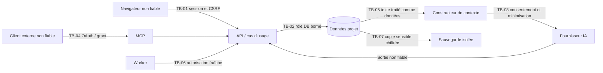

# Modèle de sécurité et analyse de menaces

**Version :** 0.2  
**Statut :** Analyse de menaces initiale  
**Références :** `PRD.md`, `DOMAIN-MODEL.md`, `ARCHITECTURE.md`, `API-CONTRACTS.md`

## 1. Objectif

Définir les actifs à protéger, les frontières de confiance, les scénarios de menace et les exigences de sécurité applicables au produit.

Le document couvre le MVP et identifie les points à réévaluer avant la production.

Il ne constitue pas une certification de sécurité.

## 2. Actifs sensibles

### 2.1 Contenus littéraires

- manuscrits inédits ;
- scènes et versions précédentes ;
- fiches de personnages ;
- univers narratifs ;
- intrigues et révélations ;
- notes personnelles ;
- commentaires et critiques ;
- propositions de modification.

### 2.2 Identités et autorisations

- comptes ;
- sessions ;
- rôles ;
- invitations ;
- jetons OAuth ;
- délégations MCP ;
- identités des agents.

### 2.3 Secrets

- clés API des fournisseurs IA ;
- secrets applicatifs ;
- clés de chiffrement ;
- identifiants d'infrastructure ;
- secrets de connexion aux bases et services.

### 2.4 Intégrité métier

- références entre objets ;
- révisions ;
- propositions ;
- approbations ;
- journaux d'audit ;
- sauvegardes ;
- état canonique du projet.

## 3. Objectifs de sécurité

Priorités :

1. confidentialité des projets ;
2. intégrité des contenus et relations ;
3. impossibilité de contourner les permissions ;
4. prévention des modifications IA non autorisées ;
5. récupération après incident ;
6. attribution fiable des actions ;
7. disponibilité raisonnable ;
8. maîtrise des coûts et consommations IA.

## 4. Frontières de confiance

### TB-01 — Navigateur vers API

Le navigateur est un environnement non fiable.

Toutes les données envoyées doivent être validées.

Les permissions affichées dans l'interface ne constituent pas une mesure de sécurité.

### TB-02 — API vers base de données

L'API doit imposer les règles métier et l'isolation des projets.

La base peut appliquer des contraintes et politiques supplémentaires.

### TB-03 — API vers fournisseur IA

Les données quittent le périmètre applicatif pour un fournisseur externe.

Le système doit limiter le contenu transmis et protéger les secrets.

### TB-04 — Client MCP vers serveur MCP

Le client est externe au système et peut être compromis ou malveillant.

Son identité, ses scopes et ses délégations doivent être vérifiés.

### TB-05 — Contenu narratif vers moteur IA

Le contenu du manuscrit est une donnée, pas une instruction de confiance.

Les prompts, documents importés et résultats de recherche peuvent contenir des tentatives d'injection.

### TB-06 — Worker vers services métier

Un traitement asynchrone ne doit pas hériter de privilèges globaux injustifiés.

Son contexte d'autorisation et ses ressources doivent être identifiables.

### TB-07 — Sauvegardes et exports

Les exports et sauvegardes constituent des copies sensibles des données.

Ils nécessitent des protections comparables à celles de la base principale.

## 5. Scénarios de menace prioritaires

| ID | Menace | Gravité initiale | Contrôles attendus |
|---|---|---|---|
| TH-01 | Accès à un projet via un identifiant deviné | Critique | Autorisation serveur, isolation projet, tests IDOR |
| TH-02 | Recherche révélant des extraits privés | Critique | Filtrage avant résultats et extraits |
| TH-03 | Agent MCP dépassant sa délégation | Critique | OAuth, scopes, permissions métier, révocation |
| TH-04 | Injection de prompt dans une scène | Élevée | Séparation instructions/données, validation des outils |
| TH-05 | Fusion IA sans approbation | Critique | Fusion réservée au parcours autorisé |
| TH-06 | Écrasement concurrent d'une scène | Élevée | Révisions et refus des écritures obsolètes |
| TH-07 | Fusion partielle d'une proposition | Élevée | Transaction atomique |
| TH-08 | Fuite de clé API IA | Critique | Chiffrement, non-exposition, rotation |
| TH-09 | XSS via contenu riche | Élevée | Sanitisation, rendu contrôlé, CSP |
| TH-10 | CSRF sur session web | Élevée | Protection CSRF, cookies adaptés, contrôle d'origine |
| TH-11 | Épuisement des coûts IA | Élevée | Quotas, budgets, limites d'exécution |
| TH-12 | Fuite par journaux ou traces | Élevée | Minimisation et masquage |
| TH-13 | Export non autorisé | Critique | Permissions spécifiques, audit |
| TH-14 | Restauration de données incohérentes | Élevée | Sauvegardes cohérentes et tests |
| TH-15 | Réutilisation de jeton MCP volé | Élevée | Durée limitée, audience, révocation |
| TH-16 | Appels externes abusifs ou SSRF | Élevée | Contrôle des destinations et outils |
| TH-17 | Pièce jointe malveillante | Élevée | Validation, stockage isolé, analyse adaptée |
| TH-18 | Confusion entre plusieurs clients IA | Élevée | Attribution user/client/grant/execution |
| TH-19 | Contournement par tâche asynchrone | Critique | Autorisation persistée et revérifiée |
| TH-20 | Altération de l'historique | Élevée | Contrôles d'accès, audit, sauvegardes |

Les gravités sont provisoires. Elles devront être ajustées selon l'architecture réelle et l'exposition du service.

## 6. Authentification

### 6.1 Exigences

- mécanisme d'identité éprouvé ;
- sessions sécurisées ;
- expiration et révocation ;
- limitation des tentatives d'authentification ;
- contrôle des redirections d'authentification ;
- MFA recommandé, particulièrement pour les administrateurs.

### 6.2 Sessions web

Les sessions doivent utiliser des protections adaptées :

- cookies `HttpOnly` lorsque pertinent ;
- attribut `Secure` en production ;
- politique `SameSite` adaptée ;
- protection CSRF ;
- rotation des identifiants de session ;
- invalidation après révocation.

## 7. Autorisation

### 7.1 Politique

Refus par défaut.

Chaque opération vérifie :

- l'identité ;
- le projet ;
- le rôle ;
- la permission ;
- l'état de la ressource ;
- les restrictions supplémentaires éventuelles.

### 7.2 Isolation des projets

L'identifiant de projet doit être présent dans les requêtes et les accès aux données concernés.

Les requêtes ne doivent pas charger une ressource uniquement par son identifiant puis supposer qu'elle appartient au projet courant.

Les relations interprojets doivent être empêchées par les services métier et, lorsque possible, par les contraintes de base.

### 7.3 Tests d'autorisation

Créer une matrice automatisée couvrant :

- propriétaire ;
- administrateur ;
- auteur ;
- relecteur ;
- lecteur ;
- utilisateur non membre ;
- client MCP lecture seule ;
- client MCP autorisé à proposer ;
- agent intégré ;
- tâche système.

Les tests doivent inclure les refus, pas seulement les parcours autorisés.

## 8. Sécurité MCP

### 8.1 Autorisation déléguée

L'accès distant doit utiliser un mécanisme d'autorisation compatible avec les exigences du transport MCP retenu.

Les délégations doivent être :

- explicites ;
- limitées ;
- révocables ;
- liées à un client identifiable ;
- liées à un utilisateur ou acteur autorisé ;
- bornées aux projets accordés.

### 8.2 Prévention du confused deputy

Un client ne doit pas pouvoir utiliser les privilèges du serveur pour agir au-delà de ceux qui lui ont été délégués.

Le serveur ne doit pas confondre :

- identité de l'utilisateur ;
- identité du client ;
- autorisations du client ;
- permissions du projet.

### 8.3 Protections supplémentaires

- validation des jetons, de leur audience et de leur expiration ;
- contrôle d'origine et de configuration des transports ;
- limitation de débit ;
- limitation des résultats ;
- validation des arguments ;
- journalisation des opérations sensibles ;
- interdiction des outils administratifs non nécessaires ;
- révocation immédiate ou à délai maîtrisé.

## 9. Sécurité des intégrations IA

### 9.1 Principe

Une sortie de modèle est une donnée non fiable.

Elle ne doit pas être exécutée comme une instruction privilégiée.

### 9.2 Injection de prompt

Scénarios :

- une scène demande à l'agent d'ignorer ses instructions ;
- une fiche contient une instruction de suppression ;
- un document importé tente d'exfiltrer une clé ;
- un résultat de recherche falsifie une consigne système ;
- une réponse de modèle invente une permission.

Contrôles :

- séparation des instructions système et du contenu narratif ;
- permissions appliquées indépendamment du modèle ;
- outils à schémas stricts ;
- refus des outils non autorisés ;
- absence d'accès aux secrets depuis le contexte ;
- confirmation humaine avant fusion ;
- traçabilité des opérations ;
- tests de résistance aux injections.

La seule formulation d'un prompt de sécurité ne constitue pas une protection suffisante.

### 9.3 Fournisseurs IA

Les clés sont conservées côté serveur.

Le système doit définir :

- qui peut configurer une clé ;
- quels projets peuvent l'utiliser ;
- quelles données peuvent être transmises ;
- quels budgets s'appliquent ;
- comment révoquer une clé ;
- quelles métadonnées sont conservées.

### 9.4 Maîtrise des dépenses

Prévoir :

- limite par requête ;
- limite de contexte ;
- limite d'outils appelés ;
- limite de durée ;
- plafond de dépenses ou consommation ;
- suivi des erreurs et tentatives répétées.

## 10. Protection des contenus

### 10.1 Rendu

Le contenu riche doit être traité comme potentiellement hostile.

Ne pas autoriser l'exécution arbitraire de scripts, d'attributs dangereux ou de ressources actives.

### 10.2 Import et fichiers

Les fichiers doivent être contrôlés selon :

- type déclaré et type réel ;
- taille ;
- extension ;
- contenu actif ;
- destination de stockage ;
- droits d'accès ;
- durée de conservation.

Ne pas utiliser directement un nom de fichier fourni par l'utilisateur comme chemin de stockage.

### 10.3 Exports

Les exports sont des opérations sensibles.

Ils doivent être :

- autorisés ;
- limités ;
- journalisés ;
- stockés temporairement ;
- accessibles via des liens à durée limitée, si téléchargement indirect.

## 11. Sécurité des modifications

### 11.1 Concurrence

Toute écriture doit vérifier sa version de base.

### 11.2 Propositions

Une proposition ne confère aucun droit supplémentaire à son auteur.

La création, l'approbation et la fusion sont des opérations distinctes.

### 11.3 Approbations

Une approbation doit être liée à la version précise du contenu examiné.

Toute modification postérieure doit nécessiter une nouvelle approbation.

### 11.4 Fusion

La fusion doit revérifier toutes les permissions et préconditions dans la transaction.

### 11.5 Audit

L'audit doit permettre d'identifier :

- acteur ;
- client IA éventuel ;
- projet ;
- ressource ;
- opération ;
- version avant/après ;
- proposition associée ;
- horodatage ;
- résultat.

## 12. Protection des secrets

- pas de secrets dans le dépôt ;
- pas de secrets dans les prompts ;
- pas de secrets dans les réponses API ;
- pas de secrets dans les traces ;
- chiffrement des clés stockées ;
- rotation possible ;
- permissions minimales des services ;
- séparation des environnements ;
- gestion explicite des accès d'administration.

La stratégie de chiffrement et de gestion des clés doit être documentée avant production.

## 13. Sauvegardes et continuité

Contrôles requis :

- sauvegardes automatiques ;
- chiffrement adapté ;
- restrictions d'accès ;
- séparation des sauvegardes du système principal ;
- surveillance des échecs ;
- restauration testée ;
- documentation des procédures.

Les objectifs RPO et RTO doivent être confirmés avant mise en production.

## 14. Journalisation et vie privée

Les journaux doivent privilégier :

- identifiants techniques ;
- événements ;
- durées ;
- résultats ;
- codes d'erreur ;
- métriques de consommation.

Ils ne doivent pas contenir systématiquement :

- manuscrits ;
- conversations complètes ;
- clés API ;
- jetons ;
- informations personnelles inutiles.

La conservation des données doit être définie selon les besoins opérationnels et obligations applicables.

## 15. Vérifications avant mise en production

### Sécurité applicative

- revue des contrôles d'accès ;
- tests IDOR ;
- tests XSS et CSRF ;
- validation des entrées ;
- vérification des dépendances ;
- tests de concurrence ;
- tests de fusion atomique ;
- contrôle des exports.

### Sécurité IA

- scénarios d'injection de prompt ;
- tentative d'appel d'outil non autorisé ;
- tentative de lecture d'un autre projet ;
- tentative d'accès aux secrets ;
- tentative de fusion sans approbation ;
- dépassement de budget ;
- révocation de délégation pendant une exécution.

### Infrastructure

- contrôle des secrets ;
- sauvegardes ;
- restauration ;
- permissions de base de données ;
- TLS ;
- configuration des journaux ;
- exposition réseau ;
- surveillance.

## 16. Gestion des incidents

Avant ouverture publique, documenter :

- qualification d'incident ;
- suspension de comptes ou clients ;
- révocation de jetons ;
- rotation des secrets ;
- isolation d'un projet affecté ;
- restauration ;
- analyse des journaux ;
- communication aux utilisateurs ;
- obligations de notification applicables.

## 17. Risques résiduels

Même avec une validation humaine :

- une proposition IA peut être littérairement mauvaise ;
- un utilisateur autorisé peut approuver une erreur ;
- un fournisseur IA peut traiter des contenus confidentiels ;
- une révision peut être techniquement valide mais narrativement incohérente ;
- un compte compromis peut agir dans les limites de ses permissions.

Le produit doit réduire ces risques sans prétendre les éliminer totalement.

## 18. Critère de validation du modèle de sécurité

Ce document pourra être approuvé lorsque :

- l'architecture cible sera stabilisée ;
- les frontières de confiance seront représentées ;
- les scénarios de menace seront testables ;
- la matrice de permissions sera complète ;
- les règles MCP seront figées ;
- la gestion des secrets sera définie ;
- les procédures de sauvegarde et de restauration seront opérationnelles ;
- les risques résiduels auront été acceptés explicitement.

## 19. Analyse structurée consolidée

**Portée :** conception de sécurité du MVP, pas un scan de code ni une certification. **Références :** [audit](DOCUMENT-AUDIT.md), [sources S03/S06/S20/S22–S24](RESEARCH-SOURCES.md), [tests](CONTRACT-TESTS.md), ADR-0008.

### Synthèse et méthode

Analyse par flux et frontières TB-01..07, familles usurpation/altération/divulgation/répudiation/DoS/élévation. Actifs : textes et versions, métadonnées parfois révélatrices, identités et grants, clés IA, intégrité des changesets et sauvegardes. Adversaires : utilisateur non membre, membre malveillant, navigateur/XSS, client MCP compromis, contenu narratif injecté, fournisseur externe, opérateur ou worker compromis. La confiance accordée à un membre ne s'étend pas à un client auquel il délègue.

Les gravités initiales des TH-01..20 sont conservées. Les contrôles ci-dessous sont des exigences proposées et testables, pas des protections déjà présentes. Chaque risque résiduel élevé est À DÉCIDER avant le lot indiqué ; un risque faible documenté n'est pas une acceptation humaine déjà acquise.

### Permissions effectives proposées

La matrice remplace l'ambiguïté configurable du PRD par des valeurs par défaut à valider avant lot 0 (D09). Pas de partage public ni invité sans compte, pas d'ACL par scène au MVP. Une conversation IA est privée à son initiateur, en plus de l'appartenance au projet ; l'historique canonique et les propositions sont partagés au niveau projet. Les clés personnelles ne sont ni visibles ni utilisables par les autres membres.

| Capacité | Owner | Admin | Author | Reviewer | Reader | IA intégrée / MCP |
|---|---|---|---|---|---|---|
| project.read, proposal.read | oui | oui | oui | oui | oui | intersection grant + rôle humain |
| narrative.write / restore | oui | oui | oui | non | non | jamais au MVP |
| comment.write / review | oui | oui | oui | oui | non | non dans catalogue MVP |
| proposal.write / submit | oui | oui | oui | oui | non | seulement grant explicite, ses propositions |
| proposal.approve / reject | oui | oui | non | non | non | jamais |
| proposal.merge + narrative.write | oui | oui | non | non | non | jamais, même via HTTP |
| export.create | oui | oui | oui | non | non | jamais dans catalogue MVP |
| Inviter / retirer | oui | author/reviewer/reader seulement ; owner/admin exclus | non | non | non | jamais |
| Attribuer rôle | oui | author/reviewer/reader seulement | non | non | non | jamais |
| Modules, projet, archivage | oui | oui | non | non | non | jamais |
| Transfert owner / purge projet | owner uniquement, parcours séparé et réauthentification | non | non | non | non | jamais |
| Configuration clé personnelle | soi-même | soi-même | soi-même | soi-même si IA autorisée | lecture seule si IA autorisée | jamais lire/configurer secret |

La permission d'utiliser l'IA n'implique pas de proposer : un Reader peut demander des réponses en lecture seulement sous consentement et budget personnel. Un reviewer peut produire une proposition mais pas modifier directement une scène. Le merge exige droits actuels du fusionneur et validité de l'approbateur, de l'auteur et du grant externe d'origine. Un owner humain peut s'auto-approuver pour son projet solo ; la séparation de deux personnes peut être ajoutée ultérieurement, sans inventer un rôle IA approbateur.

### Authentification, délégation et révocation

Web : OIDC Authorization Code + PKCE S256 ; vérifier issuer, state, nonce, redirect URI exacte, signature/algorithme autorisé, aud et exp de l'ID token. Identité `(issuer,subject)`, pas email seul. Session serveur opaque dans cookie Secure, HttpOnly, SameSite=Lax proposé ; jeton CSRF et contrôle Origin pour mutations ; CORS liste fermée. Aucun token de fournisseur IA dans le stockage navigateur. MFA souhaitable, choix IdP ouvert GO-02.

MCP : serveur de ressources OAuth avec RFC9728 et discovery AS ; 401 + WWW-Authenticate pointant les métadonnées. AS de confiance configuré, validate issuer/audience/resource/expiration/scopes/client/subject ; pas d'acceptation d'ID token comme bearer. Clients préenregistrés recommandés MVP ; si métadonnées client découvertes, appliquer règles normatives et protection SSRF, jamais récupérer une URL arbitraire sans validation. PKCE S256 pour clients publics, redirections exactes et validation de l'émetteur. OAuth 2.1 est cité comme draft par la norme MCP consultée : ne pas le présenter comme RFC final. S06/S22–S24.

Un access token référencie un grant persistant ; l'enregistrement client authentifié prévaut sur `clientInfo` autodéclaré. Pas de passage du bearer MCP aux fournisseurs. Le consentement présente projets, scopes, durée et client. Lecture seule est le profil par défaut ; lecture/proposition exige sélection explicite des scopes. L'IA ne peut ni créer ni étendre ses grants. Retrait membre, désactivation client ou révocation grant bloque toute nouvelle commande/outils/publication, même si JWT n'est pas expiré : vérification du registre à chaque appel. Pas de cache positif de permissions MVP.

Révocation concurrente sérialisée sous les mêmes verrous projet que les écritures. Une commande commitée avant la révocation reste traçable ; après commit de révocation aucune nouvelle commande ne passe. Une lecture déjà transmise ne peut être effacée à distance ; les flux longs recontrôlent entre segments et les jobs avant tout nouveau transfert. Durée exacte access/refresh tokens et rotation à fixer avec l'AS au lot 6 ; refresh tokens stockés hachés/rotatifs si plateforme les gère, détection de réutilisation selon capacités AS.

### Matrice des menaces, contrôles et preuves attendues

| ID / menace / frontière | Chemin d'attaque et actif | Contrôle concret obligatoire | Preuve de contrat | Risque résiduel / décision |
|---|---|---|---|---|
| TH-01 IDOR / TB-01,04 | Deviner sceneId ou proposalId | Clé composite projet/id et politique serveur ; 404 uniforme absent/inaccessible | CT-01/02/04 | Énumération temporelle à surveiller ; résiduel faible proposé |
| TH-02 Recherche / TB-02 | Snippet, suggestion, total ou curseur d'un autre projet | Filtrer avant ranking/snippet ; curseur signé lié au grant ; pas de cache partagé | CT-03/31 | Side-channel de volume dans un projet lisible ; faible |
| TH-03 Agent sur-privilégié / TB-04 | Scopes généraux ou projectId falsifié | Intersection rôle/client/grant/projet/plafond IA ; outils allowlist ; jamais rôle AI global | CT-17/18/19 | Compromission d'un client déjà autorisé à lire ; consentement explicite, décision avant lot 6 |
| TH-04 Prompt injection / TB-05 | Manuscrit ou résultat recherche demande exfiltration/fusion | Sources marquées données ; outil/arguments validés ; aucun secret ni réseau arbitraire accessible ; fusion humaine | CT-22/23 | Manipulation du texte proposé possible ; auteur averti, acceptable seulement avec revue explicite |
| TH-05 Merge IA / TB-01,04 | Agent appelle HTTP approve/merge caché | actorType issu auth ; plafond actor interdit même owner délégué ; pas de permission merge en grant | CT-19/32 | Humain peut accepter mauvaise proposition ; résiduel métier documenté |
| TH-06 Concurrence / TB-02 | Autosave périmé écrase r+1 | CAS obligatoire ; brouillon visible conservé ; conflit 412 | CT-05/06 | Perte du brouillon non confirmé lors fermeture brutale, stratégie client spike A |
| TH-07 Fusion partielle / TB-02 | Échec quatrième opération ou processus arrêté | Transaction unique, snapshots/audit/outbox inclus, verrou projet | CT-13/14/33 | Sinistre DB, sauvegardes ; décision de durabilité avant production |
| TH-08 Clé API / TB-03 | Lecture DB/log/context ou client | Chiffrement par enveloppe KMS/secret manager ; accès déchiffrement worker strict ; sortie redacted | CT-23/34 | Compromission runtime capable de déchiffrer ; élevé, contrôle opérateurs à valider lot 7 |
| TH-09 XSS / TB-01 | Nœud HTML, lien javascript, mark malveillant | Schéma rich text allowlist ; renderer sûr + CSP sans unsafe-eval ; aucun HTML arbitraire | CT-35 | Compromission navigateur hors application, faible après tests |
| TH-10 CSRF / TB-01 | Site tiers soumet commande avec cookie | CSRF token, Origin, SameSite, méthodes ; bearer jamais cookie MCP implicite | CT-36 | XSS contourne CSRF ; contrôle TH-09 nécessaire |
| TH-11 Coûts IA / TB-03 | Appels parallèles/réessais dépassent plafond | Réservation atomique budget avant appel, contexte/tools/durée bornés, circuit breaker | CT-28/37 | Facture fournisseur après timeout inconnue ; pas retry aveugle, risque à valider lot 5 |
| TH-12 Logs / TB-02,03 | Trace inclut bearer, prompt ou scène | Journaux structurés allowlist, redaction tests canaris ; logs requêtes HTTP sans bodies | CT-23/30/34 | Support reçoit copie manuelle ; contrôle opérateur avant lot 7 |
| TH-13 Export / TB-07 | Job ancien ou lien d'archive partagé | Autorisation demande/exécution/publication/téléchargement ; proxy authentifié, TTL, bucket privé | CT-24/27 | Copie téléchargée par membre autorisé irrévocable ; risque inhérent explicite |
| TH-14 Sauvegarde / TB-07 | Restauration incohérente ou snapshot manquant | Sauvegarde chiffrée isolée, manifeste cohérent DB/objets, restauration testée | CT-39 | RPO/RTO provisoires non garantis, à décider lot 7 |
| TH-15 Vol/rejeu token / TB-04 | Bearer copié ou rejoué autre audience | TLS, aud/resource, expiry, grant persistant révocable, rotation refresh | CT-20/40 | Bearer volé utilisable avant révocation ; DPoP à étudier selon AS, pas promis |
| TH-16 SSRF / TB-03,04 | URL fichier, issuer, OAuth metadata ou endpoint IA vise réseau interne | Endpoints IA administratifs allowlist ; HTTPS, DNS/IP privées et redirections bloquées ; pas d'outil fetch narratif MVP | CT-41 | Rebinding/egress à revalider infra lot 7 |
| TH-17 Pièce jointe / TB-05,07 | PDF/HTML/zip bombe ou instructions importées | Import médias hors MVP ; si futur sandbox parsing sans réseau, taille/type/décompression bornés | CT-22 et futurs imports | Risque exclu MVP tant qu'aucun import actif ; à décider V1 |
| TH-18 Identité falsifiée / TB-04 | clientInfo prétend être client de confiance | OAuth client et grant authentifiés ; trace séparant displayName non vérifié | CT-30/40 | Identité du modèle externe déclarative, aucune attestation promise |
| TH-19 Worker / TB-06 | Job réutilise ancien rôle ou devient superuser | Contexte initiateur persisté, relecture permissions, rôle DB sans BYPASSRLS, pas de token brut | CT-20/27 | Compromission du worker ; segmentation egress/secret avant lot 7 |
| TH-20 Historique / TB-02 | Mutation rétroactive ou restauration écrase r | Append-only applicatif, rôle sans UPDATE snapshots ; restore r+1 ; audit durable même transaction | CT-26/30 | Administrateur DB peut altérer ; immutabilité cryptographique non promise, risque opérateur à valider |
| TH-21 Fuite interprojets / TB-02 | Relation ou référence d'une autre tenant, pool mal réinitialisé | FK composites, validation références et SET LOCAL si RLS ; rôle non propriétaire | CT-16/31/42 | RLS ne remplace pas domaine, tests de pool indispensables |
| TH-22 Confused deputy / TB-03,04 | Server utilise clé/jeton plus fort pour un tool | Délégation liée à audience/projet ; credential IA d'initiateur uniquement ; aucun token forwarding | CT-17/19/23/40 | Fournisseur reçoit nécessairement le contexte choisi ; consentement lot 5 |
| TH-23 DoS / TB-01,04 | Proposition géante, graph cycles, diff coûteux, export répété | Taille bytes/profondeur/ops bornées, timeout diff, quotas jobs, pagination ; limites avant calcul | CT-43 | Dégradation sous attaque répartie ; capacity/rate limits avant lot 7 |
| TH-24 Sauvegardes exposées / TB-07 | Bucket public ou clé de déchiffrement avec backup | ACL privées testées, compte sauvegarde isolé, clé séparée, inventaire objets | CT-39/44 | Accès opérateur très privilégié ; approbation exploitation lot 7 |
| TH-25 Approbation périmée / TB-02 | Revue réutilisée après révision, rôle reviewer révoqué | Hash + proposalRevision, stateVersion CAS, capacité reviewer relue au merge | CT-11/12/45 | Mauvaise revue humaine reste possible, risque métier |
| TH-26 Transcript / TB-01,03 | Membre lit conversation privée via projet ou export | Owner de conversation + membership ; transcript exclu export projet par défaut | CT-38 | Proposition peut citer volontairement contenu privé ; avertissement et revue |

### Secrets, chiffrement, budgets et contexte

TLS partout exposé ; chiffrement disque/base/objets et backups avant production. Clés fournisseurs personnelles référencées par credentialId, chiffrées par enveloppe avec keyVersion ; pas de déchiffrement dans les handlers de lecture. Interface de rotation : nouvelle clé chiffrée, test explicite sans texte projet, bascule version, révocation de l'ancienne ; clé non exportée. Rotation KMS : rewrapping des clés de données, conservation des versions nécessaires aux sauvegardes selon procédure validée. Perte de clé rend les sauvegardes illisibles : test de restauration inclut la récupération des clés.

Budget : choisir limite technique par exécution et budget utilisateur/projet configuré sans tarification imposée. Réserver estimation maximale en transaction, puis réconcilier usage réel ; appels parallèles ne dépassent pas la réservation disponible. Timeout accepté mais inconnu garde une réservation prudente jusqu'à décision/réconciliation. Le coût d'un fournisseur indisponible n'est pas déduit comme « zéro » par défaut. Cette exigence de protection des appels est P0 même si l'interface de quotas AI-12 reste SHOULD.

Contexte sortant = instructions applicatives de confiance + requête utilisateur + passages délimités avec provenance et révision. Exclure email inutile, secrets et tokens, prompts d'autres conversations ; pas de retrieval interprojets ni d'upload intégral automatique. Le modèle ne peut choisir un endpoint réseau ou une clé. Conserver l'inventaire des sources et métadonnées d'envoi, pas les secrets ni une copie de tout le prompt dans les logs. Consentement informe sur fournisseur, périmètre et politique applicable ; aucune promesse d'absence d'entraînement ou de rétention sans preuve contractuelle S11/S13.

### Audit, sauvegarde, rétention et incident

Audit métier dans la transaction ; journaux de sécurité indépendants sur échec, sans contenu. Attributs : humanUserId, actorType, authenticatedClientId, grantId, executionId, channel, projectId, action, result, revisions, proposalRevision, changeSetId, time UTC et correlationId. `provider/model` du serveur intégré fiables comme configuration utilisée ; modèle d'un client externe non attesté et marqué declared. Les traces techniques n'héritent pas du texte des événements métier.

Rétention versions, conversations, audit et archives à valider Q-08 avant lot 7 ; tant que non définie, aucune purge automatique des révisions. « Immuable » signifie append-only pendant la rétention, pas conservation infinie. Suppression définitive nécessite confirmation owner, export proposé, politique des données dérivées, backups et clés ; aucune purge en proposition narrative.

Restaurer sur environnement isolé, accès opérateur borné, egress IA/notifications bloqué, vérifier FK/hashes/revisions et déchiffrement, invalider sessions et grants restaurés, rapprocher outbox pour éviter renvoi d'anciens effets. RPO/RTO provisoires 24 h, mesure exigée. Incident : suspendre client/compte, couper egress, révoquer grants et sessions, préserver audit, tourner secrets, qualifier contenus divulgués puis décider communication selon obligations réellement applicables. Responsable exploitation et procédure d'accès d'urgence à désigner avant production.

## 20. Décisions proposées, alternatives, risques et questions ouvertes

Autorisation applicative centrale obligatoire ; RLS recommandée en défense en profondeur plutôt que comme unique contrôle. Chiffrement au repos protège copies/disques, pas un processus autorisé à déchiffrer ; chiffrement de bout en bout incompatible avec recherche/IA serveur telle que proposée, donc non promis. Alternative auto-hébergée permet de choisir d'autres opérateurs/fournisseurs sans supprimer les menaces. Residuals opérateur, fournisseur et coût incertain ne sont pas acceptés silencieusement : GO-04 avant lot 7, GO-03 avant lot 5/6. La rétention exacte, IdP/AS et l'exposition distante sont ouverts.

## Critères d'acceptation du document

Chaque menace critique a mitigation concrète et scénario vérifiable ; matrice autorisations testable par rôle et canal ; les clients ne fournissent jamais leur propre identité d'autorité ; chaque copie/transfert a une règle d'accès ; résiduels élevés ont décision et lot ; la sécurité ne repose ni sur le prompt ni sur la liste d'outils seule. Les tests spécifiés ne sont pas présentés comme exécutés sur une application absente.
