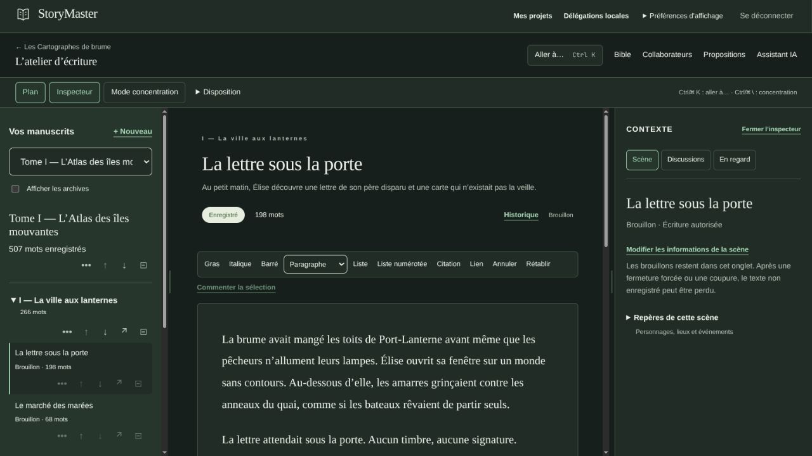
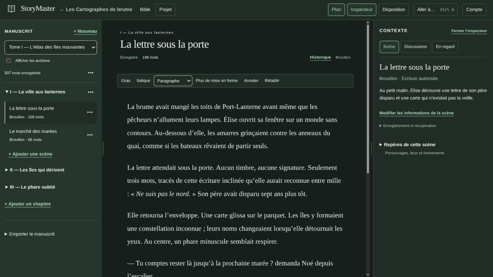
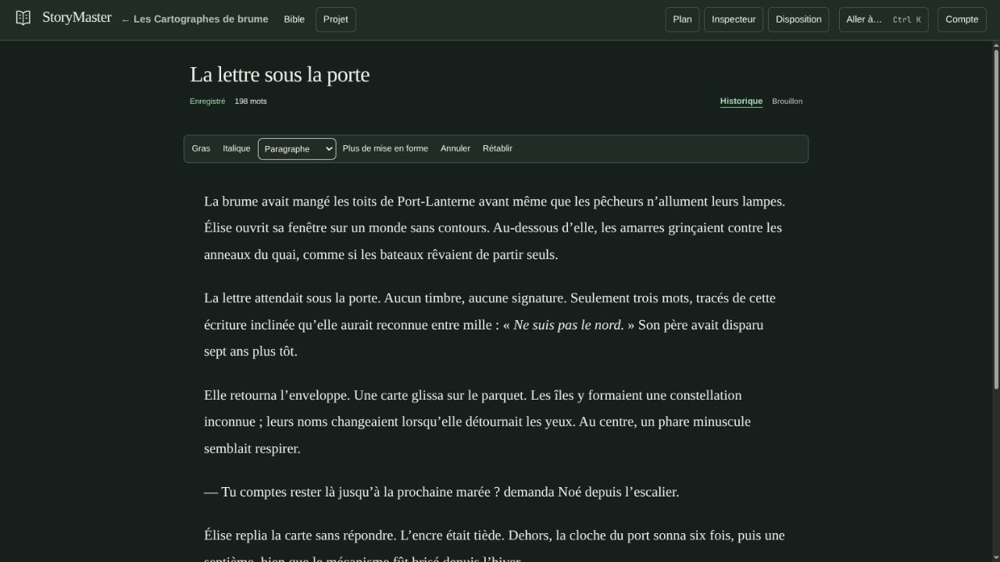

# UX-1B — Simplifier l’atelier de rédaction

**Date :** 2 novembre 2026. **Statut :** réalisation et qualification locale ; réception ergonomique humaine attendue. Mission explicite UX-1B puis UX-2, sur main uniquement. Base `d0d3a4e`, main/origin identiques au départ, [CI de référence verte](https://github.com/ZA512/StoryMaster/actions/runs/41513008055).

## Réalisation et réutilisation

Une seule barre rassemble identité, projet, Bible, menu Projet, panneaux, disposition/concentration, palette et compte. Collaborateurs, propositions, assistant simulé et exports restent accessibles dans Projet ; préférences et délégations dans Compte. Aucune commande n’exige un survol. Les menus natifs de premier plan échappent aux limites de défilement ; Tab, flèches, début/fin et Échap permettent leur utilisation.

Le plan conserve le choix du manuscrit, les archives, les créations au bon niveau, l’ordre, les déplacements, l’archivage/réactivation et les exports. Il affiche un seul titre de manuscrit et un menu par élément, avec renommage inline supplémentaire. Les anciens formulaires de métadonnées et commandes métier restent utilisés. Le résumé passe dans l’inspecteur ; sauvegarde et historique demeurent visibles près du titre. Gras, italique, style, undo/redo restent directs ; les autres formats sont dans « Plus de mise en forme ». Le bouton de commentaire apparaît lorsqu’un passage est sélectionné, y compris pour un relecteur.

L’inspecteur garde statut, résumé, références, discussions, fiche liée, épinglage et scène en regard. Les détails de récupération, techniques et scènes associées sont repliables. Pas de nouvelle charte, bibliothèque UI, modèle de données, migration, contrat ou permission.

Fichiers principaux : [Shell](../apps/web/components/shell.tsx), [menus](../apps/web/components/action-menu.tsx), [atelier](../apps/web/components/writer/writer.tsx), [contrôles](../apps/web/components/writer/workspace-controls.tsx), [éditeur](../apps/web/components/writer/text-editor.tsx), [contexte](../apps/web/components/writer/context-object.tsx), [styles](../apps/web/app/globals.css). Les tests des Lots 1/5/7 et UX-1 suivent les nouveaux accès aux mêmes fonctions ; [nouveaux parcours UX-1B](../tests/e2e/ux1b.spec.ts).

## Compacité mesurée et captures

Même scène fictive « La lettre sous la porte », même compte, thème sombre système, police de rédaction 18 px, même disposition. Mesures DOM en pixels CSS, défilement initial ; aucune retouche des captures. [Galerie avant/après](../artifacts/ux12-2026-11-02/INDEX.html), [mesures avant](../artifacts/ux12-2026-11-02/mesures-avant.json), [mesures après](../artifacts/ux12-2026-11-02/mesures-apres.json).

| Fenêtre CSS | Barres avant → après | Première ligne avant → après | Largeur utile du texte avant → après |
|---|---|---|---|
| 1280 × 720 | 170 → 52 | 518 → 260 | 523 → 562 |
| 1440 × 900 | 170 → 52 | 527 → 264 | 663 → 714 |
| 1920 × 1080 | 170 → 52 | 532 → 265 | 702 → 748 |
| 1000 × 720 | 170 → 52 | 503 → 256 | 597 → 616 |

À 1280 × 720, le panneau de rédaction gagne 118 px en hauteur (550 → 668) et la première ligne remonte de 258 px. Les autres gains proviennent de la hiérarchie du titre, du résumé déplacé et des commandes plus compactes. Ce sont des mesures de disposition, aucune performance humaine n’en est déduite. Sous 1280 px l’inspecteur reste superposé et masquable comme dans UX-1 ; masquer un panneau élargit immédiatement le texte. Le JPEG natif à viewport 1920 CSS arrondit sa largeur à 1919 pixels, identiquement avant/après ; il n’a pas été redimensionné.

## Validation et anomalies

- Construction Docker web de production, TypeScript et lint/générateurs de contrats : réussis.
- Validation JSON/Schema/OpenAPI/MCP, exigences, priorités, lots et liens : réussie ; 54 tests du validateur documentaire réussis.
- 16 parcours navigateur distincts qualifiés localement : cinq Lot 1, cinq UX-1, trois UX-1B, un parcours à deux comptes Lot 3 et un parcours intégré assistant/revue Lot 5, puis un parcours concurrent texte/références Lot 2. La suite ciblée de 12 a passé intégralement, puis le nouveau test de grossissement et les deux parcours transverses ont passé avec les trois UX-1B.
- Même nœud éditorial et undo après masquage des panneaux/concentration, brouillon en erreur réseau conservé puis enregistré explicitement ; riche, longue scène, réponse perdue/tardive, conflit, lecteur, historique, restauration, ordre et exports déjà couverts par les tests Lot 1.
- Quatre tailles, menus non coupés, navigation au clavier, absence de débordement global et contrôle axe clair/sombre. Grossissement visuel Chromium à facteur 2 via CDP, puis reflow à 640 × 450 CSS et accès aux commandes vérifiés. Cela ne vaut pas audit humain de lecteurs d’écran ni qualification de tous les zooms de tous les navigateurs. Le raccourci de zoom du navigateur intégré n’a eu aucun effet mesurable ; il n’est pas compté comme un zoom testé.

La première passe navigateur a détecté trois échecs de contraste liés aux deux compteurs du plan et au statut de sauvegarde : couleurs corrigées, puis suites rejouées. Un import de test manquant a été corrigé après échec TypeScript. Aucun échec n’est compté comme réussite. Les tests documentaires incluent les cibles de captures liées, sans sorties locales ni dépendances.

CI distante : [premier passage UX-1B sur c78c7bb](https://github.com/ZA512/StoryMaster/actions/runs/41517914305) : tous les contrôles statiques, applicatifs, restauration, benchmarks et Spike A verts ; 34/35 parcours navigateur réussis. Le test Lot 2 texte/références cherchait encore le mode concentration hors du menu Disposition. Son accès a été adapté, sans changer ses assertions de conflit/conservation, puis le parcours a passé sur la production UX-1B locale. La CI du correctif reste à observer après push ; aucun ancien succès n’est assimilé à cette preuve. Les journaux locaux se trouvent dans `artifacts/local/ux1b-*.log` ; ils ne constituent pas une preuve de CI.

## Limites et avis humain attendu

Brouillons non confirmés en mémoire uniquement, selon décision explicite ; aucune garantie après coupure ou fermeture forcée. Autosave, DraftManager, IDs, révisions, historique et permissions existants conservés. Aucun des 150 IDs ou 100 MUST, aucune priorité ni version ne change. SEC-07, GO-03, GO-04, RLS et contention restent ouverts.

Le propriétaire doit apprécier la densité, la découvrabilité des menus, le confort de rédaction et l’inspecteur. Les objectifs de temps restent à mesurer avec un humain. UX-2 reste l’étape suivante autorisée ; UX-3/4 et nouvelle charte hors mission. Pas d’ADR supplémentaire pour ce seul réagencement : les invariants et limites d’ADR-0019 demeurent.

## Critères d'acceptation du document

Fichiers, accès conservés, captures comparables, mesures de disposition, tests exécutés, échecs corrigés et limites de récupération identifiables ; réception humaine et CI distinctes.
