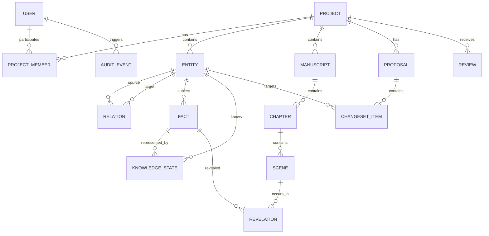
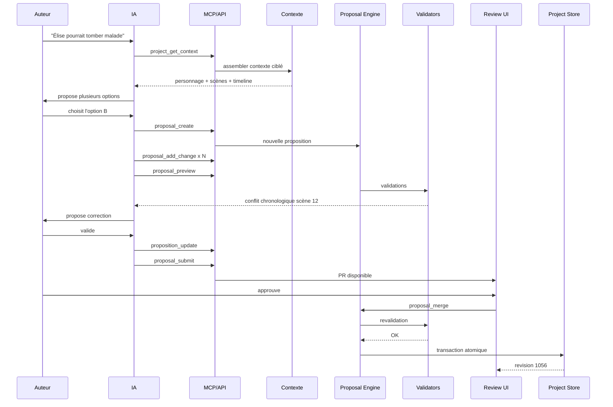

# Modèle fonctionnel central pour une plateforme web collaborative d’aide à l’écriture augmentée par IA

## Executive summary

La plateforme doit être conçue comme un **système de gestion de connaissances narratives versionné**, et non comme un simple traitement de texte enrichi. Le manuscrit n’est qu’une projection parmi d’autres d’un projet constitué d’entités narratives, de relations, de règles de canon, de chronologies, de connaissances différenciées et de propositions de modification.

Le principe architectural central recommandé est le suivant :

```text
                    ┌──────────────────────────────┐
                    │      MODÈLE NARRATIF         │
                    │                              │
                    │ personnages / lieux / scènes │
                    │ faits / arcs / événements    │
                    │ objets / indices / règles    │
                    └──────────────┬───────────────┘
                                   │
                           API métier unique
                                   │
                ┌──────────────────┼───────────────────┐
                │                  │                   │
        ┌───────▼───────┐  ┌──────▼───────┐   ┌──────▼───────┐
        │ Interface web │  │ Chat IA      │   │ Serveur MCP  │
        │ humains       │  │ intégré      │   │ IA externes  │
        └───────────────┘  └──────────────┘   └──────────────┘
                │                  │                   │
                └──────────────────┼───────────────────┘
                                   │
                     Proposal / Preview / Validate
                                   │
                          Merge / Reject / Rollback
                                   │
                    ┌──────────────▼──────────────┐
                    │ Historique immuable / audit │
                    └─────────────────────────────┘
```

Tous les acteurs — humains, automatisations et IA — doivent donc utiliser **exactement les mêmes primitives métier**. Une IA ne reçoit pas un accès SQL ni une opération générique « écris ce JSON ». Elle appelle des fonctions telles que `entity.update`, `timeline.analyze`, `proposal.create`, `proposal.submit` ou `review.run`, soumises aux mêmes permissions, validations et mécanismes d’audit qu’un utilisateur humain.

Pour les IA externes, **MCP est pertinent, mais ne remplace pas l’API**. La bonne architecture consiste à développer une API métier indépendante, puis un serveur MCP qui expose une partie contrôlée de cette API. La version actuelle du protocole MCP, publiée le 28 juillet 2026, fonctionne avec un cœur sans session, utilise JSON-RPC sur Streamable HTTP, accepte des schémas d’entrée et de sortie JSON Schema 2020-12 et prévoit des mécanismes d’autorisation OAuth adaptés aux serveurs de ressources. citeturn393684search1turn740806search0turn740806search1

Le second principe structurant est que **toute modification doit être versionnée**, même lorsque l’interface donne l’impression qu’elle est immédiatement appliquée. Les utilisateurs ou agents de confiance peuvent bénéficier d’un mode `AUTO_APPLY`, mais la modification reste enregistrée sous forme de changeset et peut être annulée ou auditée.

Le troisième principe est de distinguer trois catégories de données :

| Catégorie | Exemple | Autorité |
|---|---|---|
| Canon narratif | « Marc est le meurtrier » | vérité de l’univers |
| Information possédée | « Alice pense que Marc est innocent » | état de connaissance d’un acteur |
| Information révélée | « le lecteur découvre l’alibi au chapitre 12 » | expérience du lecteur |

Cette séparation permet de détecter des erreurs sans confondre contradiction et mensonge volontaire, et rend possibles des analyses sophistiquées de suspense, de révélations et de twists.

Le quatrième principe est de séparer **collaboration temps réel** et **gestion des propositions**. Yjs fournit un CRDT permettant à plusieurs utilisateurs d’éditer simultanément un document en fusionnant automatiquement les mises à jour concurrentes ; Tiptap peut s’appuyer dessus et Hocuspocus constitue une implémentation de backend collaboratif. Mais un CRDT ne fournit pas à lui seul le modèle « Pull Request », les validations narratives ni les branches expérimentales demandées ici. Ces mécanismes doivent être conçus au-dessus de la collaboration temps réel. citeturn393684search8turn393684search9turn740806search21turn740806search24

La recommandation finale est donc une architecture en cinq couches :

1. **modèle narratif structuré** ;
2. **API métier et moteur de commandes** ;
3. **journal de versions/propositions/fusions** ;
4. **collaboration temps réel et interface utilisateur** ;
5. **interfaces IA intégrées et MCP externes**.

La plateforme devient ainsi moins un « Scrivener collaboratif avec IA » qu’un **GitHub du récit doublé d’un système expert narratif**.

## Modèle narratif central

Chaque objet persistant reçoit un identifiant stable indépendant de son nom visible. Un personnage renommé, une scène déplacée ou un lieu rebaptisé doit conserver son identité logique. Je recommande des UUID v7 ou des ULID pour les entités principales, avec un identifiant externe opaque exposé par les API.

Un objet narratif commun devrait posséder au minimum :

```json
{
  "id": "ent_019ba94b-...",
  "project_id": "prj_019ba92c-...",
  "type": "character",
  "revision": 37,
  "status": "active",
  "title": "Élise Marceau",
  "slug": "elise-marceau",
  "summary": "Inspectrice chargée de l'enquête.",
  "tags": ["police", "protagoniste"],
  "created_at": "2026-10-30T11:42:18Z",
  "created_by": "usr_...",
  "updated_at": "2026-10-30T14:17:01Z",
  "updated_by": "agent_...",
  "metadata": {}
}
```

La `revision` constitue un mécanisme simple de concurrence optimiste. Pour les modifications HTTP directes, une variante standard peut également utiliser `ETag`/`If-Match`; JSON Patch fournit un format standard pour exprimer des opérations `add`, `remove`, `replace`, `move`, `copy` et `test`. Le RFC 6902 prévoit explicitement l’emploi de JSON Patch avec HTTP PATCH et décrit l’échec global lorsque l’une des opérations échoue. citeturn498153search0turn498153search1

### Inventaire recommandé

| Objet | Attributs essentiels | Relations typiques |
|---|---|---|
| `project` | titre, genre, langue, synopsis, modules actifs | membres, manuscrits, univers |
| `manuscript` | titre, ordre, statut, version publiée | chapitres |
| `chapter` | numéro, titre, objectif, POV | scènes |
| `scene` | texte, POV, lieu, début/fin, objectif, tension | événements, personnages |
| `character` | identité, description, objectifs, croyances, état | parenté, relations, présence |
| `place` | géographie, description, règles, coordonnées | contient, connecté à |
| `event` | instant/intervalle, lieu, participants, causalité | scènes, événements |
| `timeline` | calendrier, fuseau/règles temporelles | événements |
| `arc` | objectif, état initial/final, progression | personnages, scènes |
| `plot_thread` | question narrative, statut, résolution | indices, scènes |
| `fact` | assertion canonique, validité temporelle | sujets/objets |
| `knowledge_state` | sujet connaissant, fait, confiance | personnage ou lecteur |
| `revelation` | information révélée, moment, audience | scène, fait |
| `clue` | contenu, visibilité, interprétation | mystère, scène |
| `mystery` | question, vérité, fausses pistes | indices |
| `relationship` | type, direction, dates, intensité | deux entités |
| `rule` | règle d’univers, domaine, exceptions | faits/objets concernés |
| `species` | biologie, capacités, culture | personnages/bestiaire |
| `creature` | espèce, nom, état | lieux/personnages |
| `item` | type, propriétés, état | possession, lieu |
| `faction` | objectifs, membres, hiérarchie | personnages/lieux |
| `organization` | structure, autorité, ressources | factions/personnages |
| `culture` | valeurs, langue, coutumes | peuples/lieux |
| `language` | lexique, grammaire, usages | cultures/personnages |
| `magic_system` | règles, coûts, limites | pouvoirs/personnages |
| `technology` | fonctionnement, contraintes | objets/factions |
| `map` | image/tiles, repère spatial | lieux |
| `annotation` | auteur, texte, cible | toute entité |
| `task` | action éditoriale, responsable, état | entités |
| `source` | document, référence, provenance | faits |
| `style_guide` | ton, conventions, exemples | projet/manuscrit |
| `review` | grille, observations, score | texte/projet |
| `proposal` | changeset, auteur, statut | entités modifiées |
| `branch` | base, head, objectif | propositions |
| `snapshot` | état cohérent du projet | restauration |

Le stockage des documents éditoriaux peut rester fondé sur une représentation structurée ProseMirror/Tiptap, tandis que les objets narratifs sont enregistrés sous forme relationnelle/JSON dans PostgreSQL. Tiptap Collaboration utilise Yjs et son modèle `Y.Doc` pour la collaboration ; Yjs expose notamment `Y.Text`, `Y.Array`, `Y.Map` et des structures XML synchronisables. citeturn740806search22turn393684search9

### Vérité, connaissance et révélation

Un fait devrait être représenté indépendamment de celui qui le connaît.

```json
{
  "$schema": "https://json-schema.org/draft/2020-12/schema",
  "title": "NarrativeFact",
  "type": "object",
  "required": ["id", "project_id", "subject", "predicate", "object", "truth_status"],
  "properties": {
    "id": {"type": "string"},
    "project_id": {"type": "string"},
    "subject": {"$ref": "#/$defs/entityRef"},
    "predicate": {"type": "string"},
    "object": {},
    "truth_status": {
      "enum": ["canonical", "planned", "hypothesis", "retconned", "false"]
    },
    "valid_from": {"type": ["string", "null"]},
    "valid_to": {"type": ["string", "null"]},
    "confidence": {"type": "number", "minimum": 0, "maximum": 1},
    "source_refs": {
      "type": "array",
      "items": {"$ref": "#/$defs/entityRef"}
    }
  },
  "$defs": {
    "entityRef": {
      "type": "object",
      "required": ["id"],
      "properties": {
        "id": {"type": "string"},
        "type": {"type": "string"}
      }
    }
  }
}
```

JSON Schema 2020-12 est approprié ici pour valider les structures et constitue également la version désormais utilisée par les schémas d’outils de MCP 2026-07-28. citeturn690637search0turn690637search13turn740806search1

La connaissance devient alors un objet différent :

```json
{
  "id": "knw_72",
  "project_id": "prj_12",
  "knower": {
    "type": "character",
    "id": "char_alice"
  },
  "fact_id": "fact_marc_killer",
  "state": "believes_false",
  "confidence": 0.92,
  "known_from_event": "evt_interrogation_14",
  "known_until_event": null
}
```

Le lecteur est modélisé comme un public abstrait :

```json
{
  "id": "rev_88",
  "fact_id": "fact_marc_killer",
  "audience": "reader",
  "scene_id": "scene_31",
  "revelation_level": "hint",
  "strength": 0.35
}
```

Cela permet de distinguer :

```text
CANON              Marc est coupable.
PERSONNAGE ALICE   Marc est innocent.
LECTEUR CH. 8      Marc semble innocent.
LECTEUR CH. 14     Un indice remet en cause son alibi.
LECTEUR CH. 21     Marc est révélé coupable.
```

Un schéma de personnage peut également porter les états narratifs qui évoluent dans le temps :

```json
{
  "$schema": "https://json-schema.org/draft/2020-12/schema",
  "title": "Character",
  "type": "object",
  "required": ["id", "name"],
  "properties": {
    "id": {"type": "string"},
    "name": {"type": "string"},
    "aliases": {"type": "array", "items": {"type": "string"}},
    "roles": {"type": "array", "items": {"type": "string"}},
    "goals": {"type": "array", "items": {"type": "string"}},
    "traits": {"type": "array", "items": {"type": "string"}},
    "initial_state": {"type": "object"},
    "current_state": {"type": "object"},
    "arc_refs": {
      "type": "array",
      "items": {"type": "string"}
    },
    "style": {
      "type": "object",
      "properties": {
        "speech_register": {"type": "string"},
        "lexical_habits": {"type": "array", "items": {"type": "string"}}
      }
    }
  }
}
```

Les modules activables ne doivent pas modifier le noyau de données. Le bestiaire, le système magique, l’enquête policière ou la science-fiction peuvent ajouter des types, champs, règles de validation et vues, mais conserver le même système d’identité, de relation et de version.

## Relations, contraintes et moteur de cohérence

Je recommande de modéliser les relations comme des entités de première classe plutôt que comme de simples champs imbriqués.

Une relation possède :

```json
{
  "id": "rel_55",
  "project_id": "prj_12",
  "type": "parent_of",
  "source_id": "char_anna",
  "target_id": "char_paul",
  "valid_from": null,
  "valid_to": null,
  "attributes": {},
  "revision": 4
}
```

Les relations fondamentales peuvent être réparties ainsi :

| Domaine | Relations |
|---|---|
| Spatial | `located_in`, `contains`, `adjacent_to`, `distance_to` |
| Temporel | `before`, `after`, `overlaps`, `during`, `starts`, `ends` |
| Causal | `causes`, `enables`, `prevents`, `motivates` |
| Social | `parent_of`, `sibling_of`, `ally_of`, `enemy_of`, `loves` |
| Organisation | `member_of`, `commands`, `employed_by` |
| Matériel | `owns`, `carries`, `uses`, `created_by` |
| Narratif | `appears_in`, `pov_of`, `foreshadows`, `resolves`, `reveals` |
| Cognitif | `knows`, `believes`, `suspects`, `misunderstands` |
| Canon | `supports`, `contradicts`, `supersedes` |

Les contraintes de relation doivent pouvoir exprimer la direction, la cardinalité et la symétrie. Par exemple `sibling_of` est symétrique ; `parent_of` ne l’est pas ; `located_in` peut être limité à une localisation principale pour une entité physique à un instant donné.

Le cœur ER proposé est :



Le moteur de cohérence doit combiner des **contraintes déterministes** et des analyses probabilistes par IA.

Les contrôles déterministes sont prioritaires lorsque le problème peut être exprimé formellement.

Pour les contraintes temporelles, on peut représenter chaque événement par :

```text
start(event) <= end(event)
event_A + durée_deplacement <= event_B
presence(personnage, lieuA, t1)
presence(personnage, lieuB, t2)
distance(lieuA, lieuB) / vitesse_max <= t2 - t1
```

Exemple :

```text
20:00  Marc quitte Lyon
20:47  heure du meurtre à Grenoble
distance : 113 km
temps minimal défini par l'univers : 70 min

20:47 - 20:00 = 47 min
47 < 70
=> INCOHÉRENCE TEMPORELLE
```

L’IA peut ensuite proposer des solutions créatives, mais **elle ne décide pas si l’équation est satisfaite**.

Pour les événements partiellement ordonnés, le système peut utiliser un graphe orienté acyclique. Une relation `A before B` crée une arête ; l’introduction d’une arête qui produit un cycle révèle une impossibilité logique.

```text
A avant B
B avant C
C avant A
     ↓
cycle détecté
```

Pour les connaissances, l’invariant essentiel devient :

```text
un personnage ne peut agir explicitement à partir d'un fait
avant qu'un événement lui permette de l'apprendre,
sauf si une justification narrative existe.
```

Le moteur ne doit cependant pas produire automatiquement une erreur : un narrateur peu fiable, un espionnage clandestin ou un mensonge constituent des exceptions légitimes. Le contrôle doit donc produire :

```json
{
  "rule": "KNOWLEDGE_BEFORE_ACQUISITION",
  "severity": "warning",
  "character_id": "char_alice",
  "scene_id": "scene_41",
  "fact_id": "fact_77",
  "message": "Alice utilise une information avant sa première acquisition connue.",
  "possible_explanations": [
    "acquisition manquante",
    "connaissance secrète intentionnelle",
    "erreur narrative"
  ]
}
```

Quelques contrôles unitaires représentatifs :

```text
TEST temporal_impossible_travel
GIVEN A à Paris 10:00
AND   A à Lyon 10:30
AND   durée_min = 110 minutes
EXPECT TEMPORAL_TRAVEL_CONFLICT
```

```text
TEST impossible_parent_age
GIVEN parent.birth = 1995
AND   child.birth = 2001
AND   rule.min_parent_age = 12
EXPECT BIOLOGICAL_RULE_VIOLATION
```

```text
TEST spoiler_order
GIVEN revelation(secret)=chapter_18
AND   chapter_8 explicitly states secret
EXPECT REVELATION_ORDER_CONFLICT
```

```text
TEST deliberate_lie
GIVEN canonical fact = "Marc killed Paul"
AND   character Alice says "Marc is innocent"
AND   Alice believes Marc innocent
EXPECT NO_CANON_CONTRADICTION
```

Pour la partie transactionnelle, PostgreSQL fournit des transactions et un niveau `SERIALIZABLE`. Sa documentation précise qu’une transaction concurrente peut être annulée avec un `serialization_failure` lorsqu’un résultat équivalent à une exécution sérielle n’est pas possible. C’est un bon filet de sécurité pour les fusions multi-objets. citeturn740806search23turn740806search26turn740806search33

## API métier, propositions et modèle de Pull Request

L’API publique et le serveur MCP doivent appeler un **service de commandes métier commun**.

Je recommande une convention :

```text
domain.operation
```

plutôt qu’une API uniquement CRUD.

Les principales opérations seraient :

| Opération | Fonction |
|---|---|
| `project.get` | contexte général du projet |
| `project.context` | contexte optimisé pour un agent |
| `entity.get` | lire une entité |
| `entity.search` | rechercher des entités |
| `relation.query` | explorer le graphe |
| `manuscript.read` | lire scènes/chapitres |
| `timeline.query` | rechercher périodes/événements |
| `timeline.analyze` | vérifier contraintes |
| `proposal.create` | créer une proposition |
| `proposal.add_change` | ajouter une modification |
| `proposal.preview` | simuler la proposition |
| `proposal.validate` | exécuter validations |
| `proposal.submit` | demander validation |
| `proposal.approve` | approuver |
| `proposal.reject` | refuser |
| `proposal.merge` | fusionner |
| `proposal.rollback` | annuler une fusion |
| `review.run` | lancer une analyse |
| `branch.create` | créer variante narrative |
| `branch.compare` | comparer variante/canon |
| `branch.merge` | fusionner variante |

### Lecture

```http
POST /api/v1/operations/entity.get
```

```json
{
  "project_id": "prj_12",
  "entity_id": "char_elise",
  "include": [
    "relations",
    "knowledge",
    "appearances"
  ]
}
```

Réponse :

```json
{
  "request_id": "req_902",
  "data": {
    "id": "char_elise",
    "type": "character",
    "revision": 31,
    "name": "Élise Marceau"
  }
}
```

### Recherche

```json
{
  "operation": "entity.search",
  "arguments": {
    "project_id": "prj_12",
    "query": "personnages présents lors du gala",
    "types": ["character"],
    "filters": {
      "scene_id": "scene_gala"
    },
    "limit": 20
  }
}
```

Réponse :

```json
{
  "items": [
    {
      "id": "char_elise",
      "score": 1.0,
      "match_reason": "participant explicite à scene_gala"
    }
  ],
  "next_cursor": null
}
```

### Création d’une proposition

```json
{
  "operation": "proposal.create",
  "arguments": {
    "project_id": "prj_12",
    "title": "Introduire une maladie progressive chez Élise",
    "description": "Créer un arc médical entre les chapitres 8 et 15.",
    "base_revision": 1042,
    "actor_intent": "Réduire temporairement sa capacité d'enquête.",
    "mode": "REVIEW_REQUIRED"
  }
}
```

Réponse :

```json
{
  "proposal_id": "prop_504",
  "status": "draft",
  "base_revision": 1042
}
```

Ajout d’une modification :

```json
{
  "operation": "proposal.add_change",
  "arguments": {
    "proposal_id": "prop_504",
    "target": {
      "type": "character",
      "id": "char_elise",
      "expected_revision": 31
    },
    "patch": [
      {
        "op": "add",
        "path": "/conditions/-",
        "value": {
          "type": "illness",
          "onset_event": "evt_441"
        }
      }
    ],
    "reason": "Premiers symptômes avant l'interrogatoire."
  }
}
```

JSON Patch est bien adapté aux modifications structurées et permet notamment une opération `test` utilisable comme précondition. citeturn498153search0

Pour un manuscrit collaboratif Yjs, en revanche, il ne faut pas convertir naïvement tous les changements textuels temps réel en JSON Patch. Yjs possède son propre modèle d’updates CRDT ; les propositions textuelles devraient conserver un snapshot de base et un delta éditorial de haut niveau permettant de produire un diff lisible. Yjs traite ses changements au sein de transactions et propage ensuite les updates aux pairs. citeturn393684search9

### Preview

```json
{
  "operation": "proposal.preview",
  "arguments": {
    "proposal_id": "prop_504"
  }
}
```

```json
{
  "proposal_id": "prop_504",
  "impact": {
    "entities_changed": 7,
    "scenes_changed": 3,
    "events_added": 2,
    "relations_changed": 1
  },
  "warnings": [
    {
      "code": "TIMELINE_CONFLICT",
      "severity": "high",
      "message": "La nouvelle hospitalisation chevauche l'interrogatoire du chapitre 12."
    }
  ],
  "diffs": [
    {
      "target_id": "char_elise",
      "kind": "structured",
      "before": null,
      "after": {
        "condition": "viral_infection"
      }
    }
  ]
}
```

### Validation

```json
{
  "operation": "proposal.validate",
  "arguments": {
    "proposal_id": "prop_504",
    "checks": [
      "schema",
      "permissions",
      "references",
      "timeline",
      "knowledge",
      "canon"
    ]
  }
}
```

```json
{
  "valid": false,
  "blocking_errors": 1,
  "warnings": 3,
  "results": [
    {
      "validator": "timeline",
      "status": "failed",
      "code": "OVERLAPPING_REQUIRED_PRESENCE"
    }
  ]
}
```

### Fusion

```json
{
  "operation": "proposal.merge",
  "arguments": {
    "proposal_id": "prop_504",
    "expected_project_revision": 1055,
    "strategy": "atomic"
  }
}
```

Le serveur ouvre une transaction, revérifie les préconditions, exécute les hooks, écrit les modifications, génère les événements d’audit et incrémente la révision globale. PostgreSQL peut assurer l’atomicité transactionnelle de ces opérations. citeturn740806search29turn740806search49

Réponse :

```json
{
  "merged": true,
  "merge_id": "merge_309",
  "new_project_revision": 1056,
  "audit_event_id": "audit_7721"
}
```

### Rollback

```json
{
  "operation": "proposal.rollback",
  "arguments": {
    "merge_id": "merge_309",
    "reason": "Impact narratif non souhaité après relecture."
  }
}
```

Un rollback ne doit pas supprimer l’histoire ; il génère une **nouvelle modification inverse**.

### `review.run`

```json
{
  "operation": "review.run",
  "arguments": {
    "project_id": "prj_12",
    "scope": {
      "from_scene": "scene_30",
      "to_scene": "scene_42"
    },
    "profiles": [
      "continuity",
      "pacing",
      "mystery",
      "style"
    ],
    "baseline": "project_style_guide"
  }
}
```

Réponse :

```json
{
  "review_id": "review_90",
  "findings": [
    {
      "severity": "medium",
      "category": "mystery",
      "scene_id": "scene_35",
      "range": {
        "start": 431,
        "end": 612
      },
      "finding": "Trois indices indépendants convergent déjà explicitement vers Marc.",
      "rationale": "Le lecteur possède presque toute la chaîne causale avant le faux dénouement.",
      "suggestion": "Transformer l'un des indices en information ambiguë."
    }
  ]
}
```

### Modèle d’erreurs

```json
{
  "error": {
    "code": "REVISION_CONFLICT",
    "message": "La cible a été modifiée depuis la création de la proposition.",
    "retryable": true,
    "details": {
      "entity_id": "char_elise",
      "expected_revision": 31,
      "current_revision": 34
    }
  }
}
```

Codes minimaux :

| Code | Signification |
|---|---|
| `UNAUTHENTICATED` | aucune identité valide |
| `FORBIDDEN` | permission insuffisante |
| `NOT_FOUND` | objet absent |
| `INVALID_SCHEMA` | paramètres non conformes |
| `REVISION_CONFLICT` | concurrence optimiste |
| `DEPENDENCY_CONFLICT` | dépendance incompatible |
| `VALIDATION_FAILED` | règle métier violée |
| `PROPOSAL_NOT_MERGEABLE` | état de PR incompatible |
| `QUOTA_EXCEEDED` | quota agent/API |
| `RATE_LIMITED` | fréquence excessive |
| `MODEL_ACCESS_REVOKED` | agent révoqué |
| `INTERNAL_ERROR` | erreur non exposable |

### Structure d’une proposition

Une PR narrative doit pouvoir modifier plusieurs objets :

```json
{
  "id": "prop_504",
  "base_revision": 1042,
  "author": {
    "actor_type": "ai_agent",
    "actor_id": "agent_18",
    "on_behalf_of": "usr_77"
  },
  "title": "Maladie progressive d'Élise",
  "status": "review",
  "changes": [
    {
      "target_id": "char_elise",
      "expected_revision": 31,
      "patch": []
    },
    {
      "target_id": "evt_441",
      "operation": "create"
    },
    {
      "target_id": "scene_39",
      "operation": "text_patch"
    }
  ],
  "validation": {},
  "approvals": [],
  "created_at": "2026-10-30T13:00:00Z"
}
```

Le diff doit être disponible à quatre granularités :

```text
Projet
 ├─ objets ajoutés/supprimés/modifiés
 │   └─ champs
 │
 ├─ manuscrit
 │   └─ bloc → phrase → mot
 │
 ├─ relations
 │   └─ arêtes ajoutées/supprimées
 │
 └─ conséquences
     └─ validations et dépendances affectées
```

### Politiques de fusion

| Mode | Déclenchement | Validation humaine | Cas d’usage |
|---|---:|---:|---|
| `DIRECT` | immédiat | non | auteur seul |
| `AUTO_VALIDATED` | validations réussies | non | agent très fiable |
| `REVIEW_REQUIRED` | PR | 1 approbation | IA standard |
| `PROTECTED` | PR | N approbations | canon sensible |
| `OWNER_ONLY` | PR | propriétaire | publication |
| `READ_ONLY` | aucune écriture | — | critique |
| `SANDBOX` | branche isolée | avant fusion | expérimentation IA |

Je recommande que `DIRECT` conserve malgré tout un journal complet.

Les conflits peuvent être classés en :

```text
STRUCTUREL    même champ modifié
TEXTUEL       même passage modifié
SÉMANTIQUE    modifications différentes mais incompatibles narrativement
RÉFÉRENTIEL   cible supprimée / renommée / déplacée
CONTRAINTE    état final invalide
```

Un CRDT peut éliminer une grande partie des conflits de synchronisation textuelle sans éliminer les conflits **sémantiques**. Yjs indique explicitement que ses types partagés fusionnent automatiquement les modifications concurrentes, mais cela ne signifie pas que deux choix narratifs fusionnés sont cohérents. citeturn393684search8

Les hooks de validation doivent suivre :

```text
before_preview
before_submit
before_merge
after_merge
before_publish
```

avec deux catégories :

```text
BLOCKING
WARNING
```

Maquette « proposition » :

```text
┌─────────────────────────────────────────────────────────────────────┐
│ Proposition #504                                      EN RÉVISION   │
│ Introduire une maladie progressive chez Élise                       │
│                                                                     │
│ Créée par : Assistant Claude • pour Alice • il y a 8 min            │
├─────────────────────────────────────────────────────────────────────┤
│ OBJECTIFS                                                           │
│ Réduire temporairement la capacité d'enquête d'Élise.               │
│                                                                     │
│ MODIFICATIONS                                                       │
│ + 2 événements      ~ 3 scènes      ~ 1 personnage                  │
│ + 1 relation        + 2 tâches                                         │
│                                                                     │
│ CONTRÔLES                                                           │
│ ✓ Schéma     ✓ Canon      ⚠ Chronologie      ✓ Permissions          │
│                                                                     │
│ ⚠ Hospitalisation incompatible avec scène 12                        │
├─────────────────────────────────────────────────────────────────────┤
│ [Voir le diff] [Demander modification] [Rejeter] [Approuver]        │
└─────────────────────────────────────────────────────────────────────┘
```

Maquette « PR / diff » :

```text
┌──────────────────────────── PR #504 ────────────────────────────────┐
│ Fichiers/Objets (7)       │ Diff                                    │
├───────────────────────────┼─────────────────────────────────────────┤
│ ● Élise Marceau           │ Santé                                   │
│ ● Chapitre 9              │ - état: "bonne santé"                   │
│ ● Scène 31                │ + état: "fatigue légère"                │
│ ● Scène 35                │                                         │
│ + Malaise                 │ + symptômes:                            │
│ + Consultation            │     fatigue                             │
│                           │     fièvre                              │
│                           │                                         │
│                           │ Impact                                  │
│                           │ ⚠ scène 35 : déplacement impossible     │
├───────────────────────────┴─────────────────────────────────────────┤
│ [Accepter cet objet] [Ignorer] [Commenter]                          │
│                                                                     │
│                    [Fusionner 6 / 7 modifications]                  │
└─────────────────────────────────────────────────────────────────────┘
```

## Identité, permissions, audit et intégration MCP/IA

L’authentification humaine devrait utiliser OpenID Connect ; OIDC est la couche d’identité bâtie au-dessus d’OAuth et permet au client de vérifier l’identité d’un utilisateur et d’obtenir des claims standardisés. citeturn393684search6turn393684search7

Le modèle de permissions doit séparer :

```text
IDENTITÉ
    ↓
APPARTENANCE PROJET
    ↓
RÔLE
    ↓
SCOPES
    ↓
POLITIQUE SUR LA RESSOURCE
```

Exemples de rôles :

| Rôle | Capacités |
|---|---|
| Owner | administration complète |
| Editor | lecture + modification + propositions |
| Writer | manuscrit et objets autorisés |
| Reviewer | commentaires/reviews |
| Viewer | lecture |
| AI-Agent | scopes explicitement délégués |
| Automation | opérations techniques limitées |

Exemples de scopes :

```text
project:read
entity:read
entity:write
manuscript:read
manuscript:write
proposal:create
proposal:approve
proposal:merge
timeline:analyze
review:run
project:admin
```

Pour les IA externes, éviter un scope `project:*` accordé par défaut. Un agent chargé de critique peut recevoir :

```text
project:read
manuscript:read
review:run
proposal:create
```

mais pas `proposal:merge`.

### MCP

La version MCP 2026-07-28 est particulièrement adaptée à ce modèle : le protocole est désormais sans état au niveau de son cœur, chaque requête transporte les informations nécessaires, et les serveurs peuvent exposer des outils avec des `inputSchema` et `outputSchema` JSON Schema 2020-12. Le transport HTTP actuel inclut également des en-têtes `Mcp-Method` et `Mcp-Name`, utiles pour les gateways, le routage, la journalisation et les contrôles d’accès. citeturn740806search0turn740806search1turn393684search1

Le serveur MCP n’expose donc pas :

```text
execute_sql
modify_any_json
run_javascript
```

mais plutôt :

```text
project_get_context
entity_search
entity_read
manuscript_read
timeline_analyze
proposal_create
proposal_add_change
proposal_preview
proposal_validate
proposal_submit
review_run
```

Exemple de définition d’outil :

```json
{
  "name": "proposal_create",
  "description": "Crée une proposition de modification narrative sans appliquer les changements.",
  "inputSchema": {
    "type": "object",
    "required": ["project_id", "title", "reason"],
    "properties": {
      "project_id": {
        "type": "string"
      },
      "title": {
        "type": "string",
        "maxLength": 200
      },
      "reason": {
        "type": "string",
        "maxLength": 4000
      }
    }
  },
  "outputSchema": {
    "type": "object",
    "required": ["proposal_id", "status"],
    "properties": {
      "proposal_id": {"type": "string"},
      "status": {"type": "string"}
    }
  }
}
```

MCP reste basé sur des appels JSON-RPC. JSON-RPC 2.0 définit les membres `jsonrpc`, `method`, `params` et `id`, ainsi qu’une réponse comportant soit `result`, soit `error`. citeturn112223search0

Un appel peut donc conceptuellement ressembler à :

```json
{
  "jsonrpc": "2.0",
  "id": 81,
  "method": "tools/call",
  "params": {
    "name": "proposal_create",
    "arguments": {
      "project_id": "prj_12",
      "title": "Décaler le meurtre",
      "reason": "Le trajet actuel rend l'action impossible."
    }
  }
}
```

### OAuth pour MCP

Le serveur MCP HTTP doit être considéré comme un **resource server** OAuth. La documentation officielle des SDK MCP décrit l’usage de Protected Resource Metadata et de bearer tokens ; RFC 9728 standardise précisément le document de métadonnées d’une ressource protégée. citeturn393684search3turn690637search2turn690637search3

Il faut notamment valider :

```text
signature
issuer
audience
expiration
scopes
resource
subject/client
```

MCP 2026-07-28 renforce notamment la validation d’issuer et l’usage d’identifiants de ressources ; RFC 9700 recommande également des protections modernes telles que PKCE avec `S256`. citeturn393684search1turn393684search5turn690637search39

RFC 8707 permet de demander explicitement qu’un access token soit destiné à une ressource particulière, ce qui est pertinent pour éviter qu’un token émis pour un autre service soit accepté par le MCP de la plateforme. citeturn690637search4turn690637search7

### Audit

Chaque action doit conserver :

```json
{
  "event_id": "audit_881",
  "timestamp": "2026-10-30T14:16:10Z",
  "project_id": "prj_12",
  "actor": {
    "type": "ai_agent",
    "id": "agent_codex_4",
    "user_id": "usr_77"
  },
  "client": {
    "type": "mcp",
    "name": "external-agent"
  },
  "model": {
    "provider": "provider-name",
    "model": "model-name"
  },
  "authorization": {
    "token_fingerprint": "sha256:...",
    "scopes": [
      "proposal:create"
    ]
  },
  "action": "proposal.create",
  "reason": "Résoudre un conflit temporel.",
  "result": "success",
  "proposal_id": "prop_501",
  "trace_id": "..."
}
```

**Ne jamais journaliser le token brut.** Conserver un fingerprint ou un identifiant de session d’autorisation suffit à assurer la corrélation.

Le protocole MCP 2026-07-28 documente aussi des conventions de propagation OpenTelemetry via `traceparent`, `tracestate` et `baggage`, ce qui est utile pour corréler un appel MCP, une opération métier, les accès base de données et une requête LLM. citeturn740806search6

### Flux IA recommandé



### Gestion du contexte IA

Ne pas injecter systématiquement tout le projet dans le prompt.

Je recommande un assemblage en couches :

```text
Niveau A  instructions système / permissions
Niveau B  résumé global du projet
Niveau C  canon et règles pertinentes
Niveau D  résumé de l'arc concerné
Niveau E  fiches des entités concernées
Niveau F  scènes directement concernées
Niveau G  passages sources exacts
```

La récupération doit combiner :

- références explicites du graphe ;
- recherche lexicale ;
- contraintes temporelles ;
- recherche sémantique par embeddings ;
- récence narrative ;
- importance/canon.

Pour conserver la recherche vectorielle dans la même infrastructure, `pgvector` peut apporter recherche exacte ou index approximatifs HNSW/IVFFlat au-dessus de PostgreSQL. Le projet pgvector documente ces deux familles d’index. citeturn690637search5

Cependant, un embedding ne doit jamais devenir la source de vérité. Il sert à **retrouver** un contenu qui sera ensuite lu depuis les objets ou scènes canoniques.

### Quotas et révocation

Les quotas peuvent être exprimés par :

```text
requêtes / minute
tokens / jour
coût / projet
nombre de tools/call
taille de contexte
modifications / proposition
reviews simultanées
```

La révocation doit pouvoir concerner immédiatement :

```text
un agent
un client MCP
un fournisseur IA
un projet
un scope
un token
```

Un serveur MCP HTTP bien protégé vérifie le bearer token avant que l’appel à un outil protégé ne soit exécuté ; la documentation MCP prévoit une réponse HTTP `401` et la découverte des métadonnées OAuth. citeturn393684search2turn393684search3

## Module critique littéraire et expérience collaborative

Le module critique doit être dissocié de l’agent rédacteur afin d’éviter une dynamique où le système valide systématiquement ses propres choix.

La sortie commune recommandée est :

```json
{
  "finding_id": "finding_220",
  "profile": "pacing",
  "severity": "medium",
  "confidence": 0.71,
  "target": {
    "scene_id": "scene_18",
    "range": {
      "from": 1300,
      "to": 1880
    }
  },
  "observation": "La scène ralentit fortement après le point de tension.",
  "evidence": [
    "explication rétrospective de 520 mots",
    "aucune nouvelle décision du protagoniste"
  ],
  "suggestion": "Déplacer une partie de l'explication après la confrontation.",
  "subjective": true
}
```

Les axes d’analyse devraient inclure :

| Profil | Questions principales |
|---|---|
| Continuité | Les faits se contredisent-ils ? |
| Temporalité | Déplacements et durées sont-ils possibles ? |
| Personnages | Les motivations sont-elles cohérentes ? |
| Arcs | Progression, stagnation, résolution ? |
| Rythme | Trop long, trop rapide, répétitif ? |
| Tension | Les enjeux montent-ils ? |
| Mystère | Les révélations arrivent-elles trop tôt ? |
| Foreshadowing | Les indices sont-ils présents mais discrets ? |
| Twist | La révélation est-elle préparée sans être triviale ? |
| Style | Registre et voix cohérents ? |
| Dialogues | Voix différenciées et crédibles ? |
| Exposition | Trop d’informations condensées ? |
| POV | Ruptures de point de vue involontaires ? |
| Collaboration | Différence de style entre auteurs ? |
| Canon | Écart aux règles de l’univers ? |

Les métriques quantitatives doivent être présentées comme des indicateurs, pas comme des notes absolues de qualité :

```text
longueur des scènes
ratio dialogue/narration
densité de nouveaux concepts
nombre de personnages par scène
distance entre indices et révélation
fréquence des changements de POV
temps narratif / mots
répétitions lexicales
variation de longueur des phrases
```

Les appréciations telles que « émotion insuffisante » ou « twist prévisible » restent des jugements et doivent être clairement identifiées comme tels.

### Prompt de critique globale

```text
Tu es membre d'un comité de lecture professionnel.

Ta mission n'est pas de réécrire spontanément le manuscrit.
Analyse uniquement les éléments fournis.

Pour chaque problème détecté :
1. identifie précisément la scène et le passage ;
2. décris le problème sans jugement général sur l'auteur ;
3. explique pourquoi il peut affecter la lecture ;
4. classe la gravité : info, faible, moyenne, élevée, bloquante ;
5. indique ton niveau de confiance ;
6. propose au maximum trois pistes de correction ;
7. distingue systématiquement :
   - contradiction factuelle,
   - hypothèse,
   - préférence stylistique.

Respecte les intentions, le canon et le guide stylistique du projet.

Ne signale pas comme erreur :
- un mensonge intentionnel d'un personnage ;
- une information inconnue d'un personnage ;
- une contradiction explicitement décrite comme volontaire ;
- un changement de voix prévu par le guide stylistique.

Analyse prioritairement :
cohérence, rythme, arcs, exposition, indices,
révélations, suspense et voix des personnages.
```

### Prompt spécialisé enquête / twist

```text
Agis comme lecteur critique spécialisé en suspense et intrigue.

Tu disposes :
- des vérités canoniques ;
- des connaissances des personnages ;
- de ce qui a été révélé au lecteur ;
- de la chronologie des indices.

Évalue la prévisibilité du twist sans supposer
que tous les lecteurs réagiront de la même manière.

Recherche :
- indices trop explicites ;
- accumulation excessive d'indices vers une seule hypothèse ;
- fausses pistes artificielles ;
- informations indispensables absentes avant la révélation ;
- révélations reposant sur une information impossible à deviner ;
- incohérences entre ce qu'un personnage sait et ce qu'il fait.

Pour chaque constat, cite les éléments narratifs exacts
qui justifient ton analyse.
```

### Collaboration humaine

Les modifications temps réel d’un même passage peuvent être synchronisées avec Yjs. Son protocole d’Awareness permet aussi de distribuer des informations de présence telles que curseur, utilisateur et état en ligne ; il est conçu séparément du document persistant, ce qui convient aux informations éphémères. citeturn393684search10

L’interface pourrait montrer :

```text
Élise Marceau
─────────────────────────────────────────────
Alice       █ modifie la scène 41
Bob         ● consulte la fiche d'Élise
Claude AI   ◌ analyse la chronologie
Codex       ◌ proposition #502 en préparation
```

L’IA doit apparaître comme un participant identifiable, pas comme une fonction invisible.

Une proposition générée par IA devrait afficher :

```text
Proposé par        Codex
Pour le compte de  Alice
Modèle             [modèle enregistré]
Origine            MCP externe
Permissions        entity:read proposal:create
Contexte utilisé   17 objets / 4 scènes
Validation         timeline ✓ canon ✓ knowledge ⚠
```

Cette transparence devient particulièrement importante lorsque plusieurs humains et plusieurs agents travaillent sur le même projet.

## Architecture technologique et roadmap

La stack suivante constitue une base raisonnable, sans imposer prématurément une architecture microservices.

| Composant | Recommandation | Complexité |
|---|---|---:|
| Frontend | React + Next.js + TypeScript | moyen |
| Éditeur | Tiptap / ProseMirror | moyen |
| Collaboration | Yjs | élevé |
| Serveur collaboratif | Hocuspocus ou backend Yjs équivalent | moyen/élevé |
| API métier | TypeScript + Fastify/NestJS | moyen |
| Base primaire | PostgreSQL | moyen |
| Recherche vectorielle | pgvector | moyen |
| Cache/jobs | Redis + BullMQ | moyen |
| Stockage médias | S3 compatible | faible |
| Auth | OIDC/OAuth | élevé |
| MCP | MCP TypeScript SDK v2 | moyen |
| Versioning narratif | moteur interne | très élevé |
| Cohérence | moteur règles + graphe | élevé |
| Timeline | solveur contraintes | élevé |
| Critique IA | orchestration LLM | élevé |
| Audit | journal append-only | moyen |
| Observabilité | OpenTelemetry | moyen |

Le SDK TypeScript MCP v2 est actuellement la branche stable prenant en charge la spécification 2026-07-28. citeturn740806search9turn740806search20

Tiptap Collaboration s’appuie sur Yjs ; sa documentation mentionne aussi des snapshots/version history et des capacités de restauration, mais le système de PR narrative proposé ici reste une couche métier à développer au-dessus. citeturn740806search21turn740806search35

### Organisation logique

```text
apps/
  web
  api
  collaboration-server
  mcp-server
  workers

packages/
  narrative-model
  schemas
  permissions
  proposal-engine
  coherence-engine
  context-engine
  review-engine
  audit
  sdk
```

Même si plusieurs services sont déployés, `narrative-model`, `schemas`, `permissions` et `proposal-engine` doivent rester des composants partagés afin que MCP, l’application et les workers exécutent les mêmes règles.

### Roadmap recommandée

| Phase | Livrables | Complexité | Dépendance |
|---|---|---|---|
| Fondations | identité, utilisateurs, projets, rôles | moyen | — |
| Noyau narratif | entités, relations, faits, connaissances | élevé | fondations |
| Manuscrit | éditeur, chapitres, scènes | moyen | noyau |
| Collaboration | Yjs, présence, commentaires | élevé | manuscrit |
| Versioning | révisions, snapshots, audit | élevé | noyau |
| Proposal Engine | PR multi-objets, preview, merge | très élevé | versioning |
| IA interne | chat + tools métier | élevé | API |
| MCP | serveur externe OAuth | moyen/élevé | API + auth |
| Contexte IA | recherche, résumés, embeddings | élevé | noyau |
| Cohérence v1 | références + temporalité | élevé | relations |
| Critique | grilles + review.run | élevé | contexte IA |
| Branches narratives | scénarios alternatifs | très élevé | proposal engine |
| Cohérence avancée | connaissances, causalité, révélations | très élevé | v1 |
| Publication | exports, versions figées | moyen | manuscrit |

L’ordre recommandé est important : **ne pas commencer par le chat IA**.

Une démonstration où un chatbot modifie des fiches serait rapide à produire mais créerait une dette architecturale majeure. Le chemin robuste est :

```text
Narrative Model
      ↓
Command API
      ↓
Version / Proposal Engine
      ↓
Permissions / Audit
      ↓
Web UI
      ↓
AI / MCP
```

Le premier jalon réellement structurant devrait permettre le scénario suivant sans aucune IA :

```text
Alice ouvre projet P
→ crée personnage A
→ crée événement E
→ associe A à E
→ Bob propose de modifier E
→ prévisualisation
→ détection d'un conflit
→ Bob corrige
→ Alice approuve
→ fusion atomique
→ historique consultable
→ rollback possible
```

Lorsque ce scénario est fiable, une IA peut simplement devenir **un autre client de la même infrastructure**.

Le second jalon doit introduire un agent intégré capable de lire le projet et créer des propositions, mais sans fusion automatique.

Le troisième introduit MCP et des agents externes.

Le quatrième introduit les politiques `AUTO_VALIDATED` et les branches expérimentales une fois que l’audit, les validations et les mécanismes de récupération sont éprouvés.

Le résultat cible peut être résumé ainsi :

```text
                         PROJET
                           │
            ┌──────────────┼──────────────┐
            │              │              │
         CANON          MANUSCRIT      UNIVERS
            │              │              │
            └──────────────┼──────────────┘
                           │
                   MODELE NARRATIF
                           │
                 COMMANDES MÉTIER
                           │
          ┌────────────────┼─────────────────┐
          │                │                 │
      HUMAIN           IA INTÉGRÉE       IA MCP
          │                │                 │
          └────────────────┼─────────────────┘
                           │
                      CHANGESET
                           │
                      PROPOSITION
                           │
          ┌───────────────┬┴───────────────┐
          │               │                │
       PREVIEW        VALIDATION         REVIEW
          │               │                │
          └───────────────┴────────────────┘
                           │
                         MERGE
                           │
                    NOUVELLE VERSION
```

La décision architecturale la plus importante est donc de traiter **la modification narrative elle-même comme un objet métier**. Dès que ce principe est respecté, le travail humain, les agents internes, MCP, la collaboration, les contrôles de cohérence, les branches alternatives et le module critique convergent naturellement vers la même infrastructure.