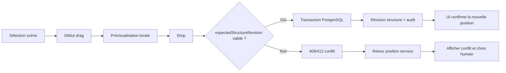
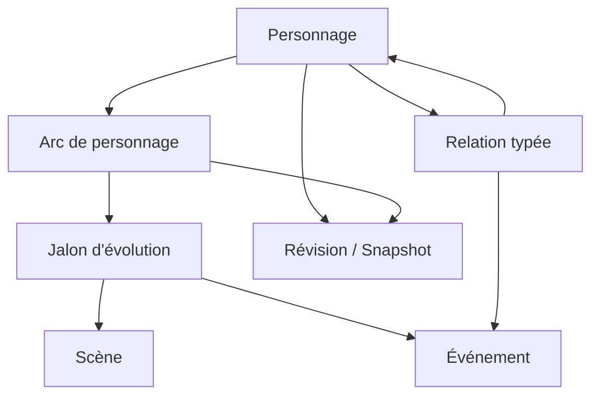

# StoryMaster — Plan de transformation UX/UI vers un véritable atelier d’écriture

> **Suivi du 2 novembre 2026 :** première tranche UX-1 implémentée et qualifiée localement, décrite dans [UX-1-REPORT.md](UX-1-REPORT.md). Le propriétaire demande explicitement de garder les brouillons en mémoire ; UX-1.5 reste différé. Les phases suivantes et la direction graphique finale ne sont pas réceptionnées par la présence de ce document. Les références `turn…` ci-dessous sont issues du document fourni : elles ne constituent pas des URLs de sources revérifiées dans le dépôt.

## Executive summary

StoryMaster possède déjà un socle fonctionnel et transactionnel beaucoup plus riche que son interface ne le laisse percevoir : écriture versionnée, bible narrative, relations, chronologie, commentaires, propositions, historique, exports, MCP et sauvegardes. Le problème principal n’est donc plus l’absence de fonctions mais **le modèle d’interaction** : les captures montrent encore une application organisée comme un ensemble de pages, formulaires et modales, alors que les meilleurs outils d’écriture donnent l’impression de manipuler directement un manuscrit, des cartes et un univers. BYOK Studio montre particulièrement bien cette différence avec ses fenêtres redimensionnables, cartes, grille, wiki, plan et manuscrit combinables ; Scrivener synchronise Binder, Corkboard et Outliner autour des mêmes objets ; Plottr fait de la timeline et du drag-and-drop son centre visuel ; Ulysses réduit progressivement l’interface jusqu’au texte seul. citeturn750158search1turn750158search12turn750158search13turn750158search29

La direction proposée est donc **StoryMaster Atelier** : une application web qui se comporte comme un logiciel de création. La priorité est UX‑1 — shell d’atelier persistant, panneaux contextuels et brouillons robustes — puis UX‑2 — cartes et réorganisation directe. UX‑3 et UX‑4 enrichissent ensuite personnages, relations et évolution temporelle. Les règles métier des Lots 0–7 restent intouchées : identifiants stables, CAS/révisions, transactions PostgreSQL, historique, autorisations et moteur de propositions. Le drag-and-drop devient une nouvelle représentation d’une commande métier existante, jamais un raccourci qui contourne le serveur. La phase commerciale IA reste différée, aucune branche autre que `main` n’est autorisée, et ni RLS ni exposition publique ne doivent être activées sans GO‑04. Ces contraintes correspondent également à la feuille UX interne existante et aux réserves du Lot 7. citeturn495643view0turn495643view1turn495643view2

## Vision UX et benchmark concurrentiel

Les 100 captures du ZIP ont bien été trouvées et examinées. Les vues d’ensemble, notamment `091-ecran-atelier.jpg`, `093-ecran-personnages.jpg`, `094-ecran-chronologie.jpg` et `095-ecran-fiche.jpg`, montrent une identité visuelle déjà cohérente et agréable, mais une interaction encore fortement fondée sur la navigation de page, les boutons et les formulaires. Les captures `009`, `010`, `012` et `020` sont particulièrement révélatrices : créer un manuscrit, un chapitre, une scène ou déplacer une scène passe encore par des fenêtres/formulaires successifs, alors que ce sont des gestes structurels que l’utilisateur devrait pouvoir effectuer directement dans son plan. Le dossier de captures se trouve localement dans `artifacts/ux-review-2026-11-02/`.

| Outil | Ce qu’il fait particulièrement bien | Limite à ne pas copier | Conséquence pour StoryMaster |
|---|---|---|---|
| **BYOK Studio** | Un projet regroupe texte, manuscrit, outline, wiki, cards, grid et scratchpad ; plusieurs fenêtres peuvent être redimensionnées et utilisées côte à côte ; l’outline peut être manipulé au clavier et transformer directement une ligne en texte à écrire. citeturn750158search0turn750158search1turn750158search2 | Risque de multiplier les types de fichiers/outils et de demander à l’auteur de choisir trop tôt la bonne représentation. | Reprendre le **workspace adaptable**, les panneaux, les cartes et le passage immédiat plan → écriture, mais conserver un modèle métier unique derrière plusieurs vues. |
| **Scrivener** | Binder, Corkboard, Outliner et Scrivenings représentent les mêmes documents ; déplacer une fiche sur le Corkboard réorganise réellement le manuscrit. citeturn750158search12turn750158search22 | Interface historiquement dense et courbe d’apprentissage importante. | Faire des **scènes uniques visibles sous plusieurs formes**, sans dupliquer les données, mais avec une interface moins chargée. |
| **Plottr** | Timeline comme hub visuel, drag-and-drop de scènes, plotlines parallèles et liens de cartes vers personnages, lieux et tags. citeturn750158search13turn750158search28turn750158search42 | Très orienté planification ; moins adapté comme environnement principal de rédaction longue. | Utiliser sa logique de **cartes + lignes narratives**, mais intégrer le plan au même atelier que l’éditeur. |
| **Ulysses** | Modèle trois panneaux pouvant devenir deux ou un seul panneau par raccourci ; bibliothèque, feuilles et éditeur restent dans le même espace mental. citeturn750158search29turn750158search36 | Modèle volontairement plus simple que StoryMaster pour les univers narratifs complexes. | Adopter la **réduction progressive de l’interface** et un vrai mode focus, sans retirer bible, relations et collaboration. |
| **Notion** | Un même objet peut être présenté dans plusieurs vues ; les layouts personnalisés peuvent regrouper ou masquer les propriétés et ouvrir/fermer un panneau de détails. citeturn127095search21turn127095search23 | Trop générique : les utilisateurs doivent souvent concevoir eux-mêmes leur système. | Utiliser les **vues multiples et la progressive disclosure**, mais fournir des modèles narratifs opinionated par défaut. |
| **StoryMaster actuel** | Solide cohérence métier, sauvegarde/versioning, historique, permissions et univers narratif déjà connectés. Le roadmap interne prévoit explicitement drag-and-drop, interactions contextuelles et panneaux adaptables. citeturn495643view0turn495643view1 | Manipulation indirecte ; formulaires denses ; informations et actions souvent séparées de l’objet manipulé. | Ne pas refaire le backend : **remplacer la couche d’interaction**, avec direct manipulation et contexte persistant. |

iturn652157image0turn652157image4turn652157image7turn652157image11

La vision produit proposée est : **« l’histoire est un ensemble d’objets uniques que l’auteur peut regarder et manipuler sous plusieurs angles »**. Une scène n’est pas une carte différente de la scène éditée : c’est la même scène, avec le même identifiant et la même révision, représentée dans l’arbre, le tableau de cartes, la chronologie ou l’éditeur. Ce principe correspond au modèle de Scrivener et à la préparation architecturale déjà documentée dans StoryMaster. citeturn750158search12turn495643view1

Les phases proposées sont **UX‑0 : conception**, **UX‑1 : atelier logiciel**, **UX‑2 : manipulation par cartes**, **UX‑3 : personnages et relations**, **UX‑4 : arcs et chronologie**, **UX‑5 : finition, apprentissage et qualification**. UX‑1 et UX‑2 sont bloquantes avant UX‑3/4. Le succès ne sera pas jugé au nombre de composants redessinés, mais sur des tâches : reprendre sa dernière scène en moins de 10 s ; créer livre + chapitre + trois scènes en moins de 2 min lors d’un second essai ; déplacer une scène en moins de 15 s ; créer une relation familiale en moins de 30 s ; retrouver le contexte d’un personnage depuis une scène en moins de 10 s ; ajouter un jalon d’évolution en moins d’une minute ; aucun brouillon perdu dans les scénarios de crash qualifiés ; aucun conflit silencieux lors d’un déplacement. Ces seuils sont des **objectifs de qualification proposés**, pas des performances actuellement démontrées.

La philosophie d’interaction doit suivre trois principes de Nielsen particulièrement pertinents ici : visibilité de l’état du système, contrôle/annulation et reconnaissance plutôt que mémorisation ; la manipulation directe est également adaptée lorsque les objets et les conséquences sont visibles et réversibles. citeturn127095search29turn127095search32turn127095search38

## Spécification fonctionnelle par écran

La transformation ne doit pas créer de nouvelles règles métier. Les commandes UI doivent continuer à passer par les services applicatifs et leurs préconditions. Le roadmap interne impose déjà que les déplacements conservent IDs, révisions de structure, CAS et conflits explicites ; le Lot 7 confirme que le drag-and-drop et la récupération persistante des brouillons ne sont pas encore livrés. citeturn495643view1turn495643view0

| Écran | Composants et interactions | États / sauvegarde / undo | Concurrence et invariants | Accessibilité et tests obligatoires |
|---|---|---|---|---|
| **Atelier d’écriture** | Barre projet compacte ; navigateur de manuscrit à gauche 240–320 px ; éditeur central min. 600 px ; inspecteur droit 280–360 px masquable ; onglets ou documents récents ; split view facultative ; `Cmd/Ctrl+K` ; clic scène = ouverture, double-clic titre = édition inline ; `+` contextuel crée directement au bon endroit. | État local `dirty / saving / saved / conflict / offline-like`; undo/redo d’édition dans Tiptap ; déplacement structurel possède son propre undo explicite ; fermeture/crash déclenche coffre de brouillon quand celui-ci sera approuvé. | Autosave texte conserve `expectedRevision`; changement de structure ne modifie jamais le texte ; sélection et panneaux n’ont aucun effet canonique ; conflit CAS affiche serveur/local et ne rejoue pas automatiquement. | Tout contrôlable au clavier ; focus restauré après création ; annonces `aria-live` pour sauvegarde/conflit ; Playwright : créer chapitre/scène sans modal globale, écrire, changer de scène, revenir sans perte. |
| **Tableau de cartes** | Colonnes = chapitres ou actes ; cartes = scènes ; poignée drag, résumé, POV, statut, personnages, indicateur de commentaires ; zoom compact/confort ; multi-sélection optionnelle seulement après UX‑2 initial ; double-clic ouvre la scène ; menu contextuel pour déplacer sans drag. | Pendant drag : état fantôme local ; drop déclenche commande unique ; succès = nouvelle révision structurelle ; échec = retour animé à la position serveur ; toast avec Undo durable borné. | Toute opération envoie `sceneId`, source, destination, position et `expectedStructureRevision`; transaction serveur ; aucune création de nouvel ID ; idempotency key ; aucun écrasement silencieux. | WCAG 2.2 exige une alternative sans drag et l’accès clavier ; fournir « Déplacer vers… », couper/déplacer, raccourcis et cible tactile ≥24×24 CSS px au minimum AA. citeturn127095search0turn127095search1turn127095search24 |
| **Fiche personnage multi-niveaux** | En-tête compact avec portrait/nom/rôle/résumé ; sélecteur `Essentiel / Approfondi / Complet`; sections repliables : identité, motivations, conflits, voix, relations, arc, scènes, notes, champs personnalisés ; édition inline plutôt que formulaire intégral. | Brouillon de fiche isolé de la version canonique ; Save explicite pour groupes importants ou autosave CAS pour champs simples ; historique toujours accessible ; niveau d’affichage n’altère aucune donnée. | Même schéma versionné ; aucune suppression de champ parce qu’il est masqué ; modules off restent lisibles selon règles actuelles ; révision indépendante. | Ordre logique des sections ; headings sémantiques ; boutons de dépliage avec `aria-expanded`; test : remplir uniquement niveau Essentiel puis passer Complet sans perte. |
| **Graphe des relations** | Canvas/panneau zoomable ; nœuds personnages/lieux/événements ; tirer un lien ouvre un mini-dialogue de type ; sélectionner une arête ouvre inspecteur ; filtres ; vue « famille » spécialisée ; liste alternative synchronisée. | Création de lien en deux temps : prévisualisation puis commit ; Undo crée la mutation inverse autorisée ; suppression logique confirmée ; ambiguïté directionnelle visible. | Réutiliser relations typées/directed/symmetric existantes ; validation des cycles là où applicable ; `expectedRevision`; provenance/audit ; aucun lien interprojet. | Canvas jamais unique moyen d’accès ; liste/table clavier équivalente ; tabulation entre nœuds visibles ; déplacer visuellement un nœud ne modifie pas le canon narratif, seulement le layout utilisateur. |
| **Chronologie** | Axe horizontal ou vertical zoomable ; lignes facultatives par personnage/arc ; événements comme cartes ; filtres ; plages et repères inconnus ; liens vers scènes ; option « ordre du récit » séparée de « temps de l’histoire ». Plottr démontre l’intérêt de lignes parallèles et de cartes reliées aux entités. citeturn750158search13turn750158search28 | Déplacement d’un événement affiche avant/après ; position inconnue reste explicitement inconnue ; undo idem commande métier. | Ne jamais confondre ordinal narratif et ordre du manuscrit ; validation du graphe/precedence existante ; toute évolution d’un personnage doit être un objet/jalon versionné, pas un changement implicite de fiche. | Alternative liste/table ; contrôle clavier « avant/après/entre… » ; zoom non indispensable à la compréhension. |
| **Inspecteur contextuel** | Panneau droit unique qui suit la sélection : scène → statut/références/commentaires ; personnage → résumé/relation ; relation → propriétés ; proposition → provenance/conflit. Panneau épinglable pour comparer deux objets. | Les changements rapides sont des brouillons locaux ; actions durables clairement marquées ; données techniques (`revision`, hash) cachées sous « Détails techniques ». | Ne crée aucun nouveau chemin de mutation ; respecte rôle courant et modules. | Contrôles accessibles et intitulés ; pas d’information uniquement en tooltip. |
| **Mode focus** | Éditeur seul ou éditeur + mini barre discrète ; sortie via raccourci/ESC explicite ; compteur et sauvegarde optionnels ; accès palette commande. Ulysses permet déjà de passer de trois panneaux à l’éditeur seul par raccourci ; Studio met également en avant un environnement d’écriture sans surcharge. citeturn750158search29turn750158search1 | Même buffer et même révision que l’atelier ; aucune copie parallèle. | Masquer l’interface ne change jamais les permissions ou règles d’autosave. | Focus visible, commandes clavier documentées ; aucun piège clavier. |
| **Onboarding contextuel** | Aide au moment où une fonction devient pertinente : première scène → « réorganiser » ; premier personnage → « ajouter une relation » ; première sélection de texte → commentaire. | Conseils dismissibles ; progression stockée par utilisateur, pas dans le canon. | Aucun automatisme narratif ; pas d’activation de module sans accord. | Aide disponible autrement via `?`/palette ; ne jamais rendre le tooltip nécessaire. NN/g recommande l’aide en contexte et la progressive disclosure plutôt que de demander de mémoriser un tutoriel. citeturn127095search31turn127095search37 |

La fiche personnage doit éviter trois schémas de données « simple / complexe / ultra détaillé ». Il vaut mieux conserver **un seul modèle versionné** et appliquer trois niveaux de présentation. Notion illustre bien cette séparation entre l’objet et son layout : les propriétés peuvent être regroupées dans des sections ou détails sans transformer l’identité de l’objet. citeturn127095search21turn127095search23

Pour l’évolution des personnages, une extension métier sera toutefois nécessaire : `CharacterArc`/`CharacterBeat` ou une structure équivalente liée à un personnage, à une position narrative et éventuellement à une scène ou un événement. Ce ne doit pas être simulé par des champs écrasés sur la fiche actuelle, car l’évolution implique plusieurs états dans le temps et StoryMaster distingue déjà ordre chronologique et ordre de lecture. Cette recommandation est cohérente avec la logique de plotlines/character arcs exposée par Plottr. citeturn750158search28

## Maquettes filaires et flux d’interaction

Les quatre wireframes suivants constituent une **spécification d’interaction**, pas une direction graphique finale. BYOK Studio justifie particulièrement l’usage de panneaux redimensionnables et d’outils combinables ; Scrivener montre la valeur de plusieurs vues synchronisées ; ces principes sont repris sans copier leur identité visuelle. citeturn750158search1turn750158search12

**Atelier — desktop ≥1280 px**

```text
┌──────────────────────────────────────────────────────────────────────────────────────────────┐
│ StoryMaster   Cartographes de brume        ⌘K       🔍       ● Enregistré        Alice ▾    │ 48px
├───────────────┬──────────────────────────────────────────────────┬───────────────────────────┤
│ MANUSCRIT     │ La lettre sous la porte                          │ CONTEXTE                   │
│ 260px         │                                                  │ 320px                      │
│               │   Chapitre I · La ville aux lanternes           │ Scène                      │
│ ▾ Livre I     │                                                  │ Statut   Brouillon         │
│   ▾ Chap. 1   │   La brume avait mangé les toits…               │ POV      Élise             │
│     ● Lettre  │                                                  │ Lieu     Port-Lanterne     │
│     ○ Marché  │   [ texte Tiptap ]                              │                           │
│   ▸ Chap. 2   │                                                  │ Personnages               │
│               │                                                  │ [Élise] [Noé] +            │
│ + Chapitre    │                                                  │                           │
│ + Scène       │                                                  │ Commentaires  2            │
│               │                                                  │ Relations / Historique ▸   │
├───────────────┴──────────────────────────────────────────────────┴───────────────────────────┤
│ 198 mots · Révision 12 (détails masqués)                                      Ctrl+\ focus │
└──────────────────────────────────────────────────────────────────────────────────────────────┘
```

Comportements : clic simple sélectionne et ouvre ; double-clic sur le titre permet l’édition inline ; poignée de chapitre ou scène apparaît au hover/focus ; `+` crée immédiatement dans le contexte courant ; clic sur un personnage l’ouvre dans l’inspecteur sans quitter la scène ; double-clic ou `Enter` peut ouvrir sa fiche complète. Sous 1024 px, l’inspecteur devient drawer ; sous 768 px, le navigateur et l’inspecteur deviennent des panneaux temporaires et l’éditeur reste prioritaire.

**Tableau de cartes**

```text
┌─────────────────────────────────────────────────────────────────────────────────────────────┐
│ ← Atelier   PLAN   [Cartes] [Liste]     Filtrer ▾    Zoom − 100% +                         │
├─────────────────────────┬─────────────────────────┬─────────────────────────┬───────────────┤
│ CHAPITRE 1              │ CHAPITRE 2              │ CHAPITRE 3              │ + Chapitre    │
│ La ville aux lanternes  │ Les îles qui dérivent   │ Le phare oublié         │               │
│                         │                         │                         │               │
│ ┌─────────────────────┐ │ ┌─────────────────────┐ │ ┌─────────────────────┐ │               │
│ │⠿ La lettre sous... │ │ │⠿ Traversée         │ │ │⠿ La lumière...     │ │               │
│ │Élise · Port         │ │ │Noé · Mer           │ │ │Élise · Mara        │ │               │
│ │198 mots   Brouillon │ │ │342 mots   Révision │ │ │Planifiée          │ │               │
│ └─────────────────────┘ │ └─────────────────────┘ │ └─────────────────────┘ │               │
│         ↓ drop zone      │                         │                         │               │
│ ┌─────────────────────┐ │                         │                         │               │
│ │⠿ Le marché         │ │                         │                         │               │
│ └─────────────────────┘ │                         │                         │               │
│ + Scène                 │ + Scène                 │ + Scène                 │               │
└─────────────────────────┴─────────────────────────┴─────────────────────────┴───────────────┘
```

Le drag est seulement une affordance. `Shift+Alt+↑/↓`, menu « Déplacer vers… », couper/coller structurel et sélection destination offrent l’équivalent clavier/pointeur simple, conformément à WCAG 2.2. citeturn127095search1turn127095search13

**Fiche personnage**

```text
┌──────────────────────────────────────────────────────────────────────────────────────────────┐
│ ← Personnages       Élise Varenne            Essentiel | Approfondi | Complet      ⋯       │
├───────────────────────────────────────────────┬──────────────────────────────────────────────┤
│ [portrait]  PROTAGONISTE                      │ ARC DU PERSONNAGE                            │
│ Élise Varenne                                 │                                              │
│ Cartographe, 27 ans                           │ ● Départ : veut retrouver son père           │
│                                               │ │                                            │
│ Résumé                         ✎              │ ● Ch. 4 : découvre le mensonge de Mara       │
│ « Elle connaît chaque quai... »               │ │                                            │
│                                               │ ● Ch. 9 : accepte de quitter l’archipel      │
│ Motivations                    ▾              │                                              │
│ Objectifs                      ▾              │ + Ajouter un jalon                           │
│ Conflits                       ▾              │                                              │
│ Voix / manière de parler       ▸              │ RELATIONS                                    │
│ Secrets                        ▸              │ Père ─── Armand      + Relation              │
│ Champs personnalisés           ▸              │ Alliée ─ Mara                                │
├───────────────────────────────────────────────┴──────────────────────────────────────────────┤
│ Scènes 12    Événements 5    Commentaires 2    Historique                                    │
└──────────────────────────────────────────────────────────────────────────────────────────────┘
```

Les trois niveaux changent uniquement la densité visible. Toute section peut rester vide. Les jalons d’arc sont de vraies données versionnées et peuvent être associés à une scène ou un événement.

**Graphe des relations**

```text
┌──────────────────────────────────────────────────────────────────────────────────────────────┐
│ ← Élise     Relations       [Toutes] [Famille] [Alliances] [Conflits]    Liste ▾            │
├─────────────────────────────────────────────────────────────────────────┬────────────────────┤
│                                                                         │ RELATION           │
│                  ┌─────────────┐                                        │ Élise → Armand     │
│                  │   Armand    │                                        │ Type : parenté     │
│                  └──────┬──────┘                                        │ Père biologique    │
│                         │ père de                                       │                    │
│                         ▼                                               │ Depuis : naissance │
│                  ┌─────────────┐──────── alliée de ─────┌────────────┐   │ Jusqu’à : —       │
│                  │    Élise    │                       │    Mara    │   │                    │
│                  └──────┬──────┘                       └────────────┘   │ [Modifier]         │
│                         │ présente à                                    │ [Historique]       │
│                         ▼                                               │                    │
│                  ┌─────────────┐                                        │                    │
│                  │ Port-Lant.  │                                        │                    │
│                  └─────────────┘                                        │                    │
├─────────────────────────────────────────────────────────────────────────┴────────────────────┤
│ + Relation     Zoom 100%     Recentrer                  Alternative accessible : Vue liste   │
└──────────────────────────────────────────────────────────────────────────────────────────────┘
```

Le canvas est une vue de lecture/manipulation, pas la source de vérité. La position graphique des nœuds est une préférence utilisateur ; elle ne crée aucune relation métier. Le lien métier n’apparaît qu’après validation du mini-dialogue et réussite du commit.





## Plan d’implémentation technique et sprint backlog

Le chantier doit se faire **exclusivement sur `main`**, sans branche temporaire ni PR, et sans toucher aux 150 exigences ni aux 100 MUST. Aucun fournisseur IA payant ne doit être appelé ; les simulateurs locaux restent la référence. RLS et exposition publique restent hors périmètre tant que GO‑04 n’est pas accepté. Le Lot 7 indique explicitement que SEC‑07, RLS/pool, brouillons persistants et contention restent ouverts. citeturn495643view0turn495643view2

| Phase / ticket | Travail attendu | Dépendances / invariants | Complexité | Priorité |
|---|---|---|---|---|
| **UX‑1.1 App shell** | Layout 3 panneaux persistants, tailles mémorisées par utilisateur, collapse, split view simple | Aucune migration narrative ; préférences utilisateur séparées | L | P0 |
| **UX‑1.2 Navigation persistante** | Conserver sélection, scroll, document courant, retour rapide | IDs stables ; aucun state métier uniquement client | M | P0 |
| **UX‑1.3 Création inline** | Manuscrit/chapitre/scène créés dans leur contexte, sans succession de modales | Services existants + idempotency | M | P0 |
| **UX‑1.4 Inspecteur contextuel** | Scène/personnage/relation/commentaire sans navigation de page | Même permission matrix | L | P0 |
| **UX‑1.5 Brouillons robustes** | Implémenter ADR‑0017 ou variante approuvée ; reprise explicite après crash | Ne jamais écraser serveur ; CAS obligatoire | L | P0 |
| **UX‑1.6 Command palette** | `Cmd/Ctrl+K`, actions contextualisées, recherche | Autorisations évaluées serveur | M | P1 |
| **UX‑1.7 Focus** | 1/2/3 panneaux, raccourcis | Même buffer/autosave | S | P1 |
| **UX‑2.1 Révision de structure** | Contrat explicite de révision pour ordre manuscrit/chapitre/scène si incomplet aujourd’hui | Migration additive uniquement | M | P0 |
| **UX‑2.2 Board cartes** | Vue cartes synchronisée avec manuscrit | IDs inchangés | L | P0 |
| **UX‑2.3 DnD transactionnel** | Reorder intra/inter chapitre, feedback optimiste + rollback | `expectedRevision`, idempotence, transaction | L | P0 |
| **UX‑2.4 Alternatives DnD** | clavier, menu « déplacer vers », pointer simple | WCAG 2.2 2.5.7 | M | P0 |
| **UX‑2.5 Undo structurel** | Commande inverse sûre après déplacement récent | Nouvelle révision ; jamais history rewrite | M | P0 |
| **UX‑3.1 Fiche progressive** | niveaux Essentiel/Approfondi/Complet | schémas actuels préservés | M | P1 |
| **UX‑3.2 Relations rapides** | création relation depuis fiche + inspecteur | validation typed relations existante | M | P1 |
| **UX‑3.3 Graphe** | vue graphique + vue liste accessible | aucune règle métier dans canvas | L | P1 |
| **UX‑4.1 Arc personnage** | nouvel agrégat/jalons versionnés | ADR/domain model + migration additive | L | P1 |
| **UX‑4.2 Chronologie enrichie** | événements + arcs + filtres + ordre récit distinct | invariants precedence existants | L | P1 |
| **UX‑4.3 Synchronisation vues** | scène ↔ arc ↔ événement ↔ personnage | IDs et références stables | M | P1 |
| **UX‑5.1 Onboarding contextuel** | aides opportunistes, dismissibles | préférence utilisateur | M | P2 |
| **UX‑5.2 Mobile/tablette** | drawers, tactile, navigation adaptée | alternative DnD obligatoire | L | P2 |
| **UX‑5.3 Accessibilité** | clavier, SR, contraste, reflow, zoom | WCAG 2.2 AA | L | P1 |
| **UX‑5.4 Qualification humaine** | tests utilisateurs, métriques, corrections | prototypes stabilisés | M | P1 |
| **UX‑5.5 Régression Lots 0–7** | CI, sauvegarde/restauration, propositions, MCP, exports | aucun affaiblissement sécurité | L | P0 |

Techniquement, le frontend doit traiter les mutations de structure comme des commandes optimistes mais **non acquises** tant que le serveur n’a pas confirmé. L’objet peut bouger immédiatement à l’écran pour la fluidité, mais l’ancien ordre doit rester disponible en mémoire jusqu’au résultat. Une réponse CAS invalide remet l’objet à l’ordre serveur et présente le conflit ; aucun client-side last-write-wins.

Les migrations restent additives et la CI doit rejouer les campagnes existantes. Le rapport du Lot 7 montre que StoryMaster dispose déjà de procédures de sauvegarde/restauration réelles et de tests de propositions/concurrence : chaque migration UX introduisant de nouvelles données — par exemple les arcs de personnages — doit donc entrer dans les archives, sauvegardes, hashes et tests de restauration. citeturn495643view0

## Critères d’acceptation et matrice de tests

| Domaine | Critère mesurable proposé | Test automatisé / humain | Refus immédiat si… |
|---|---|---|---|
| Reprise d’écriture | Dernière scène prête à écrire <10 s après ouverture projet | Playwright + test utilisateur | navigation impose plusieurs pages ou perd contexte |
| Création structure | Livre + chapitre + 3 scènes <2 min après prise en main initiale | utilisateur chronométré | modal/formulaire obligatoire à chaque niveau |
| Déplacement scène | <15 s ; 0 conflit silencieux | Playwright DnD + PG concurrency | une scène change d’ID ou écrase une révision |
| DnD clavier | même résultat que souris | Playwright keyboard | fonction inaccessible sans drag |
| Relation | créer « père de » <30 s | user test + PG invariant | sens inverse faux ou duplication incohérente |
| Fiche progressive | création Essentiel <60 s ; champs avancés masqués mais retrouvables | Playwright + user test | masquer un niveau supprime des données |
| Arc personnage | ajouter jalon + scène associée <60 s | Playwright + PG | arc écrase l’état antérieur |
| Autosave | saisie locale immédiate ; confirmation durable p95 cible <1 s sur machine de qualification | instrumentation navigateur/API | frappe bloquée par le réseau |
| Crash/brouillon | 0 perte du brouillon couvert par protocole de récupération | crash navigateur contrôlé | reprise écrase silencieusement serveur |
| Concurrence structure | 2 utilisateurs déplacent même scène → un résultat canonique + conflit explicite | PG barrières + Playwright multi-user | last-write-wins silencieux |
| Idempotence | retry réseau du drop → une seule mutation | test réponse perdue | double déplacement/révision |
| Historique | déplacement visible comme événement/révision ; IDs conservés | PG + API | historique réécrit |
| Propositions | UI UX ne permet ni IA ni MCP d’approuver/fusionner | tests Lot 4–6 | nouveau chemin privilégié |
| Performances | mesurer p50/p95/p99 pour ouverture, changement scène, board, DnD, recherche | bench local | chiffres non mesurés présentés comme SLA |
| Restore | nouvelle donnée UX restaurée et mêmes IDs/hashes | `test:recovery` | migration UX absente du backup/archive |
| SEC‑07 | checklist TLS reste **ouverte** tant que GO‑04 n’autorise pas le chantier réseau | tests de configuration seulement | refonte prétend satisfaire SEC‑07 |
| Accessibilité | WCAG 2.2 AA ciblé : clavier, drag alternative, cible ≥24 px, reflow, focus non obscurci | axe + Playwright + humain/SR | fonction essentielle uniquement pointer/hover |

WCAG 2.2 AA impose notamment une alternative aux mouvements de glisser-déposer et une taille minimale de cible de 24×24 CSS px sous les conditions prévues ; le clavier doit également pouvoir accomplir les fonctions concernées. citeturn127095search0turn127095search1turn127095search24

SEC‑07 ne doit pas être « absorbé » par le chantier UX. Le rapport du Lot 7 et GO‑04 indiquent explicitement que le chiffrement réseau complet reste un MUST non satisfait et que TLS navigateur/web/API, Keycloak/OIDC, MCP et PostgreSQL nécessite une décision séparée. citeturn495643view0turn495643view2

## Guide de design d’interaction

Le principe dominant doit être la **progressive disclosure** : montrer l’action primaire et les informations nécessaires à la tâche courante, puis révéler les options secondaires à la demande. NN/g indique que cette approche améliore notamment apprenabilité, efficacité et taux d’erreur, mais avertit que multiplier les niveaux de révélation finit par désorienter ; StoryMaster devrait donc rester à deux niveaux principaux : essentiel visible, avancé dépliable. citeturn127095search37

| Pattern | Règle StoryMaster |
|---|---|
| **Informations permanentes** | Objet sélectionné, titre, statut de sauvegarde, emplacement dans le manuscrit, conflit éventuel. |
| **Inspecteur** | Métadonnées, références, relations, commentaires et actions secondaires liées à la sélection. |
| **Tooltips** | Explication courte uniquement ; jamais seul moyen de découvrir une fonction ou de connaître un état. |
| **Menus contextuels** | Actions peu fréquentes : dupliquer, archiver, déplacer vers…, voir historique. |
| **Command palette** | Accès rapide pour utilisateur expérimenté, mais aucune fonctionnalité essentielle uniquement disponible ici. |
| **Inline edit** | Titres, résumés courts, statuts simples ; `Enter` valide, `Esc` annule. |
| **Drag/drop** | Manipulation première pour souris/tactile, accompagnée d’alternatives clavier/pointeur simple. |
| **Undo** | Visible immédiatement après mutation ; pour données durables, réalise une nouvelle commande/révision plutôt qu’une réécriture d’historique. |
| **Feedback** | État immédiat : sélection, déplacement, sauvegarde, conflit, refus permission. La visibilité de l’état est une heuristique fondamentale de l’utilisabilité. citeturn127095search34turn127095search33 |
| **Mobile** | Pas de desktop compressé : éditeur principal, drawers pour navigation/inspecteur, actions principales en bas ou proches du pouce. Studio annonce lui-même avoir repensé son mobile plutôt que simplement rétrécir le desktop. citeturn750158search1turn750158search5 |
| **Clavier** | `Ctrl/Cmd+K` palette ; `Ctrl/Cmd+1/2/3` vues/panneaux ; `Ctrl/Cmd+\` focus ; raccourcis de déplacement structuraux configurables ; aucune collision avec l’éditeur. |
| **Densité** | Compacte dans tableaux/boards ; confortable pour l’écriture ; utilisateur peut choisir densité globale sans modifier données métier. |
| **Couleurs** | Couleur comme renfort, jamais seule porteuse du statut ; états lisibles en texte/icône. |
| **Transitions** | 120–200 ms seulement lorsqu’elles expliquent une transformation spatiale ; pas d’animation décorative dans la rédaction. |
| **Actions dangereuses** | Archivage, suppression logique, fusion : libellé explicite, confirmation proportionnée ; pas de confirmation pour chaque action réversible. |
| **Technique avancée** | Révisions, hashes, IDs, provenance sous panneau « Détails techniques » ; disponibles sans saturer l’auteur. |

Le but n’est pas de cacher le logiciel : c’est de **faire apparaître la bonne complexité au bon moment**. Une interface où tout est toujours visible produit de la surcharge ; une interface où tout est caché impose du rappel. La reconnaissance plutôt que le rappel doit donc guider menus, affordances et contexte. citeturn127095search31turn127095search36

## Plan d’évaluation utilisateur et checklist Codex

La validation doit être effectuée avec de vrais parcours d’auteur, pas uniquement par Playwright. Le roadmap UX interne arrive à la même conclusion : fluidité et plaisir d’utilisation doivent être observés sur l’écriture, la recherche, le déplacement de scènes, les commentaires et la revue de propositions ; ils ne peuvent pas être déduits du nombre de formulaires ni des métriques serveur. citeturn495643view1

Le protocole proposé est de recruter au minimum trois profils lors de chaque cycle : un auteur « découverte », un utilisateur habitué à Scrivener/Plottr/Notion, et le propriétaire du produit comme utilisateur expert/opinionated. Chaque session dure 45–60 minutes, sans démonstration préalable au-delà de « voici votre projet ». Les tâches sont : reprendre une scène, créer un chapitre et trois scènes, déplacer une scène, créer un personnage, établir une parenté, retrouver une information de la bible, ajouter un jalon d’évolution, commenter un passage et passer en mode focus. Mesurer temps, erreurs, hésitations >5 s, retours arrière, demandes d’aide, usage du contexte menu/tooltip et sentiment de contrôle. Après chaque tâche, demander une note de facilité 1–7 ; en fin de session, utiliser SUS ou UMUX‑Lite et trois questions ouvertes : « qu’est-ce qui vous a ralenti ? », « qu’est-ce qui vous a surpris ? », « quelle action vous a semblé naturelle ? ». Un écran n’est accepté qu’après deux cycles sans problème critique récurrent.

Le seuil de sortie UX‑1/2 proposé est : au moins 80 % des tâches principales réussies sans aide lors du premier test, 95 % lors du second ; aucune perte de contenu ; aucune erreur d’autorisation ; aucun conflit silencieux ; temps médian dans les objectifs du tableau ; aucune action principale jugée « introuvable » par plus d’un participant sur trois. Les scores SUS/UMUX servent de tendance et non de substitut à l’observation.

Checklist exécutable à transmettre à Codex :

- [ ] Travailler **uniquement sur `main`**, sans créer aucune branche ni PR ; vérifier `origin/main` avant toute mutation et pousser exclusivement sur `main`.
- [ ] Ne modifier ni les **150 exigences** ni les **100 MUST MVP** ; ne pas déclarer SEC‑07 résolu ; ne pas activer RLS ou exposition publique sans GO‑04. citeturn495643view0turn495643view2
- [ ] Ne faire **aucun appel IA payant** ; conserver simulateurs locaux, MCP arrêté par défaut et GO‑03 commercial différé.
- [ ] Implémenter **UX‑1 avant UX‑2**, puis réception humaine avant UX‑3/4.
- [ ] Construire un shell d’atelier persistant à 1/2/3 panneaux avec inspecteur contextuel et mode focus.
- [ ] Remplacer les créations manuscrit/chapitre/scène par des interactions contextuelles inline sans supprimer les commandes métier existantes.
- [ ] Qualifier et implémenter une stratégie de brouillon persistant sûre avant de prétendre à la non-perte après crash ; jamais écraser silencieusement une révision distante. citeturn495643view0
- [ ] Ajouter le tableau de cartes en tant que **vue des mêmes scènes**, avec les mêmes IDs.
- [ ] Pour tout drag/drop, envoyer `expectedRevision`/révision structurelle + idempotency key ; appliquer côté serveur dans une transaction ; rollback visuel sur conflit ; aucune mutation canonique purement client.
- [ ] Fournir une alternative clavier et pointer-simple à chaque drag/drop conformément à WCAG 2.2. citeturn127095search1turn127095search13
- [ ] Préserver snapshots, historiques, audits, ChangeSets, références et mappings d’identifiants ; aucune réécriture destructive d’historique.
- [ ] Ne créer aucun nouveau chemin d’autorisation : HTTP/UI/MCP/assistant doivent continuer à utiliser les mêmes services et plafonds de permissions.
- [ ] Introduire les fiches personnages progressives sans créer trois schémas différents.
- [ ] Concevoir les arcs de personnages comme de vraies données versionnées avant d’ajouter leur visualisation chronologique.
- [ ] Toute nouvelle table/colonne : migration additive, archive/backup/restore mis à jour, test de conservation des données préexistantes.
- [ ] Ajouter Playwright multi-utilisateur pour DnD concurrent, changement de rôle, conflits CAS, crash/reprise brouillon, clavier et responsive.
- [ ] Ajouter tests PostgreSQL déterministes pour ordre structurel, idempotence, rollback et concurrence ; pas de tests basés uniquement sur temporisation.
- [ ] Rejouer intégralement les tests Lots 0–7, Spike A/B/C pertinents, sauvegarde/restauration et CI distante avant réception.
- [ ] Instrumenter temps de tâche et latences UI/API ; publier p50/p95/p99 seulement lorsque l’échantillon le permet, sans annoncer de SLA.
- [ ] Réaliser une revue humaine UX après UX‑1/2 avant de démarrer UX‑3/4 ; ne pas laisser Codex choisir seul la direction graphique finale.

La recommandation centrale est donc de **ne pas lancer une “refonte graphique”**. Il faut lancer une **refonte du modèle d’interaction**. StoryMaster a déjà suffisamment de fonctions ; l’enjeu est maintenant de faire en sorte qu’un auteur sente qu’il manipule son histoire plutôt qu’il administre des enregistrements. BYOK Studio fournit le meilleur point de départ visuel pour cette ambition, Scrivener le meilleur principe de vues synchronisées, Plottr la meilleure référence pour les cartes/chronologie, et Ulysses une bonne référence pour la concentration progressive. citeturn750158search1turn750158search12turn750158search13turn750158search29
## Critères d'acceptation du document

Distinguer les phases proposées de leur réalisation et de leur réception humaine ; préserver la hiérarchie du PRD et les invariants métier ; suivre le périmètre réellement livré et les validations dans UX-1-REPORT.md. Les citations héritées doivent être retrouvées sous forme d’URLs vérifiables avant de servir de preuve externe. Les objectifs de temps et de satisfaction restent à mesurer avec les utilisateurs.
